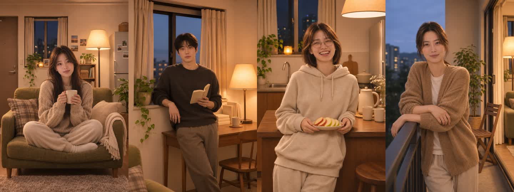
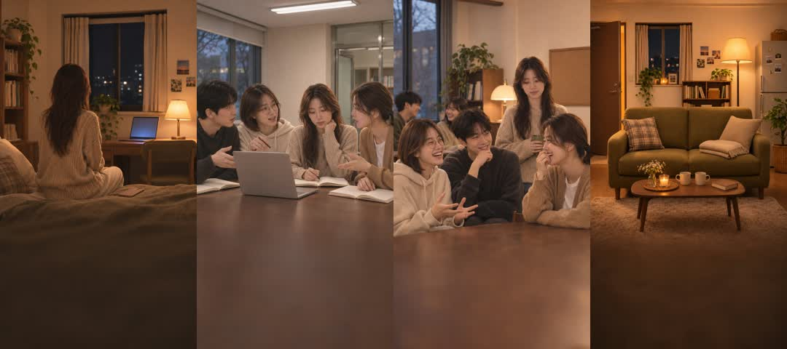
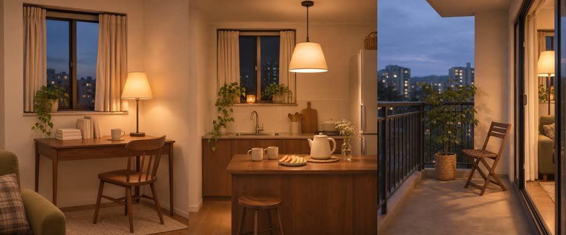

# 한벗 이미지 생성 결과

2026-11-13. 내장 `image_gen.imagegen`으로 한 장씩 생성했다. 사용자가 확인한 하늘 캐릭터 시트와 기존 거실을 기준으로 삼았다. 필수 이미지 27장(참고 시트 4장, 앱용 JPG 23장)을 저장했다. 선택 항목인 앱 아이콘은 만들지 않았다.

## 결과와 검증

아래 크기·용량·해시는 11월 13일 생성 직후의 기록이다. 11월 14일 현재 하늘·도윤의 기본 JPG는 기존 작은 초상이 남아 있어 이 두 파일은 생성 당시 해시와 다르다. 화면은 새 닫힌 입 초상을 사용한다. 실제 연결된 이미지 19장의 현재 파일 검증은 [런타임 이미지 검증](runtime-image-validation.json)에 따로 남겼다.

| 구분 | 수량 | 최종 크기 | 저장 위치 |
| --- | ---: | --- | --- |
| 캐릭터 시트 | 4 | 1280×720, 16:9 PNG | `characters/friend-<id>-sheet.png` |
| 친구 초상 | 4 | 1080×1620, 2:3 JPG | `apps/web/src/shared/assets/friend-<id>.jpg` |
| 입 프레임 | 12 | 1080×1620, 2:3 JPG | `apps/web/src/shared/assets/friend-<id>-mouth-<state>.jpg` |
| 입장 장면 | 4 | 1080×1920, 9:16 JPG | `apps/web/src/shared/assets/intro/` |
| 방 그림 | 3 | 1600×2000, 4:5 JPG | `apps/web/src/shared/assets/rooms/` |

`id`는 `haneul`, `doyun`, `jiwoo`, `seoyun`; `state`는 `closed`, `half`, `open`이다. 방 그림은 요청에 적힌 픽셀 크기와 4:5 비율에 따라 세로로 저장했다.

- 27장 모두 파일당 2,000,000바이트 이하. 가장 큰 파일은 하늘 시트 1,977,411바이트다.
- 앱용 23장의 합계는 4,389,547바이트다.
- 파일 디코딩, 정확한 가로·세로 크기, 용량, SHA-256을 기록했다.
- 친구마다 닫힌 입과 나머지 두 프레임을 비교한 8건 모두 **입 주변 검사 영역 밖의 변경 픽셀 0개**다. 검사 영역은 입 편집 마스크와 JPG 압축 경계를 포함한다.
- GIF 미리보기는 `closed → half → open → half` 순서로 프레임당 정확히 150ms다.
- `cd apps/web && npm run build` 통과. 타입 검사와 Vite 빌드를 포함한다.

수치와 파일별 경로: [image-validation.json](image-validation.json)

## 초상

왼쪽부터 하늘, 도윤, 지우, 서윤.

| 친구 | 초상 | 기준 시트 | 입 프레임 미리보기 |
| --- | --- | --- | --- |
| 하늘 | [JPG](../../apps/web/src/shared/assets/friend-haneul.jpg) | [PNG](characters/friend-haneul-sheet.png) | [150ms GIF](previews/friend-haneul-mouth.gif) |
| 도윤 | [JPG](../../apps/web/src/shared/assets/friend-doyun.jpg) | [PNG](characters/friend-doyun-sheet.png) | [150ms GIF](previews/friend-doyun-mouth.gif) |
| 지우 | [JPG](../../apps/web/src/shared/assets/friend-jiwoo.jpg) | [PNG](characters/friend-jiwoo-sheet.png) | [150ms GIF](previews/friend-jiwoo-mouth.gif) |
| 서윤 | [JPG](../../apps/web/src/shared/assets/friend-seoyun.jpg) | [PNG](characters/friend-seoyun-sheet.png) | [150ms GIF](previews/friend-seoyun-mouth.gif) |

세 프레임을 나란히 비교: [하늘](previews/friend-haneul-frames.jpg), [도윤](previews/friend-doyun-frames.jpg), [지우](previews/friend-jiwoo-frames.jpg), [서윤](previews/friend-seoyun-frames.jpg).

## 입장 장면

왼쪽부터 `alone`, `team`, `tangled`, `home`. 문구는 이미지에 넣지 않았고, 하단에는 어둡고 단순한 공간을 확보했다.

[alone.jpg](../../apps/web/src/shared/assets/intro/alone.jpg) / [team.jpg](../../apps/web/src/shared/assets/intro/team.jpg) / [tangled.jpg](../../apps/web/src/shared/assets/intro/tangled.jpg) / [home.jpg](../../apps/web/src/shared/assets/intro/home.jpg)

`home.jpg`는 로그인 배경에도 재사용할 수 있다.

## 친구별 방

왼쪽부터 도윤의 책상, 지우의 주방, 서윤의 베란다.

[desk-dusk.jpg](../../apps/web/src/shared/assets/rooms/desk-dusk.jpg) / [kitchen-night.jpg](../../apps/web/src/shared/assets/rooms/kitchen-night.jpg) / [balcony-dusk.jpg](../../apps/web/src/shared/assets/rooms/balcony-dusk.jpg)

## 앱 반영 상태

`shared/friend/friends.ts`는 네 친구 모두 새 `mouth-closed` 초상을 기본 이미지로 사용한다. 카드와 통화 대기 화면의 인물·구도를 맞추기 위해 같은 파일을 공유한다. 현재 `friend-haneul.jpg`, `friend-doyun.jpg`는 기존 작은 초상이 남아 있으므로 새 통화 화면에서는 참조하지 않는다. 기준 그림은 `references/`에도 보관했다.

2026-11-14 화면 코드 적용: 하늘·도윤·지우·서윤 네 친구를 홈과 내 방에서 선택하고, 고른 친구의 방·통화 초상을 표시한다. 입장 네 장면과 로그인 배경에도 생성 이미지를 연결했다. 이 문서의 GIF는 이미지 검수용이며, 화면 동작 검증은 [화면 연결 작업 카드](이미지-화면-연결-작업카드.md)에서 별도로 기록한다.

`TalkingPortrait`는 발화 중 150ms 간격으로 입 프레임을 선택한다. 발화 종료·끼어들기·출력 음소거·보류에서는 같은 프레임 세트의 `closed`로 돌아가며, 움직임 줄이기 설정에서는 정지한다. `VoiceClient.getOutputLevel()`에 0~1 출력 음량이 공급되면 해당 음량으로 프레임을 고른다. 현재 클라이언트는 모의 음성이므로 실제 오디오 분석은 미연결이고, 음량 미제공 시 데모 주기를 사용한다.

## 생성·편집 기록

- [원 요청 프롬프트](이미지-프롬프트.md)
- [하늘 시트에 사용한 영어 프롬프트](characters/haneul-sheet-prompt.txt)
- [나머지 실제 영어 프롬프트](generated-prompts/)
- [생성 원본과 최종 파일 대응](generated-assets-manifest.json)
- [입 편집 영역과 패치 대응](mouth-work/manifest.json)

사진의 얼굴·머리카락·의상·방 배치를 육안으로 비교했다. 주전자에 생긴 작은 표식을 제거했고, 지우의 얼굴을 상단 40% 안으로 옮겼으며, 빈 거실 책등의 문자 형태를 제거했다.

입 프레임은 각 초상의 220×160 입 주변을 선택해 내장 이미지 도구로 편집한 뒤, 부드러운 타원 마스크로 원본에 합성했다. 하늘·도윤·서윤의 닫힌 입은 원래 초상을 사용했고, 웃고 있는 지우의 닫힌 입은 별도로 편집했다. 크기 정규화, 마스크 합성, JPG 인코딩과 GIF 미리보기는 FFmpeg를 사용했다. 모든 프레임에 같은 인코딩 경로를 적용했다.

픽셀 동일성은 **최종 JPG 세 프레임 사이**에 대해 확인한 값이다. JPG 재인코딩 때문에 처음 생성된 초상과 완전히 같은 픽셀이라고 보증하지 않는다. 일부 생성 원본은 요청보다 작게 반환되어 최종 크기로 리샘플링했으므로, 최종 픽셀 크기가 해당 해상도의 원본 세부 묘사를 의미하지는 않는다.
