# 한벗 활용 데이터셋 정리 (국문·영문)

> 노션: https://app.notion.com/p/40f4c3db1a1581a8bce6edc6ec14043c

<callout icon="🎯" color="blue_bg">
**한 줄 결론**: 한국어 감정 음성·공감 대화·멀티세션 기억 데이터는 AI Hub에 이미 꽤 있음. 다만 <b>"내국인만 신청 + 재배포 금지 + 해외 반출은 별도 합의"</b> 조건이 붙어서, 바로 상용 학습보다는 **평가셋·라벨 체계 참고**로 먼저 쓰는 게 안전함. 오픈 라이선스(CC BY·MIT)로 바로 쓸 수 있는 건 Smart Turn 데이터, Nemotron 한국 페르소나, LongMemEval, 혐오·안전 벤치마크 정도임.
</callout>

<table-of-contents />

# 📌 0. 먼저 알아둘 것

## 데이터가 한벗 어디에 쓰이나

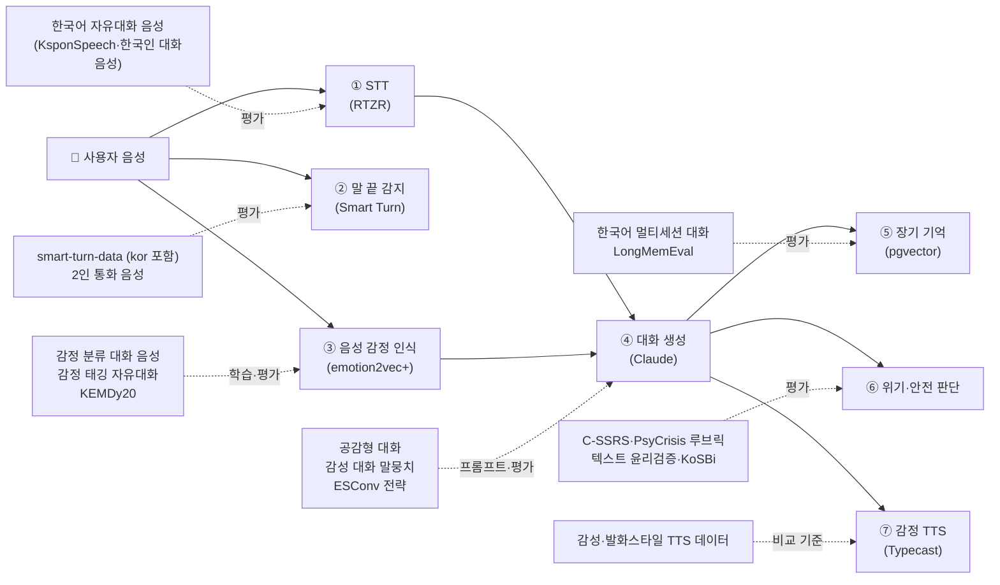

## 라이선스 3종류만 구분하면 됨

<columns>
<column>
<callout icon="🟢" color="green_bg">
**바로 써도 됨 (상업 OK)**

CC BY 4.0, MIT, ODbL 등. 출처 표기만 지키면 학습·평가 모두 가능함.

예: smart-turn-data, Nemotron-Personas-Korea, LongMemEval, CREMA-D, CounselChat, Reddit C-SSRS, K-MHaS(CC BY-SA)
</callout>
</column>
<column>
<callout icon="🟡" color="yellow_bg">
**AI Hub 조건부**

"AI 학습모델의 학습용으로만" 사용 가능. **데이터 판매 등 상업적 이용은 수행기관과 별도 협의**, 재배포 금지, 해외 반출·외국 법인은 별도 합의, **내국인만 신청**.

학습한 모델을 상용 서비스에 넣는 건 문구가 모호함 → 상용화 전 문의 필요
</callout>
</column>
<column>
<callout icon="🔴" color="red_bg">
**연구용·비상업만**

CC BY-NC, 학술 전용, IRB 필요 등. 제품 학습엔 못 넣고 **논문 비교·평가 기준·프롬프트 설계 참고**만.

예: ESConv, EmpatheticDialogues, LoCoMo, RAVDESS, ESD, DAIC-WOZ, KSS, AI Hub 안심존 데이터
</callout>
</column>
</columns>

## 이 데이터 써도 되나? 판단 순서

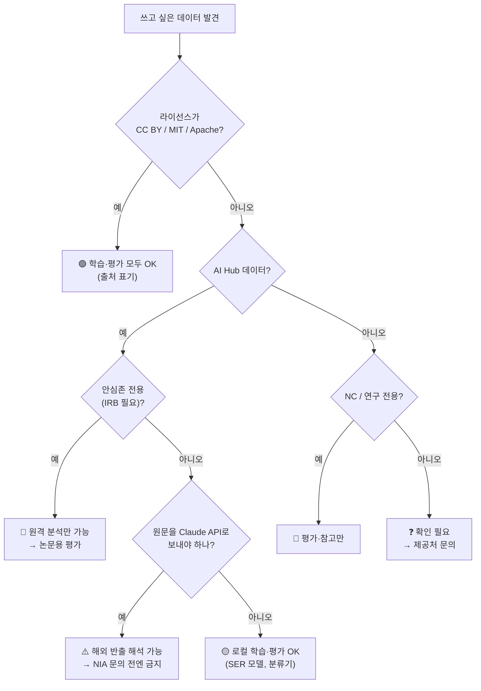

<callout icon="⚠️" color="orange_bg">
**Claude API 주의**: AI Hub 원문 대화를 few-shot이나 평가 프롬프트에 넣어 Anthropic(해외) API로 보내면 "국외 반출"이나 "제3자 제공"으로 볼 여지가 있음. 그래서 **원문 대신 라벨 체계·루브릭만 가져와 예시는 직접 작성**하거나, AI Hub 데이터는 **로컬 모델(SER, 분류기) 학습·평가에만** 쓰는 걸 권장함.
</callout>

## 🏆 우선순위 TOP 10

| 순위 | 데이터 | 어디에 | 왜 | 라이선스 |
|---|---|---|---|---|
| 1 | AI Hub 감정 분류를 위한 대화 음성 | ③ SER | 실제 앱 사용자 자연 발화, 7감정, 발화당 5명 라벨 | 🟡 |
| 2 | AI Hub 감정이 태깅된 자유대화(성인) | ③ SER, ② 턴 | 2인 통화, 40대 이상 약 60%, 감정 강도 라벨 | 🟡 |
| 3 | ETRI KEMDy20 | ③ SER 평가 | 19~39세 일반인 자유대화라 한벗 대상(대학생·청년) 연령대와 겹침, 비연기 | ❓(상업 조건 확인 필요) |
| 4 | AI Hub 한국어 음성(KsponSpeech) | ① STT | 일반 성인 2인 대화 약 1,000h, 2,000명 → RTZR CER 기준셋 | 🟡 |
| 5 | AI Hub 공감형 대화 | ④ 응답 | 공감 전략 4종(격려·동조·위로·조언) 라벨 → 루브릭 | 🟡 |
| 6 | AI Hub 한국어 멀티세션 대화 | ⑤ 기억 | 세션 간격·페르소나·요약 라벨 | 🟡 |
| 7 | pipecat smart-turn-data v3.2 | ② 턴 | **한국어 포함**, CC BY 4.0, Smart Turn 원본 학습셋 | 🟢 |
| 8 | Nemotron-Personas-Korea | 테스트 | 한국 합성 페르소나 100만 중 20대 등 대학생·청년 연령대만 골라 사용자 시뮬레이터로 사용 | 🟢 |
| 9 | LongMemEval | ⑤ 기억 | 기억 시스템 평가 표준, 한국어로 각색 가능 | 🟢 |
| 10 | ESConv + PsyCrisis-Bench 루브릭 | ④⑥ | 지원 전략 8종 + 위기 응답 평가 5차원 | 🔴(참고만) |

# 🎙️ PART 1. 한국어 음성 데이터

## ① 음성 감정 인식(SER)용

<columns>
<column>
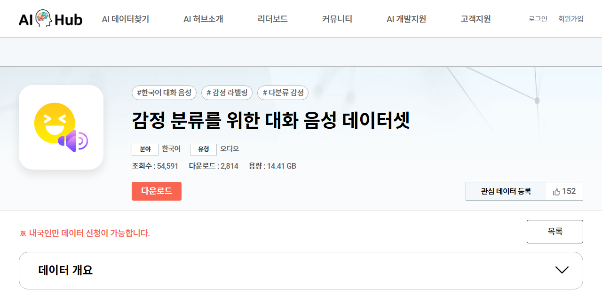
</column>
<column>
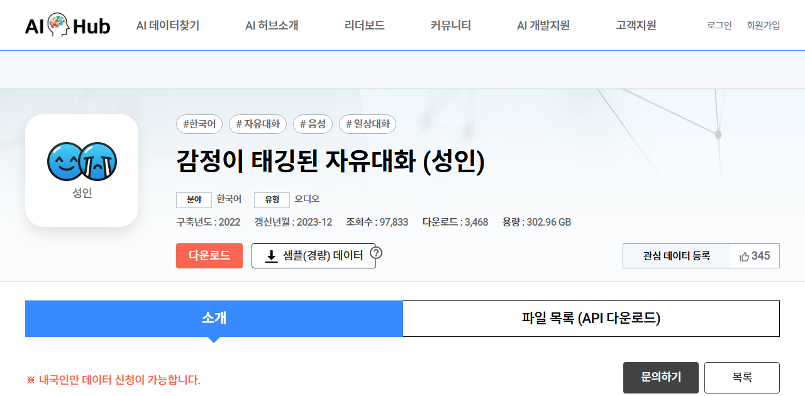
</column>
</columns>

| 데이터 | 규모 | 화자·발화 | 감정 라벨 | 한벗 활용 |
|---|---|---|---|---|
| [감정 분류를 위한 대화 음성](https://www.aihub.or.kr/aihubdata/data/view.do?dataSetSn=263) (AI Hub, KAIST) | 약 4.4만 건 (14,606 + 10,011 + 19,374) | 감정대화 앱 사용자 자연 발화, 48kHz | 7감정 (happy·angry·disgust·fear·neutral·sad·surprise), 발화당 5명 라벨 | **SER 파인튜닝 1순위**. emotion2vec+ 9클래스와 거의 겹침 |
| [감정이 태깅된 자유대화(성인)](https://www.aihub.or.kr/aihubdata/data/view.do?dataSetSn=71631) | 3,000h (페이지 내 6,000h 표기 불일치), 4,075명 | 일반 성인 2인 통화, 대본 없음. 40대 이상 59.85% | 7감정 (기쁨·놀라움·두려움·사랑스러움·슬픔·화남·없음) + 강도 3단계 | 대규모 SER 학습·평가, 통화 턴 경계 데이터로도 사용 |
| [감정이 태깅된 자유대화(청소년)](https://www.aihub.or.kr/aihubdata/data/view.do?dataSetSn=71632) | 3,000h, 4,433명 | 10대 2인 통화 | 위와 동일 | 연령 대조군 정도 (우선순위 낮음) |
| [KEMDy20](https://nanum.etri.re.kr/share/kjnoh2/KEMDy20) (ETRI) | 40세션, 80명 (19~39세) | **일반인 자유대화** | 7감정 + arousal·valence 5점 + 생체신호 | 비연기 SER 평가셋. 단 청년층만 있음 |
| [KEMDy19](https://nanum.etri.re.kr/share/kjnoh2/KEMDy19) (ETRI) | 20세션, 성우 40명 | 성우 대본+즉흥 연기 | 7감정 + A/V | 보조 평가. **연기 음성** |
| [KESDy18](https://nanum.etri.re.kr/share/kjnoh2/KESDy18) (ETRI) | 2,880발화, 성우 30명 | 대본 낭독 | 4감정 + A/V | 소규모 sanity check |
| [멀티모달 영상](https://www.aihub.or.kr/aihubdata/data/view.do?dataSetSn=58) (AI Hub) | 85,077발화, 약 110h | 화자 유형 확인 필요 | 8감정 + A/V 1~10 | 연속 감정(A/V) 보조 평가 |
| [Hi,KIA](https://zenodo.org/records/7091465) (KAIST·현대차) | 488발화, 8명 | 웨이크업워드 연기 | 4감정 | 🟢 CC BY 4.0. 짧은 발화 감도 체크 |

<callout icon="🧠" color="purple_bg">
**연기 음성 편향 주의**: KEMDy19·KESDy18·TTS 데이터·Hi,KIA는 성우 연기라 감정이 과장돼 있음. 이걸로 학습하면 일상 고민 대화의 **잔잔한 저강도 감정**에서 성능이 떨어질 위험이 있음. → **학습은 자연 대화(①·② AI Hub)**, **평가는 KEMDy20(19~39세 일반인 자유대화) + 자연 대화 일부를 직접 재라벨링**하는 구성이 좋음.
</callout>

## ② 음성 인식(STT) 검증용

| 데이터 | 규모 | 특징 | 한벗 활용 |
|---|---|---|---|
| [한국어 음성(KsponSpeech)](https://www.aihub.or.kr/aihubdata/data/view.do?dataSetSn=123) | 약 1,000h, 2,000명 | 일반 성인 2인 대화 | **RTZR STT CER 벤치마크 기본셋** |
| [한국인 대화음성](https://www.aihub.or.kr/aihubdata/data/view.do?dataSetSn=130) | 4,000h | 고령층 포함, 원거리·잡음 | 잡음 환경 STT |
| [Zeroth-Korean](https://huggingface.co/datasets/kresnik/zeroth_korean) | 약 52h | 낭독 | 🟢 CC BY 4.0. 외부 공유 가능한 기준선 |
| [자유대화 음성(노인남녀)](https://www.aihub.or.kr/aihubdata/data/view.do?dataSetSn=107) | 3,000h+, 1,000명+ | 60세 이상 자유발화, 실내외(대중교통·거리) | 🔴 대상 제외(고령 화자) |
| [고령자 근현대 경험 구술](https://www.aihub.or.kr/aihubdata/data/view.do?dataSetSn=71703) | 약 10,529h, 143,630파일 | 60세 이상 회상 인터뷰. 감정·반복·주제이탈·인터뷰어 공감·자서전적 기억 라벨 | 🔴 대상 제외(고령 화자) |
| [중·노년층 방언(강원·경상)](https://www.aihub.or.kr/aihubdata/data/view.do?dataSetSn=71517) | 2,004h | 50세 이상, 경상도는 70대 50% | 🔴 대상 제외(중·노년 화자) |
| [중·노년층 방언(충청·전라·제주)](https://www.aihub.or.kr/aihubdata/data/view.do?dataSetSn=71558) | 확인 필요 | 같은 시리즈 | 🔴 대상 제외(중·노년 화자) |

## ③ 말 끝 감지(Smart Turn)용

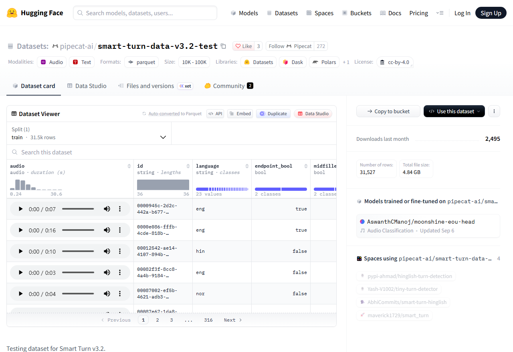

| 데이터 | 규모 | 특징 | 한벗 활용 |
|---|---|---|---|
| [smart-turn-data-v3.2-test](https://huggingface.co/datasets/pipecat-ai/smart-turn-data-v3.2-test) | 31,527행, 4.84GB | 23개 언어, **kor 포함**, `endpoint_bool`(말 끝났나) 라벨 | 🟢 **한국어만 걸러 Smart Turn v3 정확도 측정** → 가장 빨리 해볼 수 있는 실험 |
| [smart-turn-data-v3.2-train](https://huggingface.co/datasets/pipecat-ai/smart-turn-data-v3.2-train) | 270,946행, 41.4GB | 위와 동일 | 🟢 한국어 대학생·청년 발화 추가해 재학습할 때 베이스 |
| 감정 태깅 자유대화(성인)·방언 2인 대화·심리상담 타임스탬프 | – | 2인 대화의 발화 시작·끝 시간 | 턴 경계 라벨을 직접 만들어 평가 |
| [부산 노인·퇴행성 뇌질환자 음성](https://www.aihub.or.kr/aihubdata/data/view.do?dataSetSn=565) · [인지기능 장애 음성](https://www.aihub.or.kr/aihubdata/data/view.do?dataSetSn=217) | 2,200녹음 / 672h | 단절발화·간투어·머뭇거림 라벨 | 🔴 대상 제외(고령·인지저하 화자, 안심존) |

<callout icon="💡" color="gray_bg">
smart-turn 데이터는 상당수가 **합성 음성**(chirp3·rime·orpheus 등 출처 태그)임. 한국어 실제 사용자 음성과는 차이가 있으니, 최종 검증은 한벗 베타 통화 녹음(동의 받은 것)으로 해야 함. 한국어 전용 end-of-turn 데이터셋은 못 찾음.
</callout>

## ④ 감정 TTS 비교 기준

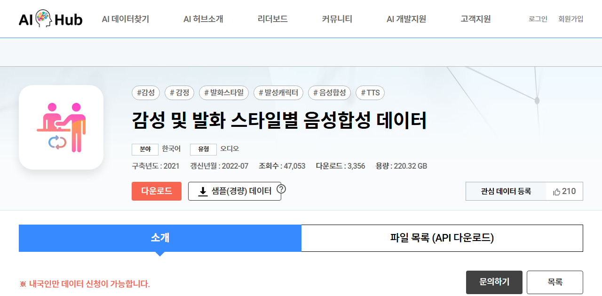

| 데이터 | 규모 | 특징 | 한벗 활용 |
|---|---|---|---|
| [감성 및 발화 스타일별 음성합성](https://www.aihub.or.kr/aihubdata/data/view.do?dataSetSn=466) | 1,067h, 성우 50명 | 대화체·구연체 등 5문체, **노인 음색 포함**, 세부 감성 93종 | Typecast 감정 프리셋과 비교하는 청취평가(MOS) 기준 |
| [감성·발화스타일 동시 고려 음성합성](https://www.aihub.or.kr/aihubdata/data/view.do?dataSetSn=71349) | 1,012h, 89명 | 독백·대화·**친절체** 등 7문체 × 감정 강도 | 한벗 응답 톤(친절체·대화체) 레퍼런스 |
| [KSS](https://huggingface.co/datasets/Bingsu/KSS_Dataset) | 약 12h, 1인 | 여성 성우 낭독 | 🔴 CC BY-NC-SA. 상용 불가, 실험만 |

## ⑤ 정신건강·의료 음성 (안심존 전용)

| 데이터 | 내용 | 접근 | 한벗 활용 |
|---|---|---|---|
| [고령인구 우울증 데이터](https://www.aihub.or.kr/aihubdata/data/view.do?dataSetSn=71401) | 60~89세 6,000명, 음성 + PHQ-9 우울 라벨, 독거 22% | 🔴 안심존, IRB | 🔴 대상 제외(고령 화자) |
| [심리상담 데이터](https://www.aihub.or.kr/aihubdata/data/view.do?dataSetSn=71806) | 실제 상담 약 1,661h, 우울·불안·중독 심각도, 상담자 개입, **침묵 시간** | 🔴 안심존, IRB | 상담자 개입 패턴·침묵 길이 분석 |
| [노인 정신건강 영상](https://www.aihub.or.kr/aihubdata/data/view.do?dataSetSn=71783) | 1,203명, 인지 정상/비정상 | 🔴 안심존 | 🔴 대상 제외(고령 화자) |

<callout icon="🚫" color="red_bg">
안심존 데이터는 **다운로드 불가**, 원격 분석 환경에서만 사용함. IRB 심의결과·연구계획서·보안서약이 필요해서 제품 파이프라인엔 사실상 못 넣음. 또 한벗은 **진단 서비스가 아님**(의료기기 규제)이라 "우울 진단" 기능 학습엔 쓰지 않는 게 맞음.
</callout>

# 💬 PART 2. 한국어 텍스트 데이터

## ① 공감·상담 대화 → Claude 응답 설계

<columns>
<column>
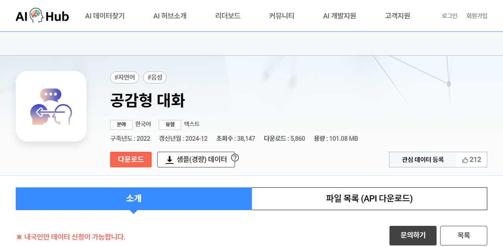
</column>
<column>
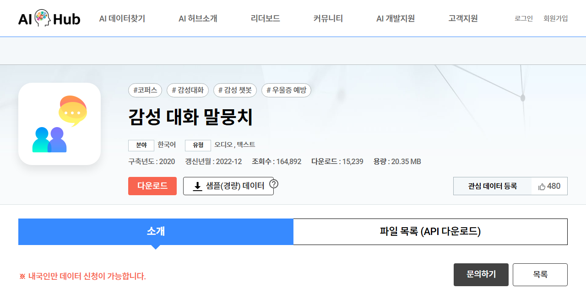
</column>
</columns>

| 데이터 | 규모 | 라벨 | 한벗 활용 |
|---|---|---|---|
| [공감형 대화](https://www.aihub.or.kr/aihubdata/data/view.do?dataSetSn=71305) (AI Hub) | 31,821세션, 47만 발화 | 시작 감정 6종, 화자 관계 7종(**조손·부부** 포함), **공감 전략 4종(격려·동조·위로·조언)**, 품질 평점 | ⭐ 공감 전략 라벨을 그대로 **응답 평가 루브릭**으로 사용 |
| [감성 대화 말뭉치](https://www.aihub.or.kr/aihubdata/data/view.do?dataSetSn=86) (AI Hub) | 27만 문장 + 음성 약 1만 | 60개 세부 감정(대분류 6), **우울증 환자 WOZ 대화** 포함 | 감정 분류 평가셋, 우울 발화 패턴 참고 |
| [웰니스 대화 스크립트](https://aihub.or.kr/aihubdata/data/view.do?dataSetSn=267) (AI Hub, 세브란스 상담 기반) | 의도 359개, 사용자 발화 5,232 | 감정·배경·증상 분류 | 정신건강 발화 의도 분류, 위기 전 단계 탐지 시드 |
| [연속적 대화 감정](https://www.aihub.or.kr/aihubdata/data/view.do?dataSetSn=271) (AI Hub) | 1만 대화 + 단발 5.5만 | 7감정 | 대화 맥락 감정 분류 평가 |
| [empathetic_dialogues_ko](https://huggingface.co/datasets/Smoked-Salmon-s/empathetic_dialogues_ko) (HF) | 26,662 | GPT-4/3.5 합성 공감 대화 | 🟢 Apache-2.0 (단 GPT 출력물). 응답 형식 비교 베이스라인 |
| [mental_health_counseling_conversations_ko](https://huggingface.co/datasets/youjunhyeok/mental_health_counseling_conversations_ko) (HF) | 3,512 | 영어 상담 Q&A를 GPT-4o 번역 | 번역투 주의, 참고만 |
| [Chatbot_data](https://github.com/songys/Chatbot_data) (songys) | 11,876 Q&A | 일상 / 이별·부정 / 사랑·긍정 | 🟢 MIT. 가벼운 위로 응답 회귀 테스트 |

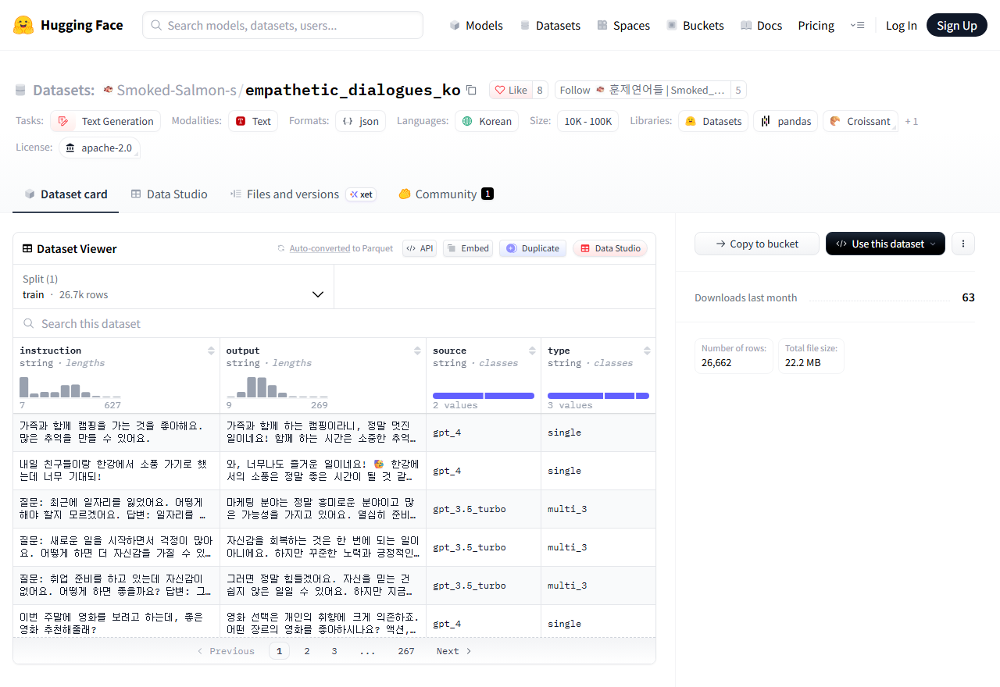

## ② 장기 기억·페르소나 → 기억 시스템 평가

<columns>
<column>
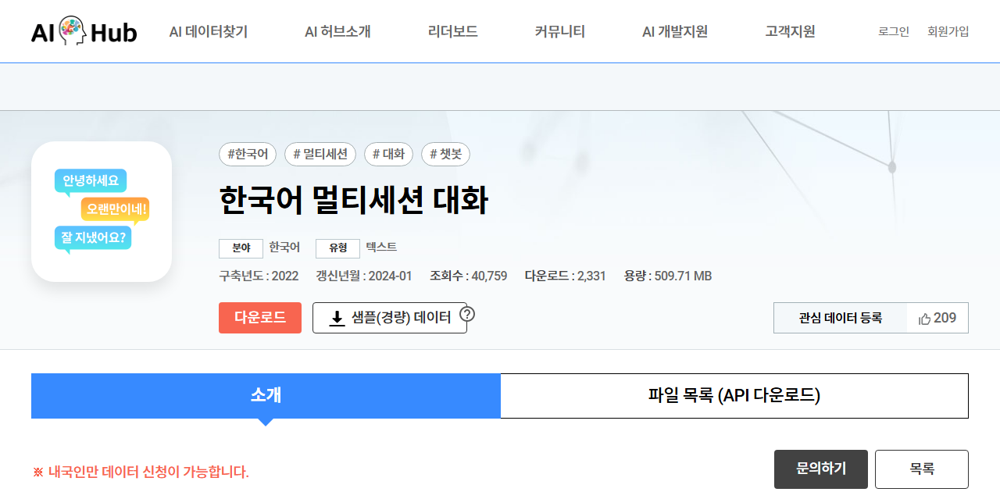
</column>
<column>
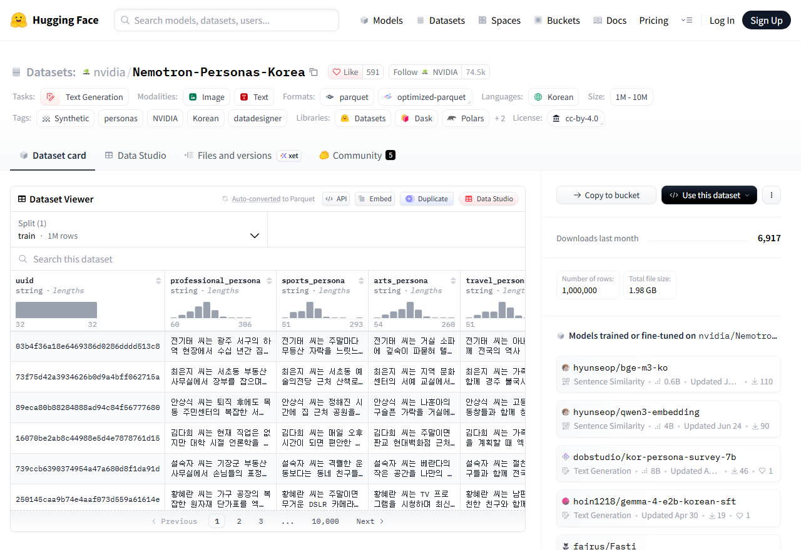
</column>
</columns>

| 데이터 | 규모 | 내용 | 한벗 활용 |
|---|---|---|---|
| [한국어 멀티세션 대화](https://www.aihub.or.kr/aihubdata/data/view.do?dataSetSn=71630) (AI Hub) | 약 8만 대화 (2~4세션) | 페르소나, 주제 13종, **세션 간 시간 간격**, 발화별 요약 | ⭐ "지난번에 말한 거 기억해?" 회상·요약 평가 |
| [한국어 대화 요약](https://www.aihub.or.kr/aihubdata/data/view.do?dataSetSn=117) (AI Hub) | 35만 대화 + 요약 | 대화 → 1문장 요약 | 통화 후 기억 카드 요약 품질 평가 |
| [모두의 말뭉치](https://kli.korean.go.kr/corpus/main/requestMain.do) (국립국어원) | 일상대화·대화요약·**요약 평가** 말뭉치 | 요약 품질 점수 포함 | 요약 평가 지표 검증 (상업 조건 확인 필요) |
| [Nemotron-Personas-Korea](https://huggingface.co/datasets/nvidia/Nemotron-Personas-Korea) (NVIDIA) | 100만 레코드 | 한국 인구통계 기반 합성 페르소나, 1인가구 포함 | 🟢 CC BY 4.0. 20대 등 대학생·청년 연령대만 골라 **가상 사용자 시뮬레이터**로 멀티세션 테스트 |
| KEEM ([arXiv 2601.05548](https://arxiv.org/abs/2601.05548)) | AI Hub 멀티세션 기반 | **감정과 그 원인**을 반영한 기억 갱신 | 한벗 기억 설계와 가장 직접적으로 관련. 데이터 공개 여부 확인 필요 |
| CareCall_mem ([arXiv 2210.08750](https://arxiv.org/abs/2210.08750)) | 확인 필요 | 네이버 독거노인 돌봄콜 기억 갱신 | 기억 갱신 방식만 참고(대상이 독거노인이라 도메인은 다름). 공개 여부 확인 필요 |

## ③ 위기 감지·안전성 → 안전장치 평가

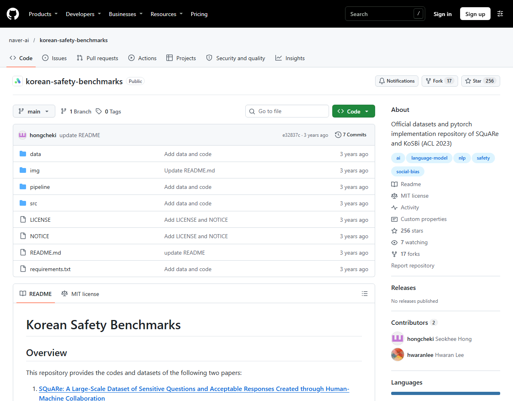

| 데이터 | 규모 | 라벨 | 한벗 활용 |
|---|---|---|---|
| [Suicidal Risk Detection (군 장병)](https://github.com/SungjoonPark/RiskDetection) | 게시물 2,791 | 전문가 자살 위험 수준 | 실제 한국어 위기 텍스트 평가 (연구윤리 동의 필요, 군 도메인 편향) |
| Harmful Suicide Content ([arXiv 2407.13942](https://arxiv.org/abs/2407.13942)) | 452건(확인 필요) | 5단계 유해성 | 자살 관련 응답 유해성 평가 (공개 여부 확인 필요) |
| [텍스트 윤리검증](https://www.aihub.or.kr/aihubdata/data/view.do?dataSetSn=558) (AI Hub, 심심이) | 45만 문장 | 비윤리 7종 + 강도 | 사용자 입력 유해성 필터 |
| [KoSBi·SQuARe](https://github.com/naver-ai/korean-safety-benchmarks) (NAVER) | 68k / 49k 질문 | 사회적 편향 / 민감 질문 응답 적절성 | 🟢 MIT. 응답 안전성 평가 |
| [KoBBQ](https://huggingface.co/datasets/naver-ai/kobbq) | 81k | 편향 12종 (**연령** 포함) | 🟢 MIT. 연령 등 편향 응답 점검 |
| [K-MHaS](https://huggingface.co/datasets/jeanlee/kmhas_korean_hate_speech) | 109,692 | 혐오 8종 (연령 포함) | 🟢 CC BY-SA. 입출력 필터 평가 |
| [KOLD](https://github.com/boychaboy/KOLD) · [APEACH](https://github.com/jason9693/APEACH) · [kocohub](https://github.com/kocohub/korean-hate-speech) | 4만 / 3.7천 / 9.4천 | 공격성·혐오 | 보조 필터 평가 |
| [KorNAT](https://huggingface.co/datasets/jiyounglee0523/KorNAT) | 14k | 한국 사회 가치 정렬 | 🔴 CC BY-NC. 내부 점검만 |

<callout icon="🕳️" color="orange_bg">
**확인된 공백**: 공개된 **한국어 자살·우울 텍스트 데이터는 거의 없음** (HF에서 language:ko + suicide/depression 검색 결과 0건). 한국어 ESConv 번역본도 못 찾음. → 위기 감지 평가셋은 **감성 대화·웰니스의 우울 발화 + C-SSRS 단계 체계 + 전문가 검수 합성 시나리오**로 직접 만드는 게 현실적임. 이 자체가 한벗의 차별점(데이터 자산)이 될 수 있음.
</callout>

# 🌍 PART 3. 영어·다국어 참고 데이터

## ① 정서지원 대화 → 응답 전략 설계

<columns>
<column>
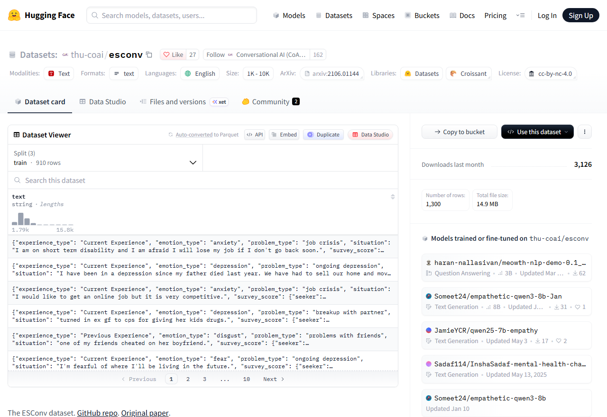
</column>
<column>
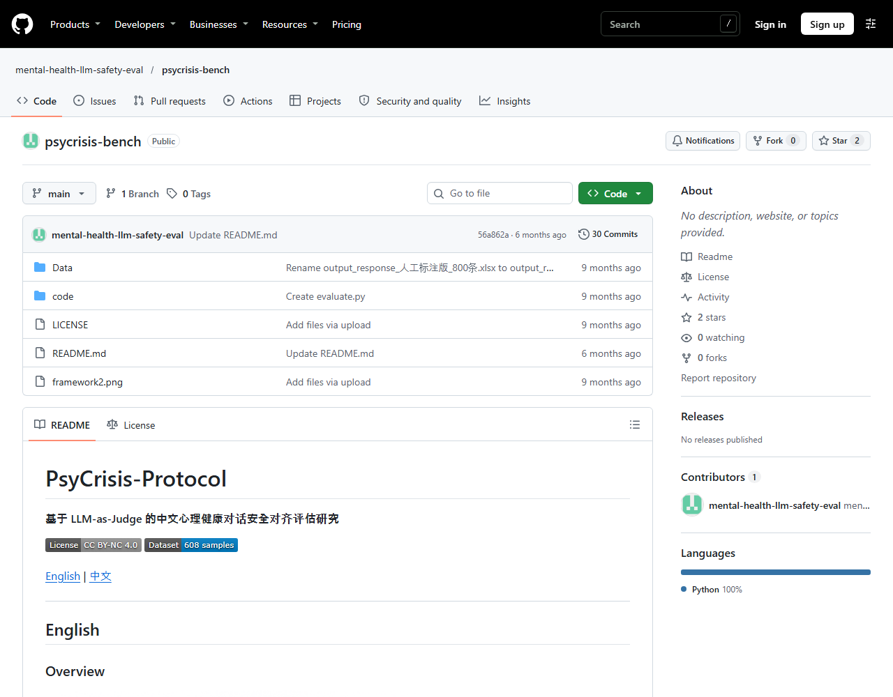
</column>
</columns>

| 데이터 | 규모 | 핵심 | 한벗 활용 | 라이선스 |
|---|---|---|---|---|
| [ESConv](https://huggingface.co/datasets/thu-coai/esconv) | 1,300대화 | **지원 전략 8종**(질문·자기개방·확언·제안·감정반영·정보·바꿔말하기·기타), 탐색→위로→행동 단계 | ⭐ Claude 시스템 프롬프트의 대화 단계 설계 | 🔴 NC |
| [EmpatheticDialogues](https://huggingface.co/datasets/facebook/empathetic_dialogues) | 약 10만 예제 | 감정 상황별 공감 응답 | 공감 응답 품질 기준 | 🔴 NC |
| [AnnoMI](https://github.com/uccollab/AnnoMI) | 133건 | 동기강화상담(MI): **단순/복합 반영**, 질문 유형 | 반영적 경청 프롬프트 | 확인 필요 |
| [CounselChat](https://huggingface.co/datasets/nbertagnolli/counsel-chat) | 2,775 | 실제 치료사 답변 + 추천수 | 답변 문체 참고 | 🟢 MIT |
| [MentalChat16K](https://huggingface.co/datasets/ShenLab/MentalChat16K) | 16,084 | 33개 정신건강 주제 (일부 합성) | 평가·미세조정 | 🟢 MIT |
| [CACTUS](https://huggingface.co/datasets/DLI-Lab/cactus) | 31,577 | CBT 기법 34종 | 인지 재구성 패턴 참고 (한벗은 치료 아닌 지지 범위) | GPL |
| [Psych8k](https://huggingface.co/datasets/EmoCareAI/Psych8k) | 약 8천 쌍 | 실제 상담 260건 기반 | 참고 | 🔴 NC, 승인 필요 |

## ② 음성 감정 인식(SER) 벤치마크

| 데이터 | 규모 | 특징 | 한벗 활용 | 라이선스 |
|---|---|---|---|---|
| [IEMOCAP](https://sail.usc.edu/iemocap/iemocap_release.htm) | 4클래스 5,531발화 | 연기 대화, 범주+VAD | 논문 비교 표준 | 신청, 연구용 추정 |
| [MSP-Podcast](https://www.lab-msp.com/MSP/MSP-Podcast.html) | 400h+ | **자연 발화** 대표, 9범주 + A/V/D | valence/arousal 지표 설계 참고 | 학술 무료, 상업 확인 필요 |
| [MELD](https://github.com/declare-lab/MELD) | 13,708발화 | 드라마 다자 대화 | 대화 맥락 SER | 방송 원본이라 주의 |
| [CREMA-D](https://github.com/CheyneyComputerScience/CREMA-D) | 7,442클립 | 6감정 × 강도 | 상업 가능한 몇 안 되는 SER | 🟢 ODbL |
| [RAVDESS](https://zenodo.org/records/1188976) · [ESD](https://github.com/HLTSingapore/Emotional-Speech-Data) | 7,356 / 29h | 연기, ESD는 영·중 병렬 | 언어 간 전이 실험 | 🔴 NC / 연구용 |
| [EmoBox](https://github.com/emo-box/EmoBox) | 32개 데이터셋, 14개 언어 | 다국어 SER 평가 프로토콜 | **한국어 없음** → 한국어 검증셋 필요 근거 | 코드 MIT |

<callout icon="📊" color="blue_bg">
**논문에 쓸 근거**: EmoBox 32개 데이터셋에 한국어가 없고, emotion2vec+는 언어별 학습 비율을 공개하지 않음. → "emotion2vec+를 한국어 대학생·청년 음성에 그대로 쓰면 성능이 보장되지 않으므로 자체 한국어 검증이 필요하다"는 주장의 근거가 됨.
</callout>

## ③ 장기 기억 · 위기 · 우울 음성

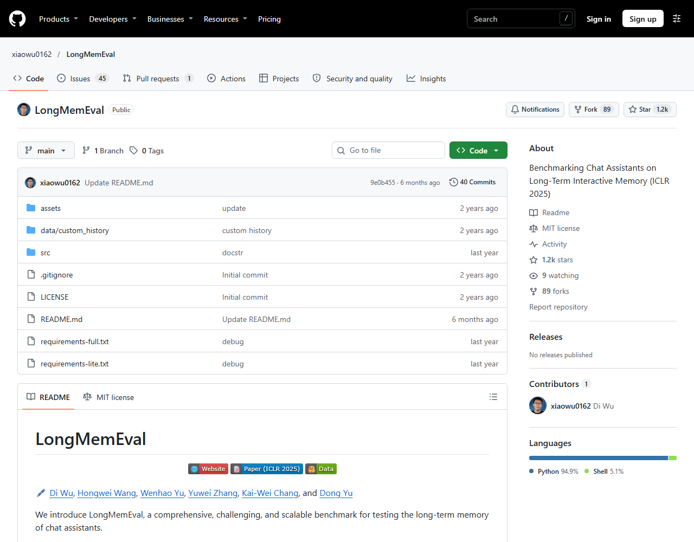

| 데이터 | 분야 | 핵심 | 한벗 활용 | 라이선스 |
|---|---|---|---|---|
| [LongMemEval](https://github.com/xiaowu0162/LongMemEval) | 기억 | 질문 500개, **정보추출·멀티세션 추론·지식 갱신·시간 추론·답변 보류** | ⭐ 한국어로 각색해 내부 기억 벤치마크로 | 🟢 MIT |
| [LoCoMo](https://github.com/snap-research/locomo) | 기억 | 초장문 대화 10건 QA·요약 | 평가 프로토콜 참고 | 🔴 NC |
| [MSC](https://parl.ai/projects/msc/) | 기억 | 멀티세션 + 페르소나 요약 | 세션 종료 요약 → 저장 구조 참고 | 확인 필요 |
| [Reddit C-SSRS](https://zenodo.org/records/2667859) | 위기 | 500명, C-SSRS 5단계(지지·지표·사고·행동·시도) | **위기 단계 체계**를 한벗 위험도 판정 기준으로 | 🟢 CC BY |
| [PsyCrisis-Bench](https://github.com/mental-health-llm-safety-eval/psycrisis-bench) | 위기 | 평가 5차원: 공감·정서조절·탐색·위험평가·외부연계 | ⭐ **위기 응답 평가 루브릭** 차용 | 🔴 NC |
| [DAIC-WOZ](https://dcapswoz.ict.usc.edu/) · [Androids](https://github.com/androidscorpus/data) | 우울 음성 | 인터뷰 음성 + 우울 라벨 | 선행연구 인용만 | 🔴 학술 전용 |
| [CANDOR](https://convokit.cornell.edu/documentation/candor.html) | 턴테이킹 | 1,656 화상 대화, 850h | 자연 대화 침묵·끼어들기 분포 참고 | 신청 |

# 🛠️ PART 4. 한벗 적용 순서

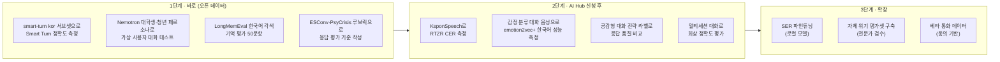

<callout icon="✅" color="green_bg">
**바로 할 수 있는 일 3개**

1. **smart-turn-data-v3.2-test에서 `language == kor`만 뽑아** Smart Turn v3 정확도를 측정함 → "한국어에서도 말 끝 감지가 몇 % 맞는지" 수치 확보
2. **감정 라벨 매핑표**를 먼저 정함: emotion2vec+ 9클래스 ↔ AI Hub 7감정 ↔ ETRI 7감정 → 공통 4~5클래스 + valence(긍정/부정)
3. **AI Hub 신청**(내국인 명의): 감정 분류 대화 음성(263), 감정 태깅 자유대화 성인(71631), 한국어 음성 KsponSpeech(123), 공감형 대화(71305), 멀티세션 대화(71630)
</callout>

<callout icon="⚠️" color="red_bg">
**하지 말 것**
- HF에 올라온 **AI Hub 무단 미러**(예: AI Hub 방언 데이터 재업로드) 사용 금지 → 재배포 금지 조항 위반 소지
- AI Hub 원문을 Claude API 프롬프트에 그대로 넣기 (NIA 확인 전)
- NC·연구용 데이터(ESConv, ED, LoCoMo 등)를 상용 모델 학습에 넣기
- 우울 음성 데이터로 "우울 진단" 기능 만들기 (의료기기 규제 영역)
</callout>

<toggle heading="h3">
🔍 확인 필요 목록

- ETRI KEMDy·KESDy 상업 이용 조건 (나눔 사이트 접속 거부로 직접 확인 못 함), KEMDy20 발화 수
- KEMDy19 = KESDy19 같은 녹음인지 공식 문구
- AI Hub 페이지 내 수치 불일치: 감정 태깅 자유대화 3,000h vs 6,000h, 주제별 일상대화 134,263 vs 109,614
- AI Hub로 학습한 모델의 상용 서비스 탑재 허용 범위
- IEMOCAP·MSP-Podcast 상업 라이선스, MSC·AnnoMI 라이선스
- KEEM·CareCall_mem·Harmful Suicide Content 데이터 공개 여부
- 멀티모달 영상(58) 화자가 성우인지
</toggle>

<toggle heading="h3">
📚 출처

- AI Hub 이용정책: https://www.aihub.or.kr/intrcn/guid/usagepolicy.do
- AI Hub 각 데이터 상세: https://www.aihub.or.kr/aihubdata/data/view.do?dataSetSn= (263, 71631, 71632, 107, 71517, 71558, 71703, 71401, 71783, 217, 565, 71806, 466, 71349, 123, 130, 464, 58, 86, 267, 71305, 71630, 271, 543, 114, 117, 558)
- ETRI 나눔: https://nanum.etri.re.kr/share/kjnoh2/KEMDy20 · KEMDy19 · KESDy18
- Hugging Face: pipecat-ai/smart-turn-data-v3.2-test·train, nvidia/Nemotron-Personas-Korea, Smoked-Salmon-s/empathetic_dialogues_ko, thu-coai/esconv, facebook/empathetic_dialogues, nbertagnolli/counsel-chat, ShenLab/MentalChat16K, DLI-Lab/cactus, EmoCareAI/Psych8k, naver-ai/kobbq, jeanlee/kmhas_korean_hate_speech, jiyounglee0523/KorNAT, kresnik/zeroth_korean, Bingsu/KSS_Dataset, emotion2vec/emotion2vec_plus_large
- GitHub: naver-ai/korean-safety-benchmarks, songys/Chatbot_data, SungjoonPark/RiskDetection, boychaboy/KOLD, jason9693/APEACH, kocohub/korean-hate-speech, xiaowu0162/LongMemEval, snap-research/locomo, mental-health-llm-safety-eval/psycrisis-bench, emo-box/EmoBox, uccollab/AnnoMI, declare-lab/MELD, CheyneyComputerScience/CREMA-D, HLTSingapore/Emotional-Speech-Data, androidscorpus/data
- Zenodo: 2667859 (Reddit C-SSRS), 7091465 (Hi,KIA), 1188976 (RAVDESS)
- 기타: sail.usc.edu/iemocap, lab-msp.com MSP-Podcast, dcapswoz.ict.usc.edu, parl.ai/projects/msc, convokit CANDOR, kli.korean.go.kr 모두의 말뭉치
- 화면 캡처: 2026-11-06 각 데이터 페이지 직접 캡처
</toggle>
