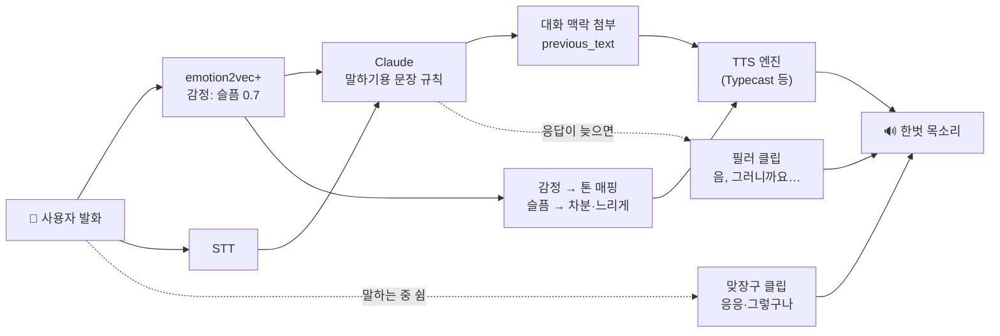
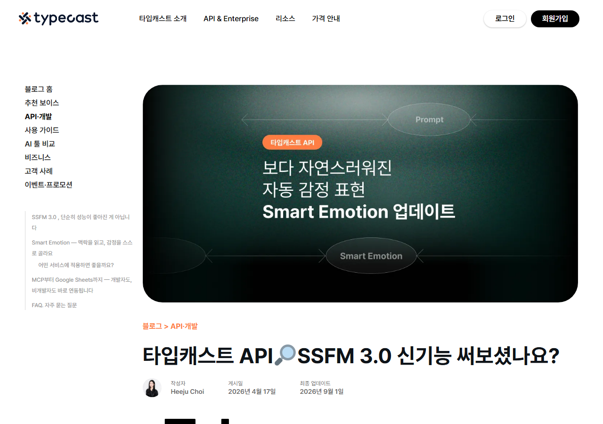
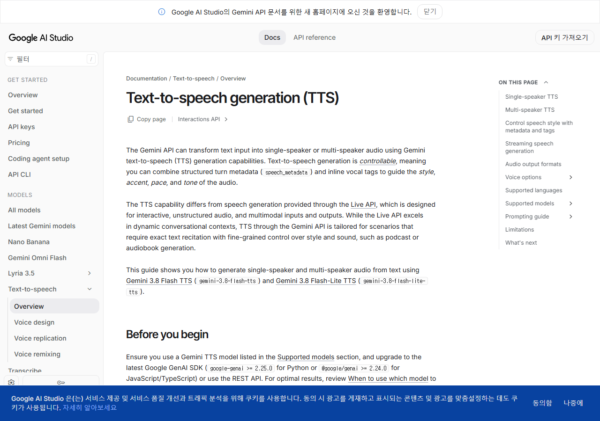
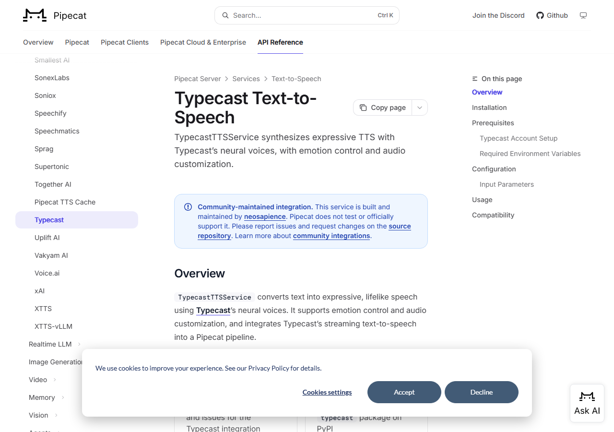
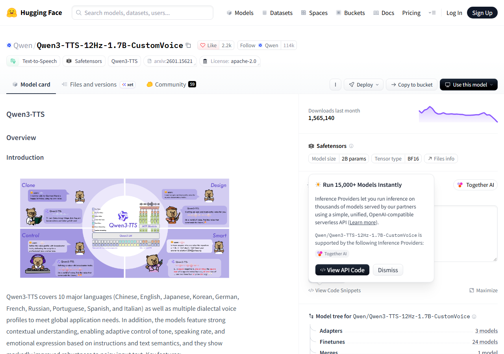
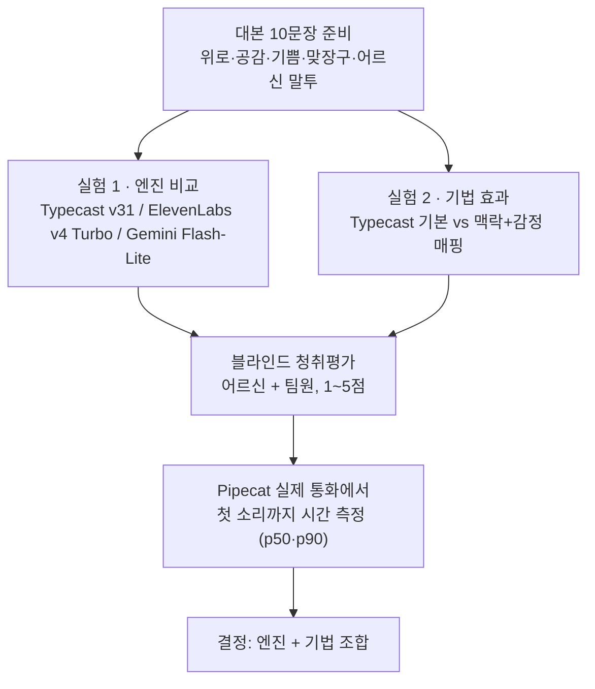

# 한벗 목소리 사람처럼 만들기 (TTS 기술·음성 비교)

> 노션: https://app.notion.com/p/40f4c3db1a158104a876ef3b5ff926f5

<callout icon="🎯" color="blue_bg">
**한 줄 결론**: 엔진을 바꾸기 전에, 지금 쓰는 Typecast에 **① 대화 맥락 넣기 ② 사용자 감정에 맞춘 톤 ③ 맞장구·필러 ④ 말하기용 문장**을 붙이는 게 가장 싸고 효과가 큼. 엔진 비교는 **Typecast ssfm-v31 vs ElevenLabs v4 Turbo**를 1순위로 들어보면 됨. 한국어+상업 가능한 풀듀플렉스(동시에 듣고 말하는) 모델은 아직 없어서, 지금 구조(STT → Claude → TTS)를 유지하는 게 맞음.
</callout>

<table-of-contents />

# 🧭 0. 사람처럼 들리는 목소리 = 엔진 + 기법

<callout icon="💡" color="gray_bg">
**핵심 포인트**: Sesame 연구에서 문장 하나만 들려주면 AI 목소리와 사람을 거의 구분 못 했지만, **대화 맥락까지 같이 들려주면 사람 녹음을 더 선호**했음. 즉 요즘 TTS는 "문장 읽기"는 이미 사람 수준이고, 남은 격차는 **대화 흐름에 맞는 억양·타이밍**임. 그래서 엔진보다 기법(맥락·감정·맞장구·타이밍)이 중요함.
</callout>

# 🎧 PART 1. 직접 들어보기

## ① 같은 문장, 다른 엔진

> 대본: <b>"아이고, 그러셨구나. 오늘 많이 속상하셨겠어요. 제가 옆에서 들어드릴게요."</b>

<callout icon="👂" color="yellow_bg">
**들을 때 체크할 것** (각 1~5점)
1. "아이고"가 **진짜 걱정하는 소리**로 들리나, 글자를 읽는 소리로 들리나
2. 문장 끝 "~겠어요"가 자연스럽게 **내려가나**
3. 쉼표에서 **숨 쉬듯 쉬나**
4. 어르신이 듣기에 **속도·발음**이 편한가
5. 전체적으로 **사람 같나**
</callout>

<columns>
<column>
**Qwen3-TTS 1.7B (Sohee)** · 오픈소스 Apache-2.0 · 한국어 기본 목소리

<audio source="audio/A_qwen3_sohee.wav">Qwen3-TTS — Sohee 목소리, 감정 지시 없음</audio>
</column>
<column>
**VoxCPM2 2B** · 오픈소스 Apache-2.0 · 30개 언어

<audio source="audio/A_voxcpm2.mp3">VoxCPM2 — 기본 설정, 참조 음성 없음</audio>
</column>
</columns>

<columns>
<column>
**OmniVoice 0.6B** · 오픈소스 (가중치 CC-BY-NC, 상용 불가) · 목소리 디자인(여성·중년)

<audio source="audio/A_omnivoice.wav">OmniVoice — 여성·중년 목소리 디자인</audio>
</column>
<column>
**MeloTTS-Korean** · 오픈소스 MIT · CPU로도 돌아가는 소형 · 감정 제어 없음 (비교 기준용)

<audio source="audio/A_melotts_kr.wav">MeloTTS-Korean — 읽기체 기준선</audio>
</column>
</columns>

<callout icon="ℹ️" color="gray_bg">
4개 모두 Hugging Face 공개 데모(Space)로 2026-11-06에 직접 합성한 결과임. 같은 모델도 목소리·설정에 따라 차이가 크니 "모델 우열"보다 **요즘 오픈소스 한국어 TTS가 어느 수준인지** 감 잡는 용도로 들으면 됨. 상용(Typecast·ElevenLabs·Gemini)은 API 키가 있어야 같은 문장으로 만들 수 있어서 아래 🔜 섹션에 정리함.
</callout>

## ② 🔜 추가 예정 음성 (기법 효과 비교)

무료 GPU 데모의 하루 사용량이 끝나서 아래 비교 음성은 아직 못 만듦. Hugging Face 토큰(무료)이나 Typecast·ElevenLabs API 키가 있으면 같은 대본으로 바로 채울 수 있음.

| 비교 | A | B | 무엇을 듣나 |
|---|---|---|---|
| 감정 지시 | 지시 없음 | "따뜻하고 다정하게, 천천히 위로하듯" | 같은 문장이 위로처럼 들리는지 |
| 감정 불일치 | 차분한 위로 톤 | "아주 밝고 신나게" | 슬픈 사람에게 밝은 톤이 얼마나 어색한지 |
| 대화 맥락 | "손주 합격 소식" 맥락 + "정말 다행이네요" | "넘어졌는데 안 다쳤다" 맥락 + 같은 문장 | 맥락에 따라 같은 문장 억양이 달라지는지 |
| 필러 | "천천히 말씀하셔도 괜찮아요." | "음… 그러니까요. 천천히 말씀하셔도 괜찮아요." | 필러가 자연스러운지, 어색한지 |
| 맞장구 | "응, 응." / "아, 그렇구나." / "아이고, 저런." | – | 짧은 맞장구가 작고 부드럽게 들리는지 |
| 말 속도 | 속도 1.0 | 속도 0.85 | 어르신에게 어느 쪽이 편한지 |
| 숫자 읽기 | "내일 10:00에… 혈압약(아침 1T)" | "내일 아침 열 시에… 혈압약 한 알" | 기호·숫자를 그대로 두면 어떻게 읽는지 |

# 🏢 PART 2. 상용 TTS 비교

<columns>
<column>

</column>
<column>

</column>
</columns>

| 서비스 · 모델 | 한국어 | 사람처럼 들리게 하는 기능 | 지연 | Pipecat | 가격(대략) | 걸리는 점 |
|---|---|---|---|---|---|---|
| **Typecast** ssfm-v31 (현재 사용) | ✅ 국내 업체 | 감정 7종 × 강도 0~2, **Smart Emotion**(`previous_text`/`next_text`로 앞뒤 문맥 반영), 쉼 표기 `<\|1s\|>` | 청크 스트리밍, 수치 미공개 | 커뮤니티 플러그인 (v30까지) | 1천 자당 약 $0.075 (Lite) | 웃음·한숨 소리 없음, SSML 없음, WebSocket 없음 |
| **ElevenLabs** v4 Turbo / v3 Conversational | ✅ | **오디오 태그** `[sighs]` `[laughs]` `[whispers]` `[exhales]` 등, 문맥 연결 | 약 100ms / 165ms | ✅ 공식 (Dialogue 서비스) | 1천 자당 약 $0.04 | 한국어에서 태그 효과는 직접 확인 필요. 태그가 대화 기록에 남지 않게 필터 필요 |
| **Google Gemini** 3.8 Flash-Lite TTS | ✅ | 자연어 스타일 지시 + `<laugh>` `<sigh>` `<short pause>` 태그, "실시간 음성 에이전트용" 명시 | 수치 미공개 | Google 서비스 있음 (이 모델 지원 여부 확인 필요) | 오디오 100만 토큰당 $6 (2027-01부터 2배) | 지시문을 본문에 섞으면 그대로 읽을 수 있음 |
| **Azure** MAI-Voice-2 (Haena·Junho) | ✅ | **한국어 감정 스타일 13종**(softvoice·hopeful·relieved 등), SSML | Flash 버전 있음 | ✅ | 확인 필요 | 미리보기 단계, 안정성 보장 없음 |
| **Inworld** TTS-2 | 확인 필요 | 말투 지시, `[laugh]` `[sigh]` `[breathe]` | 서버 기준 100ms | ✅ | 확인 필요 | 지시문·태그가 영어 중심 |
| **Cartesia** Sonic 3.6 | ✅ | 필러 자연 처리, `[laughter]` | 저지연 | ✅ | 10만 자 $5~ | 감정 태그 영어 전용 |
| Naver CLOVA Voice | ✅ | emotion·강도·피치 파라미터 | REST만 | ❌ 직접 구현 | 확인 필요 | 문장당 200자 |

<callout icon="🚫" color="red_bg">
**제외**: OpenAI TTS(`gpt-4o-mini-tts` 등, 2027-01-06 종료 예정) · Rime·Sesame(한국어 없음) · Hume(종료 예정이라는 검색 결과가 있으나 공식 페이지에선 미확인 → 확인 필요) · Gemini Live·OpenAI Realtime 같은 음성 대 음성 모델(LLM을 Claude에서 바꿔야 함)
</callout>

# 🧪 PART 3. 오픈소스 TTS (자체 서버·비용 절감 대비)

| 모델 | 한국어 | 자연스러움 기능 | 지연 | 라이선스 | 메모 |
|---|---|---|---|---|---|
| **Qwen3-TTS** 0.6B/1.7B | ✅ (Sohee) | 자연어 `instruct`로 감정·운율 지시, 3초 목소리 복제 | 첫 소리 약 97ms (공식) | 🟢 Apache-2.0 | 오픈소스 1순위 |
| **Fun-CosyVoice3** 0.5B | ✅ | instruct로 감정·속도, 제로샷 복제 | 약 150ms | 코드 Apache (가중치 확인 필요) | 양방향 스트리밍 |
| **VoxCPM2** 2B | ✅ (품질 확인 필요) | 괄호 설명으로 감정·목소리 지정 | RTF 0.13~0.3 | 🟢 Apache-2.0 | 결과 편차 있어 여러 번 생성 권장 |
| **Supertonic 3** (Supertone) | ✅ | 경량·고속 | 온디바이스급 | OpenRAIL-M (조건부 상업) | GitHub 저장소가 **보관(archive) 처리**됨 |
| **MeloTTS-Korean** | ✅ | 없음 (읽기체) | CPU 실시간 | 🟢 MIT | 기준선 |
| Raon-SpeechChat 9B (KRAFTON) | 영·한 학습 | **풀듀플렉스**, 맞장구 빈도 조절 | 0.6~0.9초 | 🔴 비상업 | 연구 참고용 |
| Dia · Orpheus · Sesame CSM · Zonos | ❌ | 웃음·한숨 태그, 대화 맥락 | – | Apache | 한국어 미지원이라 제외 |

<callout icon="🧩" color="purple_bg">
**정리**: 웃음·한숨 같은 비언어 표현이 뛰어난 오픈소스는 대부분 **영어 전용**임. 한국어로 상업 가능한 건 Qwen3-TTS·CosyVoice3·VoxCPM2 정도이고, 표현력은 상용보다 떨어질 수 있음 → 지금은 상용 API로 가고, 오픈소스는 **나중에 비용·자체 서버 단계**에서 검토.
</callout>

# 🛠️ PART 4. 사람처럼 들리게 하는 기법 7가지

<toggle heading="h3">
① 대화 맥락 넣기 (Conversational TTS)

- **원리**: 같은 "다행이네요"도 손주 합격 소식 뒤와 낙상 뒤는 억양이 다름. TTS에 앞 대화를 알려주면 맞는 억양을 고름.
- **근거**: Sesame CSM 평가, ECSS(AAAI 2024), FCTalker
- **한벗 적용**: Typecast Smart Emotion의 `previous_text`에 **직전 2~3턴(사용자+한벗)**, `next_text`에 같은 응답의 다음 문장을 넣음. 자동으로 안 채워지니 코드에서 직접 넣어야 함.
</toggle>

<toggle heading="h3">
② 사용자 감정에 톤 맞추기 (공감형 운율)

- **원리**: 사용자가 슬픈데 AI가 밝게 말하면 공감이 깨짐. 음성 대화에서 가장 눈에 띄는 실패.
- **근거**: OSUM-EChat(2508.09600) — STT→LLM→TTS 구조는 목소리에 담긴 감정 정보를 잃는다고 지적
- **한벗 적용**: emotion2vec+ 결과 → ① Claude 프롬프트에 `[사용자 감정: 슬픔 0.7]` 주입 ② TTS 규칙

| 사용자 감정 | Typecast 프리셋 | 강도 | 속도 |
|---|---|---|---|
| 슬픔·불안 | tonedown 또는 normal | 0.6~0.8 | 0.9 |
| 기쁨 | happy | 1.0 | 1.0 |
| 화남 | normal (맞서지 않기) | 0.7 | 0.95 |
| 중립 | normal 또는 Smart | 1.0 | 0.95 |
</toggle>

<toggle heading="h3">
③ 맞장구 (Backchannel)

- **원리**: 사람은 상대가 말하는 동안 "응", "그렇구나"로 듣고 있다는 신호를 줌. AI가 침묵하면 "듣고 있나?" 불안해짐.
- **근거**: VAP(Voice Activity Projection), "Yeah, Un, Oh"(2410.15929). **한국어 상담 데이터** 맞장구 예측 연구: CABP(EACL 2024), Interspeech 2024 "who, when and what"
- **한벗 적용**: 사용자가 3~4초 이상 말하다 쉬었고 Smart Turn이 "아직 안 끝남"이라 판단하면 → 미리 만든 맞장구 클립을 **작게** 재생. 대화 기록(LLM)엔 안 넣음. 에코로 STT에 다시 안 들어가게 처리.
</toggle>

<toggle heading="h3">
④ 필러 ("음…", "아이고")

- **원리**: 가끔 넣으면 생각하며 말하는 사람처럼 들림. **매 턴 넣으면 금방 어색해짐**.
- **근거**: 2412.12710, KTH Wang et al.(LREC 2022), 2404.16053. **한국어**: Filler-Speech(고려대·삼성, EMNLP 2025)
- **한벗 적용**: Claude 첫 응답이 0.7초 이상 늦을 때만 "음, 그러니까요…" 재생, 연속 사용 금지(쿨다운). TTS가 필러를 어색하게 읽으면 미리 녹음·합성한 클립으로 대체.
</toggle>

<toggle heading="h3">
⑤ 말하기용 문장 쓰기 (LLM 쪽)

- 한 문장 15~25자, 한 턴 2~3문장, **질문은 하나만**
- 마크다운·목록·이모지·괄호·영어 약어 금지
- 숫자·시간·약 이름은 한글로 풀기: "10:00" → "열 시", "1T" → "한 알"
- 어르신 선호 존댓말(해요체)
- **Pipecat**: `MarkdownTextFilter`로 안전장치, 감정 태그(`<emo>sad</emo>`)를 Claude가 붙이면 `PatternPairAggregator`로 **읽지 않고** TTS 설정만 바꿈
</toggle>

<toggle heading="h3">
⑥ 어르신용 속도와 쉼

- **근거**: 무조건 느리게 하기보다 **구절 사이와 핵심 단어 앞에서 쉬는 것**이 이해·기억에 도움(Wolters 등 2007, Heffner 2015 리뷰). 단 옛 합성기 기준 연구라 최신 TTS에서 재확인 필요.
- **한벗 적용**: Typecast `audio_tempo` 기본 0.9~0.95, 사용자별 조절 가능하게. 문장 단위로 TTS를 호출하면 자연스러운 쉼이 생김.
</toggle>

<toggle heading="h3">
⑦ 타이밍: 빠른 첫 응답 + 끼어들기 처리

- **근거**: 사람 사이 대화 전환 간격 약 0.2초(Stivers 2009). 응답이 4초를 넘으면 경험 품질 저하(2507.22352).
- **목표**: 사용자 말이 끝나고 **첫 소리까지 1~1.5초 이내**
- **끼어들기**: 한벗이 말하는 중 사용자가 "응"만 해도 끊기면 어색함 → Pipecat `MinWordsUserTurnStartStrategy`로 **최소 2~3단어**일 때만 끼어든 것으로 처리
</toggle>

# 📋 PART 5. 실험 계획

<columns>
<column>
<callout icon="✅" color="green_bg">
**가장 싼 실험부터**

1. Typecast 그대로 + `previous_text` 맥락 + 감정 톤 규칙 → 붙이기 전·후 비교 (엔진 교체 없음)
2. 맞장구 클립 3개 + 필러 클립 2개 미리 만들어 Pipecat에 연결
3. 그 다음 ElevenLabs v4 Turbo와 블라인드 비교
</callout>
</column>
<column>
<callout icon="📝" color="blue_bg">
**평가표 (1~5점)**

- 사람 같음
- 공감이 느껴짐
- 알아듣기 쉬움 (속도·발음)
- 감정이 상황에 맞음
- 맞장구·필러가 자연스러움
- "사람이야, AI야?" 판별
</callout>
</column>
</columns>

<toggle heading="h3">
🔍 확인 필요 목록

- 상용 엔진 한국어 음질 (같은 대본으로 직접 들어봐야 함)
- Typecast 첫 소리 지연 수치, Pipecat 플러그인의 v31 지원 시점
- ElevenLabs 오디오 태그가 한국어 문장에서도 잘 먹히는지
- Gemini 3.8 Flash-Lite TTS의 Pipecat 지원 여부
- Hume TTS·EVI 종료 공지 (검색 결과에만 있음)
- CosyVoice3 가중치 라이선스, Supertonic 회사·저장소 현황
- 어르신 대상 말 속도 연구가 최신 TTS에도 맞는지
</toggle>

<toggle heading="h3">
📚 출처

- Typecast: https://typecast.ai/docs/models · https://typecast.ai/kr/learn/typecast-api-ssfm-v30-smart-emotion/ · https://typecast.ai/pricing/api
- Pipecat: https://docs.pipecat.ai/server/services/supported-services · https://docs.pipecat.ai/server/services/tts/typecast · https://docs.pipecat.ai/server/services/tts/elevenlabs · https://docs.pipecat.ai/server/utilities/user-turn-strategies · https://docs.pipecat.ai/api-reference/server/utilities/text/pattern-pair-aggregator
- ElevenLabs: https://elevenlabs.io/docs/overview/models · https://elevenlabs.io/pricing/api
- Google Gemini TTS: https://aistudio.google.com/docs/speech-generation · https://aistudio.google.com/docs/pricing.md
- OpenAI: https://developers.openai.com/api/docs/guides/text-to-speech
- Azure MAI-Voice-2: https://learn.microsoft.com/azure/ai-services/speech-service/mai-voices
- Inworld: https://docs.inworld.ai/tts/tts-models.md · Cartesia: https://docs.cartesia.ai/build-with-cartesia/tts-models · CLOVA Voice: https://api.ncloud-docs.com/docs/ai-naver-clovavoice
- 오픈소스: https://huggingface.co/Qwen/Qwen3-TTS-12Hz-1.7B-CustomVoice · https://github.com/FunAudioLLM/CosyVoice · https://huggingface.co/openbmb/VoxCPM2 · https://huggingface.co/Supertone/supertonic-3 · https://huggingface.co/myshell-ai/MeloTTS-Korean · https://huggingface.co/k2-fsa/OmniVoice · https://github.com/krafton-ai/Raon-Speech · https://github.com/SesameAILabs/csm
- 음성 합성 데모(Space): Qwen/Qwen3-TTS · openbmb/VoxCPM-Demo · k2-fsa/OmniVoice · mrfakename/MeloTTS
- 논문: Sesame https://sesame.com/research · ECSS https://arxiv.org/abs/2312.11947 · OSUM-EChat https://arxiv.org/html/2508.09600v2 · 맞장구 https://arxiv.org/pdf/2410.15929 · CABP https://aclanthology.org/2024.findings-eacl.118.pdf · Interspeech 2024 https://www.isca-archive.org/interspeech_2024/park24b_interspeech.pdf · 필러 https://arxiv.org/html/2412.12710 · Filler-Speech https://aclanthology.org/2025.emnlp-main.1730.pdf · 지연 https://arxiv.org/abs/2507.22352 · https://arxiv.org/html/2404.16053v1 · Full-Duplex-Bench https://arxiv.org/abs/2503.04721 · 고령 청자 https://www.cs.stir.ac.uk/~kjt/research/match/resources/documents/isca07-wolters.pdf
</toggle>
