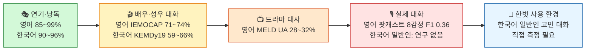
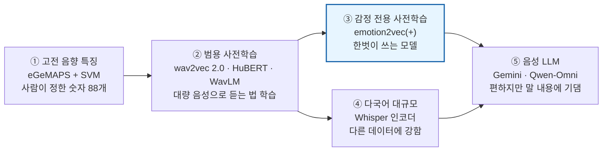
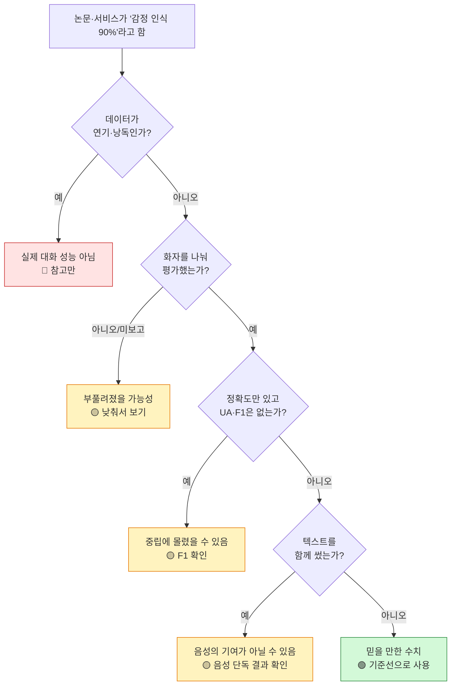
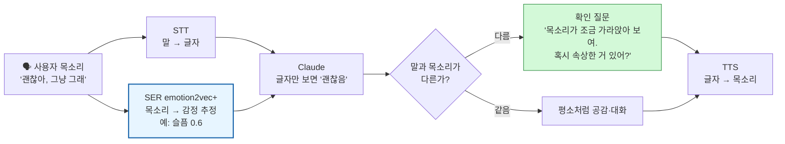

# 한벗 - SER 논문 종합 정리 (영문·국문)

> 노션 원본: https://app.notion.com/p/40f4c3db1a1581668d6dce662ece365c · 마지막 동기화 2026-11-06

> 💡 **한 줄 결론**: 음성 감정 인식 성능은 **모델보다 데이터 조건**이 더 크게 좌우함. 연기·낭독 데이터는 90%대, 실제 대화는 영어·한국어 모두 **4감정 60%대, 8감정 30%대**로 떨어짐. 한벗은 emotion2vec+를 "감정 판정기"가 아닌 "추정 신호"로 쓰고, 한국어 대화 데이터로 직접 성능을 재야 함.

> 🧭 **이 페이지 보는 법**
>
> - 개별 논문 정리는 [영어 논문 페이지](https://app.notion.com/p/40f4c3db1a1581dda509f3768679de56)(영문 10편 + 참고 1편), [한국어 논문 페이지](https://app.notion.com/p/40f4c3db1a1581458a09dddef2a8dc23)(국문 10편)에 있음
> - 이 페이지는 21편을 **모델 → 데이터 → 조건별 결과** 순서로 묶어서 비교함
> - **PART A 영문**, **PART B 국문**, **PART C 전체 종합·한벗 적용**으로 나뉨
> - 표의 동그라미 번호(①, ⑥ 등)는 각 논문 페이지의 번호와 같음. 국문은 **K①**처럼 앞에 K를 붙임

### 📖 이 페이지에서 쓰는 지표

- **정확도(WA)**: 전체 중 맞힌 비율. 많은 감정(중립 등)만 맞혀도 높게 나옴.
- **UA**: 감정별 정답률의 평균. 감정 수가 불균형해도 공정함.
- **F1 / macro-F1**: 감정마다 "놓치지 않음"과 "헛짚지 않음"을 함께 본 점수를 평균한 값. 드문 감정을 못 맞히면 크게 떨어짐.
- **CCC**: 정서가·각성 같은 점수 예측의 일치도. 1이면 완벽, 0이면 무관.
- **화자 분리 평가**: 시험에 나오는 사람의 목소리를 학습에 쓰지 않음. 처음 듣는 사람에게 통하는지 보는 엄격한 방식.
- **교차 코퍼스**: 학습에 쓰지 않은 다른 데이터셋으로 시험함.
- 서로 다른 지표·감정 수끼리는 직접 비교하면 안 됨. 아래 표에는 항상 지표와 감정 수를 함께 적음.

---

## 🖼️ 그림 한 장으로 보기: 데이터가 실제에 가까울수록 성능이 떨어짐

왼쪽(초록)에서 오른쪽(빨강)으로 갈수록 감정이 약하게 드러나고 성능이 떨어짐. 지표와 감정 수가 논문마다 달라 대략적인 흐름으로만 봐야 함.

---

# 🇺🇸 PART A. 영문 논문 종합

이론·기초 4편(①②③⑤) + 참고 ④ + 최신 기술 6편(⑥~⑪)

## A-1. 어떤 모델을 쓰는가

시간 순서대로 모델이 발전해 온 흐름. 파란 상자가 한벗이 쓰는 계열임.

| 모델 계열 | 대표 모델 | 대표 결과 (논문) | 특징 |
| --- | --- | --- | --- |
| 고전 음향 특징 + 분류기 | eGeMAPS(88개 특징) + SVM | 각성 UAR 약 80%, 정서가 약 66% (2분류, ③) | 해석 쉬움, 가벼움 |
| 사전학습 없는 딥러닝 | CNN14, FBANK 기준선 | SUPERB 감정 35.4% (⑥) · 사전학습 모델보다 낮음 (⑤) | 데이터 많이 필요 |
| 범용 사전학습 음성 모델 | wav2vec 2.0, HuBERT, WavLM | SUPERB 감정: wav2vec 2.0 Base 63.4% → HuBERT Large 67.6% → **WavLM Large 70.6%** (⑥) · 정서가 CCC .638 (⑤) | 현재 표준 |
| **감정 전용 사전학습** | **emotion2vec** (한벗: emotion2vec+) | IEMOCAP WA **71.8%**, 9개 언어 모두 최고 (⑦) · 드라마 대화 UA 27~28% | 분류기만 붙여도 됨 |
| 다국어 음성 인식 인코더 | Whisper large v3 | 32개 데이터 중 23개 1위, 처음 보는 데이터 평균 **52.0%** (⑧) | 다른 데이터에 강함 |
| 음성 + 텍스트 앙상블 | Whisper·WavLM·HuBERT + RoBERTa·Llama 2 | 자연 대화 8감정 macro-F1 **0.357** (대회 1위, ⑨) | 무겁고 비쌈 |
| 음성 LLM (무학습) | Gemini 2.5, Qwen-Omni, Qwen2-Audio, Audio Flamingo 3 | 전체 평균 최고 35.7% (⑩) · 30개 데이터 모두 전용 모델보다 낮음 (⑪) | 말 내용에 기댐 |

> 🔎 **모델에서 보이는 흐름**
>
> - 사전학습이 성능의 핵심임. 사전학습 없음 35% → 사전학습 63~71% (⑥).
> - 같은 IEMOCAP에서 emotion2vec(71.8%)과 WavLM Large(70.0\~70.6%)의 차이는 1\~2%p로 작음.
> - 처음 보는 데이터에서는 다국어로 대량 학습한 Whisper가 가장 강했음(⑧). emotion2vec은 이 비교에 들어가지 않음.
> - 음성 LLM은 편하지만 목소리 단서를 잘 못 씀. 단서가 없으면 "중립"으로 쏠림(⑩).

## A-2. 어떤 데이터를 쓰는가

| 데이터 | 종류 | 언어 | 쓰인 논문 | 대표 결과 |
| --- | --- | --- | --- | --- |
| TESS, eNTERFACE, RAVDESS, EmoDB 등 | 배우 연기 | 영어·독일어 등 | ③⑦⑧ | **85~99%** |
| IEMOCAP | 배우 대화(대본+즉흥), 10명 | 영어 | ⑤⑥⑦⑧ | 4감정 WA·UA **71~74%** |
| MELD | 드라마 "프렌즈" 대사 | 영어 | ⑦⑧ | 7감정 UA **28~32%** |
| MSP-Podcast | 실제 팟캐스트 (자연 대화) | 영어 | ⑤⑦⑧⑨ | 8감정 macro-F1 **0.36** (⑨) · UA 22% (⑧) · 정서가 CCC .61~.64 (⑤⑨) |
| VENEC | 5개국 배우 연기 | 영어 | ① | 사람끼리 같은 감정을 고른 비율 25% (31개 선택지) |
| 다국어 벤치마크 (EmoBox 32개, VoxEmo 35개) | 대부분 연기 | 14~15개 언어 | ⑧⑪ | **한국어 없음** |

## A-3. 조건에 따라 결과가 어떻게 달라지는가

| 조건 | 이렇게 하면 | 결과 | 근거 |
| --- | --- | --- | --- |
| 데이터 종류 | 연기 → 배우 대화 → 드라마 → 팟캐스트 | 99% → 74% → 32% → 22% (UA) | ⑧ |
| 처음 보는 데이터 | 같은 데이터 → 다른 데이터로 시험 | 73.5% → 52.0% (Whisper) · 정서가 30% 하락 | ⑧, ⑤ |
| 감정 차원 | 각성 vs 정서가 | 각성 80% vs 정서가 66% · 정서가가 늘 더 어려움 | ③ |
| 사전학습 | 없음 → 있음 | 35% → 71% | ⑥ |
| 텍스트 추가 | 자연 대화에 받아쓴 텍스트를 더함 | 대회 상위 팀 다수가 사용, 성능 향상 | ⑨, ⑪ |
| 텍스트 추가 | 말과 목소리가 다를 때 텍스트를 더함 | 오히려 하락 (34.0% → 19.8%) | ⑩ |
| 잡음 | 웃음·기침을 말소리 크기로 섞음 | 정서가 CCC .278 하락 | ⑤ |
| 화자 | 같은 모델, 사람별로 봄 | 일부 화자는 모든 모델이 계속 틀림 | ⑤ |
| 음성 LLM | 질문 문구만 바꿈 | 최대 49점 차이 | ⑪ |

> 📌 **PART A 요약**: 최신 모델(WavLM, emotion2vec, Whisper)끼리의 차이는 몇 %p 수준이지만, **연기 → 자연 대화**로 바뀌면 수십 %p가 떨어짐. 자연 대화에서는 음성과 텍스트를 함께 쓰는 쪽이 유리하고, 음성 LLM 하나로는 아직 부족함.

---

# 🇰🇷 PART B. 국문 논문 종합

핵심 6편(K①~K⑥) + 참고 4편(Hi,KIA, KoHMT, Jo·Kwak, Byun). 10편 모두 본문 확인

## B-1. 어떤 모델을 쓰는가

| 모델 계열 | 대표 모델 | 대표 결과 (논문) | 평가 방식 |
| --- | --- | --- | --- |
| 고전 음향 특징 | eGeMAPS | 호출어 4감정 51.0% (Hi,KIA) | 🟢 화자 분리 |
| 스펙트로그램 + CNN | VGG16 | 자유대화 7감정 성인 83.5%, 청소년 73.0% (K③) | 🟡 미보고 |
| Bi-LSTM + 사전학습 오디오 특징 | Bi-LSTM + VGGish / YAMNet | 성우 대화 4감정 F1 **0.59**, 낭독 0.77 (K⑤) · 연기 DB 96.0% (Jo·Kwak) | 🟢 K⑤ / 🔴 Jo |
| wav2vec 2.0 | 영어판, 한국어 미세조정판 | 성우 대화 정서가·각성 CCC .55 (K①) · 호출어 68.6% (Hi,KIA) · 같은 대본 데이터 93.7% (K⑥) | 🟡 / 🟢 / 🔴 |
| HuBERT | HuBERT | CCC .53 (K①) · 음성만 52.8% (KoHMT) | 🟡 / 🟡 |
| **WavLM** | WavLM Large | 성우 대화 4감정 UA **66.3%** (K②) | 🟢 화자 분리 |
| 음성 + 한국어 텍스트 모델 | pko-T5, KcELECTRA, KoELECTRA, Tacotron 임베딩 | KEMDy20 F1 38.4 → 44.2 (음성 추가, K④) · 같은 대본 96.6% (K⑥) · 77.0% (KoHMT) · 96.0% (Byun) | 🟡 / 🔴 |
| emotion2vec / emotion2vec+ | — | **한국어로 평가한 논문 없음** | — |

🟢 화자 분리 평가 · 🟡 화자 분리 미보고 또는 무작위 분할 · 🔴 연기·같은 대본 + 화자 분리 미보고

> 🔎 **모델에서 보이는 흐름**
>
> - 한국어 연구는 대부분 **영어로 사전학습한 모델**을 그대로 가져다 씀(wav2vec 2.0, HuBERT, WavLM). K⑥은 한국어 미세조정이 없는 영어 wav2vec 2.0으로도 93.7%를 냄. 데이터가 쉬웠다는 뜻임.
> - 한국어 텍스트 모델을 더하면 수치가 오름. 다만 같은 대본 데이터에서는 텍스트만으로 94.5%(K⑥)라서 음성의 기여를 알기 어려움.
> - 화자 분리 평가를 한 연구(K②, K⑤, Hi,KIA)는 모두 **50~70%** 구간에 있음.

## B-2. 어떤 데이터를 쓰는가

| 데이터 | 만든 곳 | 종류 | 쓰인 논문 | 대표 결과 |
| --- | --- | --- | --- | --- |
| KEMDy19 (= KESDy19로 보임) | ETRI | 성우 40명 2인 대화 | K①, K②, K⑤ | 4감정 UA 66.3% · F1 0.59 (화자 분리) · CCC .55 (무작위) |
| KESDy18 | ETRI | 성우 30명 문장 낭독, 폰·외장 마이크 | K⑤ | 4감정 F1 0.76~0.77 |
| KEMDy20 | ETRI | **일반인** 자유 대화, 중립·기쁨 약 95% | K④ | 7감정 정확도 87.5%, F1 44.2 (음성+텍스트) |
| AI Hub 감정 태깅 자유대화 (성인·청소년) | NIA | 2인 자유대화, 11개 주제 | K③ | 7감정 성인 83.5%, 청소년 73.0% |
| AI Hub 감정 인식 데이터 | NIA | 앱으로 수집한 상황별 대화 | KoHMT | 7감정 77.0% (결합), 음성만 52.8% |
| AI Hub 감정 음성 (같은 대본 다화자) | NIA | 서로 다른 문장 15,767개를 여러 화자가 읽음 | K⑥ | 7감정 93.7% (음성), 94.5% (텍스트만) |
| 조선대 DB | 조선대 | 200명 짧은 대본 연기, 비공개 | Jo·Kwak | 8감정 96.0% |
| 자체 배우 DB | 광운대 등 | 배우 4명 드라마 대본 | Byun | 4감정 94.9% (음성) |
| Hi,KIA | KAIST·현대차 | 성우 8명 호출어(0.64초) | Hi,KIA | 4감정 68.6%, 사람 63.2% |

## B-3. 조건에 따라 결과가 어떻게 달라지는가

| 조건 | 이렇게 하면 | 결과 | 근거 |
| --- | --- | --- | --- |
| 데이터 종류 | 낭독 → 성우 대화 (같은 연구, 같은 평가) | F1 0.77 → 0.59 | K⑤ |
| 데이터 종류 | 같은 대본·연기 → 자유대화 → 성우 대화(화자 분리) | 93\~96% → 73\~84% → 59\~66% | K⑥, K③, K②·K⑤ |
| 화자 분리 | 무작위 분할 vs 화자 분리 (같은 KEMDy19) | 지표가 달라 직접 비교는 불가. 무작위 분할(K①)은 낙관적으로 봐야 함 | K①, K② |
| 연령 | 성인 → 청소년 | 83.5% → 73.0% (−10%p) | K③ |
| 마이크 | 스마트폰 vs 외장 마이크 | 0.773 vs 0.762, 0.594 vs 0.598 · **차이 거의 없음** | K⑤ |
| 음성 추가 | 텍스트 모델에 음성을 더함 (KEMDy20) | 정확도 87.1 → 87.4, **F1 38.4 → 40.9** | K④ |
| 텍스트 추가 | 음성 모델에 텍스트를 더함 | 52.8% → 77.0% (KoHMT) · 94.9% → 96.0% (Byun) | KoHMT, Byun |
| 데이터 양 | 감정별 50개 → 500개 (음성+텍스트) | 60.5% → 96.6% | K⑥ |
| 감정 종류 | 가장 많이 틀리는 감정 | 기쁨·분노를 중립으로 착각(K②), 사랑스러움(K③), 두려움(Jo) | K②, K③, Jo |

> 📌 **PART B 요약**: 한국어 연구는 데이터 조건이 제각각이라 수치 비교가 어려움. 믿을 만한 기준은 <b>화자 분리 평가를 한 성우 대화 4감정 59~66%</b>임. 90%대는 연기·같은 대본 데이터이면서 화자 분리를 보고하지 않은 경우뿐임. 일반인 자연 대화(KEMDy20)를 음성만으로 평가한 연구는 없음.

---

# 🧩 PART C. 전체 종합과 한벗 적용

## C-1. 영문·국문 비교

| 항목 | 영문 | 국문 |
| --- | --- | --- |
| 연기·낭독 데이터 | 85\~99% | 90\~96% |
| 배우·성우 대화 | IEMOCAP 4감정 71~74% (화자 분리) | KEMDy19 4감정 UA 66%, F1 0.59 (화자 분리) |
| 일반인 자연 대화 | 팟캐스트 8감정 macro-F1 0.36 · 드라마 UA 22~32% | KEMDy20 F1 44 (음성+텍스트) · 음성 단독 연구 없음 |
| 최고 모델 | WavLM·emotion2vec(같은 데이터), Whisper(다른 데이터) | WavLM Large (K②) |
| 텍스트 결합 효과 | 자연 대화에서 도움, 말과 목소리가 다르면 방해 | 수치는 오르지만 같은 대본 데이터에서는 누수 위험 |
| 엄격한 평가 비율 | 대부분 화자 분리 | 10편 중 3편만 화자 분리 |
| emotion2vec 평가 | 영어 + 9개 언어 | **없음** |

## C-2. 이렇게 하면 이렇게 나온다 (핵심 규칙 7가지)

1. **연기·낭독 데이터로 재면 90% 이상이 나옴.** 언어와 모델에 관계없이 같음. 서비스 성능으로 보면 안 됨.
2. **실제 대화로 바꾸면 크게 떨어짐.** 4감정 60%대, 8감정 30%대. 감정이 약하게 드러나기 때문임.
3. **화자를 나누지 않으면 부풀려짐.** 같은 사람·같은 문장이 학습과 시험에 모두 들어가기 때문임.
4. **처음 보는 데이터에서는 20%p 안팎 떨어짐.** 녹음 환경, 화자, 라벨 기준이 달라서임.
5. **감정 종류가 많을수록 낮아짐.** 특히 경멸·혐오·두려움·사랑스러움 같은 드문 감정이 어려움. 가장 흔한 오류는 "중립으로 착각"임.
6. **정서가(좋다/나쁘다)가 각성(들뜸/가라앉음)보다 어려움.** 최신 모델은 정서가를 말의 내용으로 보완함.
7. **텍스트를 더하면 대체로 오르지만 이유를 따져야 함.** 자연 대화에서는 실제 도움이 되고, 대본 데이터에서는 정답이 새는 것일 수 있음. 음성은 드문 감정과 "말과 목소리가 다른" 경우에 기여함.

### 숫자를 볼 때 확인할 순서

예: K⑥ Shin(93.7%)은 첫 질문에서 낭독 데이터라 🔴, K② Hyeon(66.3%)은 끝까지 통과해 🟢.

## C-3. 한벗 적용

### 한벗 안에서 SER이 하는 일

SER은 감정을 단정하지 않고, 말(텍스트)과 목소리가 어긋날 때 확인 질문을 던지는 신호로 씀(⑩ LISTEN, K④ Jeong 근거).

> 🎯 **한벗 조건**: 한국어 · 일반인 · 고민 상담 대화 · 스마트폰 녹음 · emotion2vec+ + Claude
>
> → 21편 중 이 조건을 그대로 평가한 연구는 **없음**. 가장 가까운 근거는 K②(성우 대화, 화자 분리, 4감정 UA 66%)와 K⑤(F1 0.59)임. 일반인 대화는 성우보다 감정이 약하므로 **이보다 낮을 가능성**이 있음(추정).

| 결정할 것 | 권장 | 근거 |
| --- | --- | --- |
| 모델 후보 | emotion2vec+ (현재) vs WavLM Large vs Whisper 인코더를 같은 조건에서 비교 | ⑥⑦⑧, K② |
| 측정 데이터 | KEMDy19(성우 대화, 기존 논문과 비교용) + KEMDy20(일반인 대화) + AI Hub 자유대화(연령대별) | K②, K④, K③ |
| 평가 방식 | 화자 분리 평가, UA·macro-F1 보고, 감정별 정답률과 "중립 착각" 비율 확인 | K②, K④, ⑨ |
| 감정 범주 | 4감정(분노·기쁨·슬픔·중립) 또는 정서가·각성 위주. 세밀한 감정은 음성만으로 무리 | ⑨, K⑤ |
| 시스템 구조 | 전용 SER + Claude 유지. 음성 LLM 하나로 합치지 않음 | ⑩⑪ |
| SER의 역할 | "말은 괜찮다는데 목소리가 가라앉은" 경우처럼 텍스트가 놓치는 신호를 잡음. SER on/off 비교 실험으로 기여 측정 | ⑤⑩, K④ |
| 사용자 대응 | 감정을 단정하지 않고 확인 질문으로 묻기 | ①②, K② |
| 녹음 조건 | 스마트폰 조건은 큰 걱정은 아님. 다만 실제 사용 환경 잡음은 따로 확인 | K⑤, ⑤ |

> ⚠️ **주의**: 위 수치는 모두 논문마다 데이터·감정 수·지표가 다름. 발표나 보고서에서 "한국어 SER 정확도는 몇 %"처럼 한 숫자로 말하지 말고, <b>"성우 대화, 4감정, 화자 분리 기준 UA 66%"</b>처럼 조건을 함께 말해야 함.
