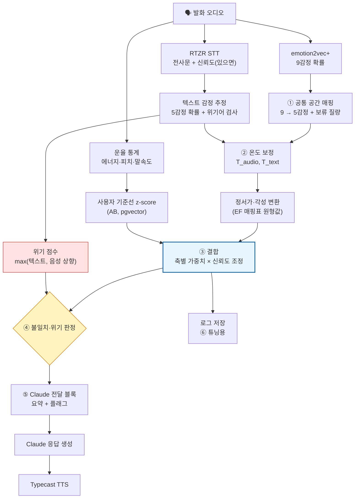

# J. 음성(SER)·텍스트 감정 가중치 설정 방법

> 🔄 **11/6 가중치 수정:** 원문 재확인 후 시작 가중치(글:목소리)를 정서가 0.7:0.3 → **0.65:0.35**, 각성 0.3:0.7 → **0.1:0.9**, 5감정 0.6:0.4 → **0.55:0.45**로 바꿈. 근거: TalTech(Odyssey 2024) 최적 비율 정서가 0.55·각성 0·8감정 0.45, Macary(SLT 2021) 만족/불만 0.69. 본문의 이전 값은 그대로 두었고 상세 근거는 J2_가중치_근거보강.md 참고.

> 작성일: 2026-11-06 · 회의 질문: "방법론 적어놓은 거 있지 않았어? → 감정쪽 SER 가중치 설정 필요"
> 대상: 한벗 (RTZR STT → emotion2vec+ SER → Claude → Typecast TTS)
> 기존 노트와 겹치는 내용(불일치 시 되묻기 규칙, 7가지 핵심 규칙, Kim·Yi·Won 2024, Li SLT 2024, Jeong 2023, 정서가·각성 CCC, EF 매핑표, AB 기준선)은 **다시 정리하지 않고 참조만** 함.
> - `한벗 논문 보강/ser_papers_synthesis.md` C-2·C-3
> - `회의 후속 조사/EF_텍스트단위_감정분류.md` F-6 (매핑표·운용 규칙)
> - `회의 후속 조사/AB_맥락_개인화.md` B-1 (사용자 기준선 z-score)
> - `회의 후속 조사/GH_라벨기준_복합감정.md` H (RECOLA 각성 .65~.80 vs 정서가 .38~.46)

---

## 한 줄 결론

> 💬 **한 줄:** "감정 하나에 가중치 하나"가 아니라 **축마다 다르게** 둠

- **시작 가중치:**
  - 정서가(좋다/나쁘다): 텍스트 **0.7** : 음성 0.3
  - 각성(들뜸/가라앉음): 음성 **0.7** : 텍스트 0.3
  - 5감정 범주: 텍스트 **0.6** : 음성 0.4
- **더하는 단계:**
  1. 온도 보정(calibration)
  2. 확신도(엔트로피)와 STT 품질로 가중치를 조금씩 조정
  3. 사용자 평소 목소리 대비 편차(z-score) 붙이기
- **불일치는 따로:** 평균을 내면 "말은 괜찮은데 목소리는 가라앉은" 신호가 묻힘
  - → 평균과 별도로 계산해 **되묻기 플래그**로 Claude에 넘김
- **위기:** 둘 중 높은 쪽을 따름. **음성이 위험도를 낮추는 일은 없게** 함
- **역할:** 계산은 코드, Claude에는 요약된 결과와 플래그만 줌
- **재조정:** KEMDy20·AI Hub로 **화자 분리** 격자 탐색해서 다시 정함 (지표: UA + 부정 감정 재현율)

---

## 1. 쉬운 개념 설명

### 왜 가중치가 필요한가

한벗은 같은 발화에서 감정 추정치를 두 개 얻음.

- **텍스트 쪽**: STT 전사문 "괜찮아, 그냥 그래" → 단어상 중립·약한 긍정
- **음성 쪽**: emotion2vec+ → 슬픔 0.55, 중립 0.25 …

둘이 같으면 문제없음. 다르면 "어느 쪽을 얼마나 믿을지"를 정해야 함. 이 비율이 **가중치**임.

### 핵심 사실 3가지 (근거는 2·3장 표)

- **① 텍스트는 정서가, 음성은 각성에 강함**
  - IEMOCAP 화자 분리(LOSO) 정서가 CCC: 텍스트 **0.405** vs 음성 0.204
  - 각성 CCC: 음성 **0.543** vs 텍스트 0.382 (Atmaja·Akagi 2021)
  - 기존 노트 RECOLA(음성 각성 .65 vs 정서가 .38)와 방향이 같음
  - → **축마다 가중치를 다르게 두는 게 맞음**
- **② 섞는 방식의 차이는 작고, 섞는 것 자체의 효과는 큼**
  - IEMOCAP: 음성 56.0%, 텍스트 55.2% → 결합 **63.9~65.1%** (Pepino 외 2020)
  - 초기·후기 방식 간 차이는 1%p 안팎
  - → 모델을 다시 학습하지 않는 **후기 결합(late fusion)**으로 충분함
- **③ 확률을 그대로 섞으면 안 됨**
  - 모델마다 "자신감" 크기가 다름 (과신하는 모델이 결합을 장악)
  - → 섞기 전에 **온도 보정**으로 확률 크기를 맞춤 (Guo 외 2017, Chou 외 2023)

### 용어

| 용어 | 뜻 | 한벗에서 |
|---|---|---|
| 초기 결합 (early fusion) | 음성 특징 + 텍스트 특징을 이어 붙여 모델 하나를 학습 | 학습 데이터·GPU 필요 → 지금 단계에선 안 씀 |
| 후기 결합 (late fusion) | 각 모델의 **출력 확률**을 나중에 섞음 | **채택.** emotion2vec+와 텍스트 분류기를 그대로 둔 채 섞음 |
| 하이브리드 | 일부 층은 합치고 출력도 합침 | 연구용 |
| 게이트/어텐션 결합 | 입력마다 "어느 쪽을 볼지"를 신경망이 정함 | 학습 필요, 후순위 |
| 동적 가중치 | 확신도·품질에 따라 발화마다 가중치를 바꿈 | **채택** (엔트로피 + STT 품질) |
| 온도 보정 | 확률을 `softmax(logit / T)`로 펴거나 좁혀 실제 정답률에 맞춤 | **채택** (모달리티별 T 1개) |
| LLM 결합 | 수치를 글로 바꿔 LLM 프롬프트에 넣고 LLM이 판단 | **부분 채택** — 계산은 코드, 해석·말투는 Claude |
| 정서가 (valence) / 각성 (arousal) | 좋다–나쁘다 / 차분–흥분 | 외로움·우울(저각성 부정)을 잡는 축 (EF 참조) |

---

## 2. 결합 방식 비교표

| 방식 | 하는 일 | 장점 | 단점 | 숫자 근거 | 한벗 판단 |
|---|---|---|---|---|---|
| 텍스트만 | 전사문으로만 감정 판단 | 단순, Claude가 이미 함 | "괜찮아"+슬픈 목소리 놓침, STT 오류에 약함 | KEMDy20 F1 38.4 (Jeong 2023) · WER 40%면 약 10%p 하락 (Li 2024) | 기준선(E0) |
| 음성만 | SER 결과로만 판단 | 말 내용과 무관한 신호 | 정서가 약함, 자연 대화에서 낮음 | 독거노인 3감정 64.7%, 6감정 51.4% (Kim·Yi·Won 2024) | 기준선(E1) |
| 초기 결합 | 특징 연결 후 공동 학습 | 상호작용 학습 가능 | 재학습 필요, 데이터 많이 필요 | IEMOCAP 65.1%, MSP-Podcast 58.2~59.1% (Pepino 2020) | 보류 |
| 후기 결합 – 고정 가중치 | `w_t·p_t + w_a·p_a` | 설명 쉬움, 튜닝 쉬움 | 발화마다 품질이 달라도 같은 비율 | Pepino 2020: "시스템당 스칼라 가중치 1개" 방식은 학습형 결합층보다 **약간 낮음**(수치 미보고) | **시작점** |
| 후기 결합 – 학습형 (스태킹) | 두 모델의 logit을 작은 분류기(LR·SVM)에 넣음 | 데이터로 최적 비율 학습 | 라벨 데이터 필요, 과적합 위험 | IEMOCAP 63.9% (Pepino 2020) · 정서가 CCC 0.553, 각성 0.579 (Atmaja 2021, LOSO) | 2단계 튜닝 후보(E9) |
| 후기 결합 – 축별 가중치 | 정서가·각성마다 다른 비율 | 근거 있는 비대칭 반영 | 축 변환표 필요 | 텍스트 정서가 .405 vs 음성 .204 / 음성 각성 .543 vs 텍스트 .382 (Atmaja 2021) | **채택** |
| 동적 – 확신도·엔트로피 | 엔트로피 높으면 그 모달리티 비중↓ | 실시간 품질 반영, 학습 불필요 | 보정 안 된 확률이면 오작동 | 엔트로피 기반 대체 규칙: IEMOCAP UA 65.36→65.81, MSP-IMPROV 52.22→53.24 (Chua 2025) | **채택(약하게)** |
| 동적 – 불확실성 분포 학습 | 모달리티별 분산을 학습해 가중치로 | 이론적으로 가장 깔끔 | 구현 난도 높음 | COLD Fusion (Tellamekala 2024) — 음성·영상, 수치 확인 필요 | 장기 |
| 2단계 (텍스트 → 음성) | 텍스트로 긍정/부정/중립, 그 안에서 음성으로 세부 감정 | 한국 노인 데이터에서 최고 | 텍스트가 "중립"이면 음성 부정 신호가 묻힘 | 6감정 69.3% (Kim·Yi·Won 2024) | 비교 실험(E8) |
| LLM 결합 | 음성 특징을 글로 써서 LLM에 줌 | 구조 변경 없음, 맥락과 함께 판단 | 큰 LLM은 이득이 작음, 재현성 낮음 | LLaMA-3-8B zero-shot 35.1→44.2, **Claude 3.5 Sonnet 58.99→59.23** (SpeechCueLLM 2024) | 해석만 맡김 |

> 📌 **읽는 법**
>
> - Claude 3.5 Sonnet은 음성 설명을 넣어도 IEMOCAP zero-shot F1이 **0.24점**만 오름 (SpeechCueLLM)
> - → 큰 LLM에 수치를 주고 "알아서 섞어"하면 거의 반영 안 될 수 있음
> - → **결합은 코드에서, Claude에는 결론과 플래그를 분명히** 주는 편이 안전함

---

## 3. 논문 표

검증 수준: 🟢 본문·표 확인 · 🟡 초록·요약만 확인 · 🔴 수치 확인 필요

| # | 논문 | 연도·학회 | 방법 | 핵심 숫자 | 한벗 시사점 | 링크 |
|---|---|---|---|---|---|---|
| J1 | Pepino, Riera, Ferrer, Gravano. *Fusion approaches for emotion recognition from speech using acoustic and text-based features* 🟢 | 2020 · ICASSP | openSMILE 음성 + BERT 텍스트. 초기 결합 3종 vs 후기 결합(두 logit을 이어 붙여 softmax 층 학습) | IEMOCAP AvRec: 음성 56.0, 텍스트(BERT) 55.2, 초기 결합 64.7~65.1, 후기 결합 63.9. MSP-Podcast: 45.7 / 51.0 / 56.5~59.1 / 58.0. 스칼라 가중치 방식은 약간 낮음. **IEMOCAP 기본 분할은 텍스트 성능을 낙관적으로 추정**한다고 경고 | 결합 자체로 +8~13%p. 방식 차이는 작음 → 후기 결합으로 시작. 대본 데이터는 텍스트 누수 주의 | [arXiv 2403.18635](https://arxiv.org/abs/2403.18635) · DOI 10.1109/ICASSP40776.2020.9054709 |
| J2 | Atmaja, Akagi. *Two-stage dimensional emotion recognition by fusing predictions of acoustic and text networks using SVM* 🟢 | 2021 · Speech Communication 126:9–21 | 음성·텍스트 DNN을 따로 학습 → 예측값을 SVM으로 결합(후기). 정서가·각성·지배성 | IEMOCAP LOSO CCC — 정서가: 음성 .204, 텍스트 .405, 결합 .553 / 각성: 음성 .543, 텍스트 .382, 결합 .579. MSP-IMPROV LOSO — 정서가: 음성 .206, 텍스트 .192, 결합 .291 / 각성: .503 / .189 / .570. 후기 결합이 기존 초기 결합보다 높음 | **축별 가중치의 직접 근거.** 정서가는 텍스트, 각성은 음성. 단 MSP-IMPROV처럼 텍스트가 약한 데이터에선 정서가도 음성이 비슷 → 데이터로 재조정 필요 | [arXiv 2210.14495](https://arxiv.org/abs/2210.14495) |
| J3 | Wagner 외. *Dawn of the transformer era in speech emotion recognition: closing the valence gap* 🟡 | 2023 · IEEE TPAMI 45(9) | wav2vec 2.0·HuBERT 미세조정으로 정서가·각성·지배성 회귀 | MSP-Podcast 정서가 CCC **.638** (텍스트 없이). 정서가 향상은 트랜스포머가 **암묵적으로 배운 언어 정보** 덕분이라고 분석. 성별엔 공정, 개별 화자엔 불공정 | 큰 음성 모델은 정서가도 어느 정도 잡지만 그건 "말 내용"을 엿듣는 것 → 한국어 고령 화자에선 근거 없음. 화자별 편차 큼 → 기준선 보정 필요 | [arXiv 2203.07378](https://arxiv.org/abs/2203.07378) |
| J4 | Li, Bell, Lai. *SER with ASR Transcripts: WER and Fusion Techniques* 🟢 (기존 E9) | 2024 · IEEE SLT | ASR 11종 전사문 + 음성 결합 | WER 약 12%면 정답 전사와 차이 미미, 약 40%면 텍스트 약 10%p 하락, 음성과 결합 시 하락폭 약 4%p | **STT 품질이 낮을 때 텍스트 가중치를 낮추는 규칙**의 근거 | [arXiv 2406.08353](https://arxiv.org/abs/2406.08353) |
| J5 | Kim, Yi, Won. *SER in People at High Risk of Dementia* 🟢 (기존 D7) | 2024 · Dementia and Neurocognitive Disorders 23(3) | 독거노인 133명 실제 발화. 텍스트(KPFBERT)로 3극성 → 음성으로 세부 감정 | 음성 6감정 51.4%, 음성 3감정 64.7%, 텍스트 3감정 79.8%, 2단계 6감정 69.3% | 고령 한국어에서 **극성(정서가)은 텍스트가 15%p 앞섬** → 정서가 텍스트 0.7의 국내 근거 | [DOI](https://doi.org/10.12779/dnd.2024.23.3.146) |
| J6 | Jeong 외 (KEMDy20) (기존 `ser_korean_papers.md` ④) | 2023 | 텍스트 + 직전 2발화 맥락 + 음성 | F1 텍스트 38.43 → +맥락 39.13 → +음성+맥락 44.16 | 한국어 일반인 대화에서 음성 추가 효과 +5.7 F1. KEMDy20을 튜닝 데이터로 쓸 근거 | 기존 노트 참조 |
| J7 | Chua, Wong, Chen, Miao. *Speech Emotion Recognition via Entropy-Aware Score Selection* 🟢 | 2025 · arXiv 2508.20796 (APSIPA ASC 2025로 소개됨, 확인 필요) | wav2vec2 4감정 + Whisper 전사 → RoBERTa 감성. 음성 예측의 **엔트로피 ≥ τe 이고 varentropy ≤ τv면** 텍스트 감성으로 대체. 임계값은 학습 데이터 75/25 백분위 ±10에서 격자 탐색 | IEMOCAP UA 65.36 → 65.81, MSP-IMPROV UA 52.22 → 53.24. 임계값 수치는 미보고 | 엔트로피 기반 동적 가중치는 **효과가 작고(+0.5~1%p) 안정적** → "약하게" 적용. 임계값은 백분위로 잡는 방식을 차용 | [arXiv](https://arxiv.org/abs/2508.20796) |
| J8 | Byeon, Oh, Yu. *A Dynamic Confidence-Weighted Ensemble of Speech and Text Models for Emotion Recognition* 🟡 | 2026 · ICEIC (IEEE) | SER + 텍스트 분류기. 가중치 = ① 사전에 잰 **감정 클래스별 난이도** × ② 실시간 확신도 | 초록에 수치 없음 🔴 | 국내 그룹. "**감정마다 다른 가중치**"(예: 불안은 음성이 약하니 텍스트 비중↑) 아이디어 근거 | [기록](https://pure.seoultech.ac.kr/en/publications/a-dynamic-confidence-weighted-ensemble-of-speech-and-text-models-/) · DOI 10.1109/ICEIC69189.2026.11386277 |
| J9 | Guo, Pleiss, Sun, Weinberger. *On Calibration of Modern Neural Networks* 🟡 | 2017 · ICML | 온도 보정: 검증셋에서 스칼라 T 하나를 NLL 최소화로 맞춤 | 예측 클래스(정확도)는 그대로, 확률만 실제 정답률에 맞춰짐 (구체 ECE 수치는 이 문서에 인용 안 함) | 결합 전 모달리티별 T 1개씩 맞추기. 구현 10줄 수준 | [arXiv 1706.04599](https://arxiv.org/abs/1706.04599) |
| J10 | Chou, Goncalves, Leem, Lee, Busso. *The Importance of Calibration: Rethinking Confidence and Performance of Speech Multi-label Emotion Classifiers* 🟡 | 2023 · Interspeech | SER 다중 라벨용 온도 보정 + 클래스 균형 손실 | 검색 요약상 ECE **15.43~20% 개선** 🔴 (원문 표·데이터셋 미확인) | SER에서도 보정이 신뢰도를 개선함 → 보정 후 엔트로피를 써야 동적 가중치가 의미 있음 | [ISCA](https://www.isca-archive.org/interspeech_2023/chou23_interspeech.html) |
| J11 | Tellamekala 외. *COLD Fusion: Calibrated and Ordinal Latent Distribution Fusion for Uncertainty-Aware Multimodal Emotion Recognition* 🟡 | 2024 · IEEE TPAMI 46(2) | 모달리티별 잠재 분포의 분산을 **불확실성 점수**로 학습해 결합 가중치로 사용. 분산이 오류를 따르도록 보정 제약 | 음성·영상(AVEC 2019, IEMOCAP 등). 수치 확인 필요 🔴 | "보정된 불확실성으로 가중치를 정한다"는 원리의 학술 근거. 한벗은 이를 엔트로피로 단순화 | [arXiv 2206.05833](https://arxiv.org/abs/2206.05833) |
| J12 | Wu, Gong, Ai, Shi, Donbekci, Hirschberg. *Beyond Silent Letters: Amplifying LLMs in Emotion Recognition with Vocal Nuances* (SpeechCueLLM) 🟢 | 2024 · arXiv 2407.21315 | 음량·피치·말 속도를 **화자별 분위수**로 "높음/낮음" 같은 말로 바꿔 프롬프트에 넣음 | IEMOCAP 가중 F1: LoRA LLaMA-2 70.11 → 72.60, zero-shot LLaMA-3-8B 35.14 → 44.18, **Claude 3.5 Sonnet 58.99 → 59.23**. 직전 3발화에만 붙일 때 최고. 특징을 다 넣으면 오히려 낮음(71.46) | ① 숫자 대신 **"평소보다 낮음" 같은 말**로 전달 ② 화자별 기준(=AB의 z-score)이 효과적 ③ 정보는 적게 ④ 큰 LLM에 결합을 맡기면 이득이 작음 | [arXiv](https://arxiv.org/abs/2407.21315) |

> 🔎 **표에서 보이는 흐름**
> - 축별 비대칭(텍스트=정서가, 음성=각성)은 영어 2개 데이터(J2), 한국 노인(J5), 기존 RECOLA 결과에서 반복됨.
> - 결합 방식 간 차이(1%p)보다 **데이터 분할·보정·STT 품질** 같은 조건 차이가 더 큼(J1, J4).
> - 동적 가중치는 이득이 작지만(J7) 실패를 막는 역할이 큼. 한벗에선 정확도보다 "놓치지 않기"가 목적이라 채택함.
> - "말과 목소리 불일치"를 정면으로 다룬 결합 논문은 못 찾음 → 한벗의 불일치 플래그는 **설계안**이며 검증 대상임.

---

## 4. 한벗 결합 방법

### 전체 흐름



### 4-1. 공통 공간 매핑 (EF 매핑표 재사용)

**범주**: EF F-6 매핑표를 그대로 씀.

| 서비스 5감정 | emotion2vec+ 9 |
|---|---|
| 기쁨 | happy |
| 슬픔 | sad |
| 분노 | angry + disgusted (확률 합) |
| 불안 | fearful |
| 중립 | neutral |
| 판정보류 (결합에서 제외, 따로 기록) | surprised + other + unknown |

- 보류 질량(`hold`)을 뺀 5개를 다시 합 1로 정규화함
  - `hold`가 크면 음성 신뢰도를 낮춤 (4-3)
- 텍스트 쪽도 같은 5감정 확률을 내게 함
  - 경량 한국어 분류기 또는 Claude 사전 호출 + enum 고정
  - EF E8: 라벨 수가 많으면 LLM이 라벨을 지어냄

**정서가·각성 원형값**

- **출처:** EF 표의 박인조·민경환(2005) 대표 단어 값
- **변환:** 정서가 −1~+1, 각성 0~1로 옮긴 **설계값**
  - `v = (V−3)/2`, `a = (A−1)/4`
- **주의:** 원 척도가 1~5인지 원문 대조 필요(EF 🔴) → **상대 비교용**으로만 씀

| 5감정 | 대표 단어 V/A | 정서가 v | 각성 a |
|---|---|---|---|
| 기쁨 | 기쁘다 4.24/3.97 | +0.62 | 0.74 |
| 슬픔 | 슬프다 1.92/2.46 | −0.54 | 0.37 |
| 분노 | 화나다 1.55/4.22 | −0.73 | 0.81 |
| 불안 | 불안하다 1.79/3.49 | −0.61 | 0.62 |
| 중립 | (해당 단어 없음) | 0.00 | 0.40 (설계값) |

발화의 정서가 = Σ p(감정)·v(감정), 각성 = Σ p(감정)·a(감정).

> ⚠️ **각성 값 주의**
>
> - 범주 확률에서 뽑은 각성은 거칠음 (중립 0.40에 끌려감)
> - → **운율 통계(에너지·피치·말 속도)의 사용자 기준선 z-score**를 함께 봄
> - 차원형 음성 모델(J3 계열) 추가는 W3 이후 비교 실험 후보 (라이선스 확인 필요)

### 4-2. 보정 (calibration)

- **무엇을**: 모달리티마다 온도 T 하나. `p_cal = softmax(log p / T)`
  - emotion2vec+가 확률만 주면 `log p`를 logit처럼 씀
  - 상수 차이는 softmax에서 사라짐
- **어디서 맞추나**: 5감정으로 매핑한 뒤의 확률로 맞춤
  - KEMDy20(또는 AI Hub)의 **화자 분리 검증셋**에서 NLL 최소화
  - 테스트셋은 건드리지 않음
- **확인 지표**: ECE(15구간), 신뢰도 도표
  - T > 1이면 과신, T < 1이면 과소신이었다는 뜻
- **텍스트가 Claude 사전 호출이면**: LLM이 말로 낸 확신도는 그대로 안 씀
  - 검증셋의 구간별 실제 정답률로 바꿈 (히스토그램 구간 보정)
  - 확률 분포가 없으면 "top1 + 확신도 등급"만 쓰고 엔트로피 조정은 생략
- **왜 먼저 하나**: 4-3의 엔트로피 조정은 "확률이 믿을 만하다"는 전제에서만 의미 있음 (J10, J11)

### 4-3. 결합 규칙과 시작 가중치

**기본 가중치 (시작값)**

| 대상 | 텍스트 w_t | 음성 w_a | 근거 |
|---|---|---|---|
| 정서가 | **0.7** | **0.3** | J2 IEMOCAP LOSO .405 vs .204 (약 2:1) · J5 극성 텍스트 79.8 vs 음성 64.7 · GH 음성 정서가 .38 |
| 각성 | **0.3** | **0.7** | J2 .543 vs .382 · GH 음성 각성 .65 |
| 5감정 범주 | **0.6** | **0.4** | 정서가 우세 + 슬픔/분노 구분은 각성(음성) 몫 → 중간값. J1에서 두 모달리티 단독 성능이 비슷(56.0 vs 55.2) |
| 범주 중 **불안** | 0.7 | 0.3 | EF: SER 단독 불안이 약함. J8의 "클래스별 난이도" 아이디어 |

**범주를 섞는 계산**

- **방식:** 로그 선형(가중 기하평균), `p ∝ p_t^w_t · p_a^w_a`
- **장점:** 산술평균보다 "한쪽이 강하게 아니라고 하는 감정"을 더 깎아 줌
- **확인:** 산술평균과의 비교는 실험 E3 변형으로 확인

**발화별 조정 (곱한 뒤 다시 합 1로 정규화)**

| 조정 | 조건 | 곱하는 값 | 근거 |
|---|---|---|---|
| 확신도 | 정규화 엔트로피 Hn (0~1) | `rel = 0.5 + 0.5·(1 − Hn)` → 0.5~1.0 | J7, J11. 바닥 0.5를 둬 한쪽이 완전히 꺼지지 않게 함 |
| STT 품질 | STT 신뢰도 < 0.6 또는 추정 WER 높음 | 텍스트 × 0.5 | J4 (WER 40% → 텍스트 −10%p) |
| 짧은 말 | 어절 ≤ 2 ("응", "그래") | 텍스트 × 0.7 | 단어 정보가 거의 없음 (설계값) |
| 짧은 음성 | 발화 < 1.0초 | 음성 × 0.5 | 설계값. Hi,KIA 0.64초 4감정 68.6%는 연기 호출어라 일반화 어려움 |
| 판정보류 | `hold` > 0.4 | 음성 × 0.5 | EF: other/unknown/surprised면 텍스트 위주 |
| 기준선 미완성 | 사용자 기준선 표본 < 20발화 | 음성 × 0.8 | AB: 기준선 없이 원점수는 화자차가 큼(J3도 화자 불공정 보고) |
| 세션 내 부정당함 | 되묻기에 사용자가 2회 이상 "아니야" | 이번 세션 음성 × 0.8 | 설계값. 사용자 말을 존중 |

최종 가중치는 0.15~0.85로 자름(한쪽 독점 방지).

**사용자 기준선 (AB 재사용)**

- **저장:** 사용자별 평소 값의 평균·표준편차
  - 음성 정서가·각성, 에너지·피치·말 속도
- **계산:** 매 발화 z-score
- **쓰임:** 결합값은 안 바꿈. **불일치 판정과 Claude 전달 문구**에만 씀
  - 예: "평소보다 목소리가 가라앉음"
- **이유:** 평균을 바꾸면 해석이 어려워짐
  - SpeechCueLLM(J12)도 화자별 분위수를 "말"로 바꿔 주는 방식이 효과적이었음

### 4-4. 불일치 처리 → 되묻기, 위기 우선

**결합값(평균)과 불일치 플래그를 따로 계산함.** 평균만 보면 "괜찮아 + 슬픈 목소리"가 중립 쪽으로 묻힘(4-7 예시에서 실제로 중립 0.49가 됨).

**되묻기 조건 (하나라도 만족하면 `ask_back = 후보`)**

| 코드 | 조건 | 의미 |
|---|---|---|
| D1 극성 불일치 | 텍스트 top1과 음성 top1의 극성(긍정/중립/부정)이 다르고, 두 top1 확률이 모두 ≥ 0.40 | 둘 다 꽤 확신하는데 서로 다름 |
| D2 숨은 부정 | 텍스트 정서가 ≥ −0.10 인데 음성 정서가 z ≤ −1.5 또는 (에너지 z ≤ −1.5 그리고 피치 z ≤ −1.0) | "괜찮아"인데 평소보다 가라앉음 (외로움·우울 누락 방지, EF 위험 1번) |
| D3 애매 | 결합 top1−top2 차이 < 0.10 이고 결합 부정 확률(슬픔+분노+불안) ≥ 0.35 | 사람도 갈릴 수준(GH: MSP-Podcast 18% 합의 실패) |
| D4 고각성 부정 음성 | 텍스트 중립, 음성 분노/불안 ≥ 0.45 (EF 운용 규칙) | 목소리가 불편해 보임 |

**되묻기 억제 (하나라도 해당하면 되묻지 않고 공감만)**

- 직전 3턴 안에 이미 되물었음 (세션당 최대: 10턴에 2회)
- 음성 신뢰도 조정 후 w_a < 0.25 (짧은 음성·보류·잡음)
- 사용자가 이번 세션에서 되묻기를 2회 부정함
- 위기 흐름이 진행 중 (위기 흐름이 우선)

**EF 운용 규칙과의 관계**

- "SER 중립 + 텍스트 정서가 낮음 → 슬픔(저각성) 채택" → 결합 후 라벨 보정 규칙으로 그대로 둠
- "SER = other/unknown/surprised → 텍스트만" → 위 `hold` 조정으로 구현됨

**위기 우선 (crisis override)**

```
risk_final = max(risk_text, risk_audio_raise)
```

- `risk_text`: 위기어·자해 표현·Claude 위험 분류 (기존 안전 노트). **음성 결과와 무관하게 계산**.
- `risk_audio_raise`: 음성이 위험도를 **올리기만** 함. 예: 울음 감지, 고각성 부정 + 평소 대비 큰 편차 → 한 단계 상향(안부 확인 질문 강화). 
- **금지**: "죽고 싶어"를 차분한 목소리로 말했다고 위험도를 낮추는 것
  - 결합 가중치는 위기 판정에 쓰지 않음
  - 직전 6~10턴에 위기 신호가 있었으면 "괜찮아"여도 위기 상태 유지

### 4-5. Claude에 넘길 것 vs 코드에서 할 것

| 코드에서 (결정적·테스트 가능) | Claude에게 (해석·말하기) |
|---|---|
| 9→5 매핑, 온도 보정, 정서가·각성 변환 | 결합 결과를 맥락(직전 6~10턴)과 함께 해석 |
| 축별 가중치·신뢰도 조정·결합 | 되묻기 문장 만들기(단정하지 않게, 한 번만) |
| 사용자 기준선 z-score | "목소리"를 근거로 말할지, 말한다면 어떻게 |
| 불일치 플래그 D1~D4, 되묻기 횟수 제한 | 사용자가 부정하면 수용하고 넘어가기 |
| 위기 점수 max 규칙, 안전 흐름 트리거 | 위기 시 정해진 안전 응답 틀 안에서 말투 조정 |
| 로그 저장(튜닝용) | 응답 후 감정 라벨 1개 출력(enum 5 + 보류) → 로그 |

**이유**

- J12: 큰 LLM은 음성 설명을 받아도 감정 판단이 거의 안 바뀜 (**+0.24점**)
- 같은 입력에 같은 결과가 나와야 가중치를 튜닝할 수 있음

**전달 블록 예시** (시스템 프롬프트 뒤, 사용자 발화 바로 앞에 붙임)

```xml
<emotion_signal turn="12">
  <transcript stt_conf="0.93">괜찮아, 그냥 그래</transcript>
  <text_estimate>중립 0.60 · 슬픔 0.17 · 기쁨 0.15 (정서가 -0.05)</text_estimate>
  <voice_estimate>슬픔 0.49 · 중립 0.29 (정서가 -0.32)
    평소 대비: 목소리 정서가 많이 낮음(z -2.1), 에너지 낮음(z -1.6), 말 속도 느림(z -1.2)
  </voice_estimate>
  <fused>중립 0.49 · 슬픔 0.28 · 부정 합 0.39 / 정서가 -0.13 / 각성 0.46</fused>
  <flags mismatch="D1,D2" ask_back="allowed" risk="none" asks_this_session="0"/>
  <guidance>
    말과 목소리가 다름. 감정을 단정하지 말고, 한 번만 부드럽게 확인할 것.
    "목소리" 언급은 관찰로만("조금 지쳐 보이는데"), 판단·진단 금지.
    사용자가 아니라고 하면 받아들이고 화제를 이어갈 것.
  </guidance>
</emotion_signal>
```

- 숫자는 소수 둘째 자리까지, 상위 2~3개만. 9감정 원본 확률은 넘기지 않음(로그에만).
- z-score는 숫자와 함께 **말로**("많이 낮음") 줌. 구간: |z| < 1 "평소와 비슷", 1~2 "낮음/높음", ≥ 2 "많이 낮음/높음".
- Claude 출력 쪽은 도구 호출 스키마로 `emotion_label ∈ {기쁨, 슬픔, 분노, 불안, 중립, 보류}`, `asked_back: bool`만 받음.

### 4-6. 의사코드

```python
EMO5 = ["기쁨", "슬픔", "분노", "불안", "중립"]
NEG = {"슬픔", "분노", "불안"}
POL = {"기쁨": "pos", "중립": "neu", "슬픔": "neg", "분노": "neg", "불안": "neg"}
V = {"기쁨": .62, "슬픔": -.54, "분노": -.73, "불안": -.61, "중립": 0.0}   # 설계값
A = {"기쁨": .74, "슬픔": .37, "분노": .81, "불안": .62, "중립": .40}

BASE_W = {                      # (w_text, w_audio) 시작값
    "valence":  (0.7, 0.3),
    "arousal":  (0.3, 0.7),
    "category": (0.6, 0.4),
}
CLASS_W_OVERRIDE = {"불안": (0.7, 0.3)}   # 클래스별 난이도 반영 (J8 아이디어)

def map_e2v(p9):
    p5 = {"기쁨": p9["happy"], "슬픔": p9["sad"],
          "분노": p9["angry"] + p9["disgusted"],
          "불안": p9["fearful"], "중립": p9["neutral"]}
    hold = p9["surprised"] + p9["other"] + p9["unknown"]
    s = sum(p5.values())
    return {k: v / s for k, v in p5.items()}, hold

def temp_scale(p, T):                          # T는 검증셋에서 NLL 최소화로 미리 맞춤
    q = {k: max(v, 1e-6) ** (1 / T) for k, v in p.items()}
    s = sum(q.values())
    return {k: v / s for k, v in q.items()}

def norm_entropy(p):
    return -sum(v * log(v) for v in p.values() if v > 0) / log(len(p))

def to_va(p):
    return sum(p[k] * V[k] for k in p), sum(p[k] * A[k] for k in p)

def reliability(p_t, p_a, ctx):
    r_t = 0.5 + 0.5 * (1 - norm_entropy(p_t))
    r_a = 0.5 + 0.5 * (1 - norm_entropy(p_a))
    if ctx.stt_conf is not None and ctx.stt_conf < 0.6: r_t *= 0.5
    if ctx.n_eojeol <= 2:                       r_t *= 0.7
    if ctx.audio_sec < 1.0:                     r_a *= 0.5
    if ctx.hold > 0.4:                          r_a *= 0.5
    if ctx.user_baseline_n < 20:                r_a *= 0.8
    if ctx.session_denials >= 2:                r_a *= 0.8
    return r_t, r_a

def weights(kind, r_t, r_a, cls=None):
    wt, wa = CLASS_W_OVERRIDE.get(cls, BASE_W[kind]) if cls else BASE_W[kind]
    wt, wa = wt * r_t, wa * r_a
    s = wt + wa
    wt = min(max(wt / s, 0.15), 0.85)
    return wt, 1 - wt

def fuse(p_t, p9_audio, ctx, T_text, T_audio):
    p_a, ctx.hold = map_e2v(p9_audio)
    p_a = temp_scale(p_a, T_audio)
    p_t = temp_scale(p_t, T_text)
    r_t, r_a = reliability(p_t, p_a, ctx)

    # 범주: 로그 선형 결합, 클래스별 가중치
    logit = {}
    for k in EMO5:
        wt, wa = weights("category", r_t, r_a, cls=k)
        logit[k] = wt * log(max(p_t[k], 1e-6)) + wa * log(max(p_a[k], 1e-6))
    p_f = softmax(logit)

    # 정서가·각성: 축별 가중치
    v_t, a_t = to_va(p_t); v_a, a_a = to_va(p_a)
    wt, wa = weights("valence", r_t, r_a); v_f = wt * v_t + wa * v_a
    wt, wa = weights("arousal", r_t, r_a); a_f = wt * a_t + wa * a_a

    # EF 운용 규칙: SER 중립 + 텍스트 정서가 낮음 → 슬픔 쪽으로
    if argmax(p_a) == "중립" and v_t <= -0.3:
        p_f = shift_mass(p_f, to="슬픔", amount=0.15)

    z = ctx.baseline.zscore(v_audio=v_a, energy=ctx.energy,
                            pitch=ctx.pitch, rate=ctx.rate)   # AB 기준선
    return dict(p_t=p_t, p_a=p_a, p_f=p_f, v=(v_t, v_a, v_f),
                a=(a_t, a_a, a_f), z=z, w_audio_cat=1 - weights("category", r_t, r_a)[0])

def disagreement(r, ctx):
    t1, a1 = argmax(r["p_t"]), argmax(r["p_a"])
    top = sorted(r["p_f"].values(), reverse=True)
    p_neg = sum(r["p_f"][k] for k in NEG)
    flags = []
    if POL[t1] != POL[a1] and r["p_t"][t1] >= .40 and r["p_a"][a1] >= .40:
        flags.append("D1")
    if r["v"][0] >= -0.10 and (r["z"].v_audio <= -1.5 or
                               (r["z"].energy <= -1.5 and r["z"].pitch <= -1.0)):
        flags.append("D2")
    if top[0] - top[1] < 0.10 and p_neg >= 0.35:
        flags.append("D3")
    if t1 == "중립" and max(r["p_a"]["분노"], r["p_a"]["불안"]) >= .45:
        flags.append("D4")
    return flags

def decide(r, ctx, risk_text, risk_audio_raise):
    risk = max(risk_text, risk_audio_raise)        # 음성은 올리기만 함
    risk = max(risk, ctx.recent_risk_carryover)    # 직전 6~10턴 위기 유지
    if risk >= RISK_CRISIS:
        return Plan(mode="safety", flags=[], ask_back=False)
    flags = disagreement(r, ctx)
    suppressed = (ctx.turns_since_last_ask < 3 or ctx.asks_last10 >= 2
                  or r["w_audio_cat"] < 0.25 or ctx.session_denials >= 2)
    return Plan(mode="normal", flags=flags,
                ask_back=bool(flags) and not suppressed, risk=risk)
```

### 4-7. 계산 예시: "괜찮아, 그냥 그래" + 슬픈 목소리

**조건 (가상)**

- 3어절, 1.6초, STT 신뢰도 0.93
- 사용자 기준선 표본 40개 (완성)
- 보정 온도 T_audio = 1.5 (과신 가정), T_text = 1.0
- 아래 수치는 의사코드를 실제로 돌려 검산했음

**1) 음성 매핑·보정**

| | 기쁨 | 슬픔 | 분노 | 불안 | 중립 | 보류 |
|---|---|---|---|---|---|---|
| emotion2vec+ 원본 | happy .03 | sad .55 | angry .04 | fearful .03 | neutral .25 | other .08 + unknown .02 = **.10** |
| 5감정 재정규화 | .033 | .611 | .044 | .033 | .278 | (제외) |
| 온도 보정 T=1.5 | .070 | **.487** | .085 | .070 | .288 | |

**2) 텍스트 추정**: 중립 .60, 슬픔 .17, 기쁨 .15, 불안 .05, 분노 .03

**3) 정서가·각성**

| | 정서가 | 각성 |
|---|---|---|
| 텍스트 | −0.05 | 0.47 |
| 음성 | −0.32 | 0.46 (범주 기반이라 거침) |

**4) 신뢰도**

- 정규화 엔트로피: 텍스트 0.713, 음성 0.802
- → rel: 텍스트 **0.644**, 음성 **0.599**
- 짧은 말·STT·보류(.10)·기준선 조건은 모두 해당 없음

**5) 가중치와 결합**

| 대상 | 시작 (t:a) | 조정 후 (t:a) | 결합 결과 |
|---|---|---|---|
| 정서가 | 0.7 : 0.3 | 0.715 : 0.285 | **−0.13** |
| 각성 | 0.3 : 0.7 | 0.315 : 0.685 | 0.46 |
| 범주 | 0.6 : 0.4 | 0.617 : 0.383 | 중립 **.49**, 슬픔 .28, 기쁨 .12, 불안 .06, 분노 .05 (부정 합 .39) |

→ **평균만 보면 "중립"으로 끝남.** 이게 평균과 불일치를 따로 봐야 하는 이유임.

**6) 불일치 판정**

- D1: 텍스트 top1 중립(.60) vs 음성 top1 슬픔(.49), 둘 다 ≥ .40, 극성 다름 → ✅
- D2: 텍스트 정서가 −0.05 ≥ −0.10, 음성 정서가 z −2.1 (가상 기준선) → ✅
- D3: 결합 1·2위 차 .21 ≥ .10 → ❌
- D4: 음성 분노·불안 < .45 → ❌
- 억제 조건: 직전 되묻기 없음, 범주 음성 가중치 .383 ≥ .25 → 억제 안 함
- 위기: 텍스트 위기어 없음, 울음 미감지 → risk none

→ `ask_back = allowed`, 4-5의 블록이 Claude로 감.

**7) Claude 응답 예**

> "그렇구나. 근데 오늘은 목소리가 조금 지쳐 보이네. 혹시 마음 쓰이는 일 있었어? 아니면 그냥 피곤한 날일 수도 있고."
- 사용자 "아니야, 진짜 괜찮아" → 수용하고 화제 이어감, `session_denials += 1`.

**비교: 같은 목소리에 "죽고 싶다"**

- 음성은 차분(각성 낮음)해도 `risk_text`가 위기
- → 결합·되묻기를 건너뛰고 안전 흐름으로 감
- 음성이 위험도를 낮추지 않음

**비교: Kim·Yi·Won식 2단계였다면**

- 텍스트가 1단계에서 "중립"으로 분류하면 음성은 중립 안의 세부만 고름
- → 슬픔 신호가 사라짐
- 2단계는 정확도엔 유리할 수 있으나 **부정 감정 재현율**엔 불리할 수 있음 → E8에서 확인

---

## 5. 가중치 튜닝 실험 계획

### 데이터와 분할

| 데이터 | 용도 | 주의 |
|---|---|---|
| KEMDy20 (ETRI, 일반인 자유대화, 텍스트+음성+정서가·각성 라벨) | **주 튜닝셋** | 중립·기쁨 약 95% → 정확도 금지, UA·macro-F1 사용 |
| AI Hub 감정 태깅 자유대화 (연령대별) | 외부 검증, 연령 효과 | 7감정 버전 차이 → EF 매핑표로 5감정 변환 |
| KEMDy19 (성우 대화) | 기존 논문 비교(4감정 UA 66.3%) | 대본성 발화면 텍스트 누수(J1 경고) → 튜닝엔 쓰지 않음 |
| 한벗 파일럿 (동의 받은 실제 통화, 제3자 라벨) | 최종 확인, 기준선 z 효과 | 라벨 기준은 KEMDy와 같게(GH: 제3자 지각 기준) |

- **화자 분리 5-fold**: 같은 사람이 학습(보정·가중치 선택)과 시험에 동시에 들어가지 않게 함.
- fold 안에서 다시 화자 분리 검증셋을 떼어 **T와 가중치를 검증셋에서만 고르고**, 시험 fold는 마지막에 한 번만 봄(중첩 교차검증).
- STT는 정답 전사가 아니라 **RTZR 실제 전사문**으로 돌림(J4: 정답 전사를 쓰면 텍스트를 과대평가함).

### 지표

| 지표 | 정의 | 목표 |
|---|---|---|
| UA (4감정) | 감정별 재현율 평균 (기쁨·슬픔·분노·중립) | 텍스트 단독 대비 상승 |
| **부정 감정 재현율** | 실제 슬픔·분노·불안 중 결합 결과가 부정으로 잡은 비율 | **1순위.** 텍스트 단독보다 ≥ +5%p (설계 목표) |
| 숨은 부정 재현율 | 텍스트는 비부정, 라벨은 부정인 발화 중 D1~D3로 플래그된 비율 | "괜찮아" 케이스를 실제로 잡는지 |
| 정서가·각성 CCC | 결합 정서가·각성 vs 라벨 | 축별 가중치 검증 |
| ECE | 보정 전후 | 감소 확인 |
| 되묻기 비율 | 전체 발화 중 ask_back | ≤ 15% (설계 목표, 파일럿에서 체감 확인) |
| 되묻기 정밀도 | 되물은 발화 중 실제로 텍스트와 라벨이 달랐던 비율 | 높을수록 좋음 |

**선택 기준**: 되묻기 비율 ≤ 15% 조건에서 `0.5·UA + 0.5·부정 재현율` 최대. 동점이면 가중치가 시작값에 가까운 쪽(단순한 쪽).

### 격자 탐색 범위

| 매개변수 | 시작값 | 탐색 |
|---|---|---|
| 정서가 w_text | 0.7 | 0.5, 0.6, 0.7, 0.8, 0.9 |
| 각성 w_audio | 0.7 | 0.5, 0.6, 0.7, 0.8, 0.9 |
| 범주 w_text | 0.6 | 0.3 ~ 0.8 (0.1 간격) |
| 신뢰도 바닥 (rel 최솟값) | 0.5 | 0.3, 0.5, 0.7, 1.0(=조정 끔) |
| D1 확률 기준 | 0.40 | 0.30, 0.40, 0.50 |
| D2 z 기준 | −1.5 | −1.0, −1.5, −2.0 |
| D3 차이 기준 | 0.10 | 0.05, 0.10, 0.15 |
| 결합 방식 | 로그 선형 | 로그 선형 / 산술 평균 |

- 정서가·각성·범주 가중치는 서로 독립 → 따로 탐색해도 됨 (조합 폭발 방지)
- 조합 수: 5 + 5 + 6 + 4 + 27 = **수십 개** 수준

### 실험표

| ID | 설정 | 바꾸는 것 | 보는 지표 | 기대 / 판단 기준 |
|---|---|---|---|---|
| E0 | 텍스트 단독 (RTZR 전사) | — | UA, 부정 재현율, 정서가 CCC | 기준선 |
| E1 | 음성 단독 (emotion2vec+ → 5감정) | — | UA, 부정 재현율, 각성 CCC | 기준선. 독거노인 3감정 64.7%(J5)와 비교 |
| E2 | 고정 0.5 : 0.5, 보정 없음 | 결합 효과만 | UA | E0·E1보다 높아야 함 (J1: +8~13%p) |
| E3 | 축별 고정 (정서가 0.7:0.3, 각성 0.3:0.7, 범주 0.6:0.4) | 축별 비대칭 | 정서가·각성 CCC, UA | E2 대비 CCC 상승 기대 (J2) |
| E3b | E3 + 산술 평균 | 결합 연산 | UA, 부정 재현율 | 로그 선형 vs 산술 |
| E4 | E3 + 온도 보정 | 보정 | ECE, UA | ECE 감소, UA 비슷 |
| E5 | E4 + 엔트로피 신뢰도 조정 | 동적 가중치 | UA, 부정 재현율 | +0.5~1%p 수준 기대 (J7) |
| E6 | E5 + STT·짧은 말·짧은 음성·보류 조정 | 품질 규칙 | 저품질 부분집합 UA | 저품질 구간에서 하락폭 감소 (J4) |
| E7 | E6 + 사용자 기준선 z (D2) | 개인화 | 숨은 부정 재현율, 화자별 최저 UA | KEMDy20은 화자당 발화 수 확인 후, 주로 파일럿 |
| E8 | 2단계 (텍스트 극성 → 음성 세부) | 구조 | UA, **부정 재현율** | J5 방식. UA는 높아도 부정 재현율이 낮을 수 있음 |
| E9 | 학습형 스태킹 (두 logit → 로지스틱 회귀) | 학습 결합 | UA | J1·J2 방식. 시작값 규칙과 차이 작으면 규칙 유지 |
| E10 | LLM 결합 (Claude에 원 확률·z 문구 주고 라벨 출력) | 결합 주체 | UA, 재현성(같은 입력 3회 일치율) | J12상 이득 작을 것. 코드 결합 대비 비교 |
| E11 | 불일치 기준 격자 (D1~D3) | 되묻기 | 되묻기 비율, 정밀도, 숨은 부정 재현율 | 비율 ≤ 15% 지점 선택 |

> 결과 기록 양식: 각 행마다 fold별 평균 ± 표준편차, 선택된 가중치, 화자 수·발화 수, STT 버전.

### 튜닝 이후 운영

- 가중치·온도·임계값은 설정 파일로 빼고 버전 관리함(`fusion_config_v1.yaml`).
- 서비스 로그를 쌓아 분기마다 재튜닝
  - 로그: 결합 전후 확률, 플래그, 되묻기 후 사용자 반응
  - 사용자 "아니야" 응답은 약한 라벨로만 씀 (되묻기 정밀도 추정용)
- 사용자별 가중치 개인화는 기준선 z가 안정된 뒤(표본 ≥ 100) 검토
  - 처음부터 사용자별로 학습하면 과적합 위험이 큼

---

## 6. 확인 필요

- 🔴 **emotion2vec+ 출력 형태**: logit을 받을 수 있는지, 확률만 나오는지. 확률만이면 `log p`로 온도 보정(결과는 같음).
- 🔴 **RTZR STT 신뢰도 값**: 단어·발화 단위 신뢰도를 API로 받을 수 있는지 미확인. 없으면 STT 조정은 "짧은 말"·"알 수 없는 단어 비율"로 대체.
- 🔴 **정서가·각성 원형값**: 박인조·민경환 척도 범위(1~5 가정) 원문 대조 필요(EF와 동일). 중립 각성 0.40은 설계값.
- 🔴 **J8 (Byeon 외 2026, ICEIC)**: 데이터셋·가중치 공식·수치 모두 초록에 없음. 원문 확인 필요.
- 🔴 **J10 (Chou 외 2023)**: ECE 15.43~20% 개선은 검색 요약 기준. 데이터셋(MSP-Podcast로 추정)과 원문 표 미확인.
- 🔴 **J11 COLD Fusion**: 음성·영상 결합이라 음성·텍스트에 그대로 적용되는지, 수치 미확인.
- 🔴 **J7 학회**: arXiv 판에는 학회 표기 없음. APSIPA ASC 2025는 검색 요약 기준.
- 🔴 **J3 Wagner 2023**: 정서가 CCC .638은 초록 기준. 텍스트 결합 대비 수치는 원문 미확인.
- 🔴 **시작 가중치 0.7/0.3·0.6/0.4와 모든 임계값(0.40, −1.5, 0.10, 15%)**: 논문 수치에서 추론한 **설계값**이며 한국어 고령 화자에서 검증된 값이 아님. E3~E11로 확정해야 함.
- 🔴 **KEMDy20 화자당 발화 수**: 사용자 기준선 z(E7)를 KEMDy20에서 흉내 낼 수 있을 만큼 화자별 발화가 많은지 확인 필요.
- 못 찾음: **"말과 목소리가 다를 때 되묻기"의 효과를 측정한 논문**, **한국어 음성·텍스트 결합 가중치를 직접 비교한 논문**(KEMDy20 후기 결합 가중치 연구), **emotion2vec 출력을 LLM 프롬프트에 넣어 성능을 잰 논문**.
- 라이선스: 차원형 음성 모델(audeering wav2vec2 계열)을 쓰려면 상업 이용 가능 여부 확인 필요.

---

### 참고 링크

- J1 https://arxiv.org/abs/2403.18635
- J2 https://arxiv.org/abs/2210.14495
- J3 https://arxiv.org/abs/2203.07378
- J4 https://arxiv.org/abs/2406.08353
- J5 https://doi.org/10.12779/dnd.2024.23.3.146
- J7 https://arxiv.org/abs/2508.20796
- J8 https://pure.seoultech.ac.kr/en/publications/a-dynamic-confidence-weighted-ensemble-of-speech-and-text-models-/
- J9 https://arxiv.org/abs/1706.04599
- J10 https://www.isca-archive.org/interspeech_2023/chou23_interspeech.html
- J11 https://arxiv.org/abs/2206.05833
- J12 https://arxiv.org/abs/2407.21315
