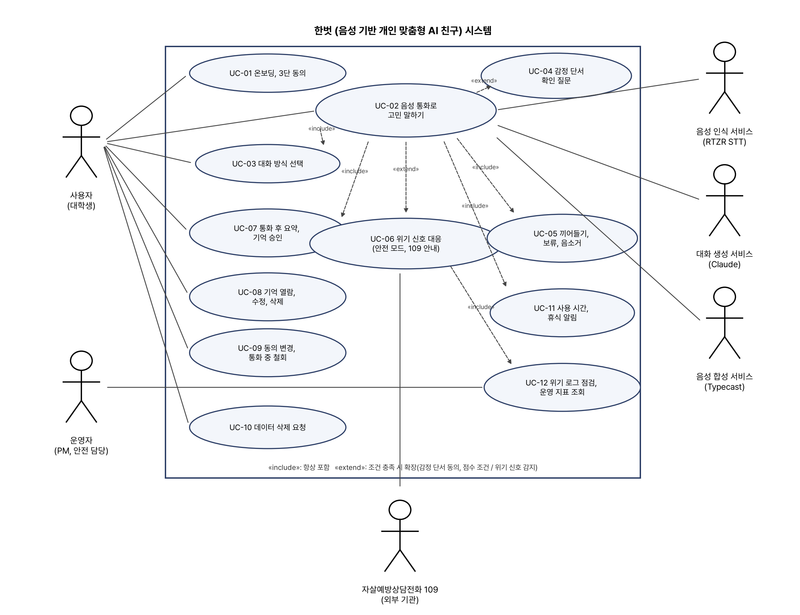
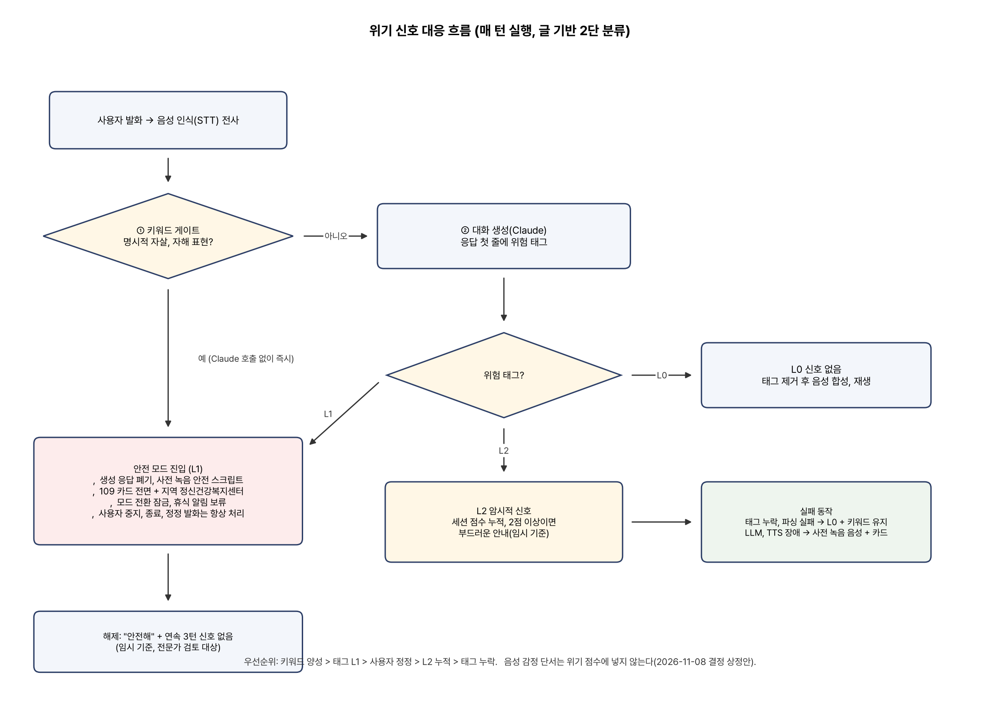

# 소프트웨어공학 프로젝트 2차 산출 보고서

음성 기반 개인 맞춤형 AI 서비스 “한벗” · 팀 문워크 · 2026. 11. 12.

## 1. 프로젝트 개요

### 1.1. 문제 정의 (1차 산출물 요약)

#### 1) 배경과 필요성

- **청년층의 고립·정서적 어려움과 고민 표현의 어려움**
  - 2024년 고립·은둔 청소년 실태조사에서 9~24세 응답자 중 28.6%가 스스로 고립·은둔 상태라고 응답하였고, 이 중 62.5%는 죽고 싶다고 생각한 경험이 있다고 함.

  - 대학생은 팀 프로젝트의 역할 분담 불만, 서로 연결된 대인관계 때문에 고민을 꺼내기 어려운 상황을 반복적으로 겪음.

- **음성 감정 단서를 반영하되 추정이 틀릴 수 있음을 전제로 한 대화 설계**
  - 기존 텍스트 기반 대화형 AI는 억양, 말의 속도, 음량 변화, 발화 사이의 멈춤 같은 감정 단서를 반영하지 못함.

  - 감정 추정은 틀릴 수 있으므로 한벗은 추정을 단정하지 않고 확인 질문으로만 쓰며, 위기 상황과 개인정보에 대한 안전장치를 요구사항으로 고정함.

### 1.2. 대상 사용자와 범위

  - 1차 타깃은 1차 산출물과 동일하게 대학생으로 유지함(2026. 11. 7. 팀 회의에서 고령층은 대상에서 제외하기로 확정).

  - 이번 학기 제품 범위는 음성 통화, 대화 방식 선택, 감정 단서 확인 질문, 위기 대응, 동의 기반 기억 관리, 데이터 삭제의 여섯 영역이며, 12월 대학생 20~30명 사용자 테스트로 검증함.

  - 화면 콘셉트는 11/12 기준 ‘편지 한 통’(V3.1, 통화가 편지 한 통이 되어 봉인·편지함에 쌓임), ‘기본형’(V4, 토스·당근 식 익숙한 구조), ‘하늘이네 집’(V5) 세 시안을 비교하는 중임. 본 명세서는 콘셉트와 무관한 기능 요구로 적고, 콘셉트 확정 후 화면 용어(편지함·봉인 등)와 친구 영상(아바타) 표시 여부를 반영함.

### 1.3. 기존 대안과의 차이 (피드백 ③ 반영)

  - 1차 산출물의 표 2는 고민을 털어놓는 ‘기존 경로의 한계’와 ‘경쟁 서비스 비교’가 한 표에 섞여 익명 커뮤니티가 경쟁 서비스처럼 읽혔음. 두 표로 분리함.

**<표 1> 기존 고민 경로의 한계 (문제 정의 관점)**

| 경로 | 접근성 | 비밀 보장 | 맥락 유지 | 감정 단서 | 한계 |
|---|---|---|---|---|---|
| 지인(친구·가족) | 높음 | 낮음(관계가 얽힘) | 높음 | 높음 | 관계 부담, 같은 고민을 반복해 말하기 어려움 |
| 익명 커뮤니티 | 높음 | 중간(불특정 다수 노출) | 없음 | 없음 | 공감 대신 평가가 돌아올 수 있음 |
| 텍스트 기반 대화형 AI | 매우 높음 | 높음(1대1) | 제한적 | 없음 | 문장만 분석해 말투에 담긴 서운함을 놓침 |
| 전문 심리상담 | 낮음(예약·비용·대기) | 높음 | 높음 | 높음 | 일상의 작은 고민까지 다루기에는 문턱이 높음 |

**<표 2> 경쟁 서비스 비교 (서비스 포지셔닝 관점)**

| 항목 | 한벗 | 텍스트 캐릭터 챗(제타 등) | 음성 AI(ChatGPT 음성 등) | 정신건강 앱(Wysa 등) |
|---|---|---|---|---|
| 입력 방식 | 음성 통화 | 텍스트 | 음성 | 텍스트 중심 |
| 감정 파악 | 음성 단서(억양·속도·멈춤) + 글 | 글만 | 글 중심 | 글만 |
| 감정 처리 | 단정하지 않고 확인 질문 | 없음 | 없음 | 설문·척도 |
| 대화 방식 선택 | 들어줘·정리·조언 3가지 | 캐릭터 설정 | 없음 | 프로그램 기반 |
| 기억 관리 | 저장 전 승인, 사실·추정 분리, 열람·수정·삭제 | 대화 기록 | 계정 메모리 | 제한적 |
| 위기 대응 | 2단 분류 + 안전 모드 + 109 안내 | 청소년 이용 제한 | 안전 정책 | SOS 화면 |
| 포지션 | 안전한 경청·동반(치료 아님) | 롤플레이 | 범용 비서 | 웰니스·치료 보조 |

## 2. 1차 산출물 피드백 반영

### 2.1. 반영 내용과 자체 점검

  - 1차 산출물(2026. 10. 3.)에 대한 보완 의견 다섯 가지의 반영 위치와 반영 상태를 정리함. ‘부분 반영’은 설계·계획은 반영했으나 측정값이나 팀 결정이 아직 남은 항목임.

**<표 3> 피드백 반영 현황**

| 번호 | 피드백 요지 | 반영 내용 | 반영 절 | 상태 |
|---|---|---|---|---|
| ① | 음성 감정 분석의 정확도·한계 검증 계획 부재, 오추정 시 사용자 위험 | 국내 논문 10편·반려 로봇 대화 연구로 기준선(음성만 64.7~66.3%)을 잡고 검증 계획(AI Hub 데이터·화자 독립 분할·합격선)과 오추정 위험·완화 표 추가. 감정 추정을 ‘확인 질문’으로만 쓰도록 요구사항에 고정 | 5절, FR-05·06, NFR-02·03 | 부분 반영(평가는 11월 4주 실행) |
| ② | 위기 상황 대응 흐름과 전문 기관 안내 방식 미명시 | 위기 2단 분류·안전 모드·109 안내의 흐름도와 상태 전이표, 실패 시 동작 추가 | 6절, UC-04, FR-08~10, NFR-05~07 | 반영(전문가 검수·109 연동 확인은 남음) |
| ③ | 표 2의 ‘익명 커뮤니티’는 성격이 다른 비교 대상 | ‘기존 경로의 한계’(표 1)와 ‘경쟁 서비스 비교’(표 2)로 분리 | 1.3절 | 반영 |
| ④ | 10/22까지 ‘작업 없음’, 개발 기간이 짧아 보임, 주차별 표 필요 | 10/23~12/12 주차별 계획을 표로 작성하고 11/12 기준 진행 상태 기재 | 8절 | 반영 |
| ⑤ | 대화 기억의 데이터 저장 범위와 보관 기간 정의 | 데이터 종류별 목적·동의·저장·보관 기간 표와 삭제 범위 추가 | 7절, FR-11~14, NFR-08~11 | 부분 반영(보관 일수는 11/9 회의·법무 검토 후 확정) |

## 3. 요구사항 명세서

### 3.1. 작성 기준

  - 요구사항 명세서는 사용자 관점에서 시스템이 무엇을 해야 하는지(What)를 정의하고, 개발과 시험의 기준이 되는 약속 문서임. 기능 요구사항과 비기능 요구사항(성능·품질·안전·인터페이스·개인정보·제약조건)으로 나누고 우선순위를 붙임.

  - 우선순위: P0 = 12월 발표까지 반드시 구현, P1 = 가능하면 구현, P2 = 이후(기록 1년 뒤 다시 받기, 앱 잠금, 편지지·서체 선택, 주간 편지 등 디자인 시안의 후보). 수용 기준의 수치는 시험한 표본 안의 결과로만 보고함.

**<표 4> 용어 정의**

| 용어 | 정의 |
|---|---|
| 턴(turn) | 사용자가 말하기 시작해 한벗에게 발언권을 넘기기까지의 발화 한 덩어리 |
| TTFA | 사용자 발화 종료부터 한벗의 첫 음성 재생까지의 시간(Time To First Audio) |
| 감정 단서 | 음성에서 추정한 범주(답답함·밝음·가라앉음·불안·중립)와 점수, 말 속도·멈춤 지표 |
| 확인 질문 | 감정 단서를 단정하지 않고 “목소리가 좀 가라앉은 것 같은데, 맞아?”처럼 되묻는 한 문장 |
| 3단 동의 | R(필수: 서비스 이용·대화 기록 저장), S(선택: 음성 감정 단서 분석), V(선택: 원본 음성 보관, 이번 단계 비활성) |
| 기억 상태 | 내가 말한 것(stated) → 한벗이 추정한 것(inferred) → 사용자가 맞다고 한 것(confirmed) → 저장을 승인한 것(approved) |
| 안전 모드 | 위기 신호 감지 시 조언 생성을 멈추고 사전 검수된 안내와 109 카드를 제공하는 상태 |
| 결합 감정 판단 | 글(전사)의 감정 점수와 목소리의 감정 점수를 가중 결합한 판단. 긍정–부정은 글을, 흥분도는 목소리를 더 믿음 |

### 3.2. 기능 요구사항

**<표 5> 기능 요구사항**

| ID | 요구사항 | 내용 및 수용 기준 | 우선순위 |
|---|---|---|---|
| FR-01 | 온보딩·AI 고지·3단 동의 | 첫 실행 시 “한벗은 AI 친구이며 치료나 상담을 대신하지 않는다”는 고지와 109 안내를 보여주고 R·S·V 동의를 개별로 받음. R 없이는 서비스 이용 불가. 고지 문구는 온보딩·통화 화면·첫 인사 3곳 노출, 동의 8조합별 허용 기능표와 동작 일치 8/8 | P0 |
| FR-02 | 음성 통화 루프 | 1탭으로 통화를 시작하고 음성 인식 → 대화 생성 → 음성 합성이 끊기지 않고 이어짐. 양쪽 자막 표시. 기기 3종×환경 2종에서 10분 통화 완료율 보고(목표 90% 이상) | P0 |
| FR-03 | 대화 방식 선택 | ‘그냥 들어줘’, ‘함께 정리해줘’, ‘솔직하게 조언해줘’ 중 하나를 통화 전·중에 선택·전환함. AI의 감정 추정보다 사용자의 선택이 우선. ‘들어줘’ 모드에서 조언 문장 5% 이하 | P0 |
| FR-04 | 끼어들기·보류·음소거 | 한벗이 말하는 중 사용자가 말하거나 탭하면 300ms 이내에 멈춤. “응”, “음” 같은 짧은 맞장구에는 멈추지 않음. 보류는 마이크와 발화를 모두, 음소거는 마이크만 끔 | P0 |
| FR-05 | 음성 감정 단서 분석 | S 동의가 있을 때만 턴 종료 시 목소리 감정 범주·점수와 속도·멈춤 지표를 계산하고 글의 감정 점수와 가중 결합함(초기값: 긍정–부정 글 0.65·목소리 0.35, 흥분도 글 0.1·목소리 0.9, 5감정 0.55·0.45, rules.yaml). 받아쓰기 오류율이 15%를 넘으면 글 비중을 낮춤. 결과가 해당 턴의 응답 생성 전에 도착하지 않으면 폐기하고 다음 턴에 쓰지 않음(오용 0건) | P0 |
| FR-06 | 확인 질문 | 감정 단서는 단정 표현 없이 확인 질문으로만 씀. 조건은 점수 기준 충족, 직전 5턴에 질문 없음, S 동의, 안전 모드 아님. “아니야”면 그 세션에서 같은 범주는 다시 묻지 않음. 단정 표현 0건(100턴, 2인 판정) | P0 |
| FR-07 | 통화 후 요약 | 통화 종료 후 15초 이내에 오늘 이야기 요약과 사용자가 확인한 감정만 표시함 | P0 |
| FR-08 | 위기 신호 1단 감지 | 매 턴 전사에서 명시적 자살·자해 표현을 키워드 게이트로 검사하고 양성이면 대화 생성 없이 즉시 안전 모드로 전환함. 평가 세트에서 명시 위기 재현율 0.90 이상, 비위기 오탐 10% 이하 | P0 |
| FR-09 | 위기 신호 2단 감지 | 대화 생성 응답 첫 줄의 위험 태그(L0/L1/L2)를 해석함. L1이면 생성문 폐기 후 안전 모드, L2면 세션 점수 누적 후 기준 초과 시 부드러운 안내. 태그 형식 준수율 99% 이상 | P0 |
| FR-10 | 안전 모드·전문기관 안내 | 조언을 멈추고 사전 검수된 짧은 공감 응답과 109 카드(전화 연결·번호 복사), 지역 정신건강복지센터를 안내함. 사용자의 중지·종료·정정 발화는 항상 처리. 시나리오 20개에서 유해 발화 0건 | P0 |
| FR-11 | 기억 후보 승인 | 요약에서 추출한 기억 후보를 ‘내가 말한 것’과 ‘한벗이 느낀 것’으로 나눠 보여주고 항목별로 승인·거절함. 미승인 후보는 저장·검색되지 않음(노출 0건, 자동 테스트) | P0 |
| FR-12 | 기억 열람·수정·삭제와 격리 | 저장된 기억을 상태별로 열람·수정·삭제하며 다음 통화부터 반영됨(100%). 사용자는 자신의 데이터만 접근함(타인 데이터 접근 시도 100% 차단) | P0 |
| FR-13 | 동의 변경·통화 중 철회 | 설정에서 S 동의를 끄면 진행 중인 감정 분석을 취소하고 이후 감정 단서·추정 기억을 만들지 않음(철회 후 저장 0건) | P0 |
| FR-14 | 원본 음성 폐기·데이터 삭제 | 원본 음성은 처리 직후 메모리·임시 파일에서 삭제하고 보관하지 않음. 기억 1건·대화 1건·계정 단위 삭제 요청을 받아 운영 DB·임베딩·캐시·진행 중 작업에서 24시간 이내 삭제하고, 삭제한 기억은 다시 후보로 올리지 않음 | P0 |
| FR-15 | 사용 시간 표시·휴식 알림 | 오늘 사용 시간을 표시하고 일일 60분·주 6일(임시 기준) 경계에서 휴식을 권함. 안전 모드 중에는 보류 | P0 |
| FR-16 | 위기 로그 점검(운영자) | 운영자가 S 동의 사용자의 위기 판정 로그와 오탐·안전 모드 전환 횟수를 점검함(사용자 테스트 기간 매일 1회) | P0 |
| FR-17 | P1 후보 기능 | 통화 화면 친구 영상(아바타) 표시(디자인 방향 확정 후), 사용자 감정에 맞춘 말투(슬픔·불안이면 차분하고 느리게, 음성 합성 톤·속도 매핑), 맞장구 클립(3~4초 이상 말하다 쉴 때, 대화 기록에는 넣지 않음), 필러 클립(첫 응답이 0.7초 이상 늦을 때만, 연속 금지), 음성 2~3종 선택, 통화 중 텍스트 입력 전환 | P1 |

### 3.3. 비기능 요구사항

**<표 6> 비기능 요구사항**

| ID | 분류 | 요구사항 | 검증 방법·근거 |
|---|---|---|---|
| NFR-01 | 성능 | TTFA 중앙값 1.0초 이하 목표, 90퍼센타일 1.5초 이하, 4초 초과는 실패로 집계. 끼어들기 정지 300ms 이하, 머뭇거림 중 끊는 비율 10% 이하 | 턴마다 발화 종료·첫 재생 시각 기록. 사람 간 대화 턴 간격 평균 약 0.2초, 응답 선호는 약 1초에서 정점 |
| NFR-02 | 품질(감정) | 성능은 두 지표로 보고함. ① 목소리 단독 4감정 UA(화자 독립, 공개 기준선 KEMDy19 UA 66.3과 같은 조건) ② 글+목소리 결합 3감정 정확도. 합격선은 결합 약 70%(11/9 조정안), 미달이면 감정 단서 기능을 끈 채 출시 | 국내 실제 대화 133명 연구: 목소리만 64.7%, 글+목소리 69.3%. 90%대 국내 논문은 같은 대본·화자 미분리라 기준에서 제외. 화자 단위 신뢰구간 보고 |
| NFR-03 | 품질(감정) | 감정 점수는 보정(ECE) 전에는 확률로 해석하지 않고 순위용으로만 씀. 불확실하면 판정보류(약 25%)로 두고 묻지 않음. 범주는 평가용 4감정 + 서비스용 5감정(+불안) + 판정보류 + 2축(긍정–부정·흥분도)으로 제한. ‘중립’ 판정도 믿지 않고 글로 다시 확인함 | 보정 세트의 신뢰도 곡선·ECE 보고. 라벨을 묶을수록 정확도 상승(27분류 F1 .46 → 4그룹 .69). 화자 독립 평가에서 기쁨의 33%·분노의 28%가 중립으로 오인됨 |
| NFR-04 | 품질(위기) | 위기 평가 세트에서 명시 위기 재현율 0.90 이상, 비위기 오탐 10% 이하. 중간 위험·암시 유형은 별도 보고 | 명시·자해·암시·중간·대조 유형별 평가 세트(동결). 시험 세트 성능이며 안전성 보증 아님 |
| NFR-05 | 안전 | 위기 판단은 글(키워드 게이트 + 위험 태그) 기반. 목소리 단서를 위험도에 반영할지(올리기만 허용, 둘 중 높은 쪽)는 11/9 회의 결정 사항으로 rules.yaml 값으로 두며 기본값은 ‘반영 안 함’ | 코드 검토. 목소리 점수만으로 위기로 넘어갈 근거가 없고, 반영하더라도 낮추는 방향으로는 쓰지 않음 |
| NFR-06 | 안전 | 대화 생성·음성 합성 장애 시에도 사전 녹음된 안전 안내와 109 카드를 제공함. 진단 척도(PHQ-9 등)와 효능 주장은 쓰지 않음 | 장애 주입 테스트, 문구 체크리스트 |
| NFR-07 | 안전(절차) | 사용자 테스트는 위기 평가 통과, 전문가 문구 검수, 동의·삭제·격리 테스트 통과, 연구윤리 절차 확인, 위기 운영 담당 지정이 모두 충족된 뒤 시작함 | 시작 게이트 체크리스트 |
| NFR-08 | 개인정보 | 원본 음성은 저장하지 않고 처리 직후 폐기하며 화자 식별 정보(voiceprint)는 만들지 않음 | 자동 테스트. 생체인식정보 요건 회피 |
| NFR-09 | 개인정보 | 감정 단서·추정 기억은 별도 동의(S) 없이는 만들지 않고 가명 키로 분리 저장함. 데이터는 목적이 끝나면 지체 없이 파기하고 보관 기간을 처리방침에 명시함 | 동의 조합 테스트 8/8. 개인정보 보호법 제21조·제23조 |
| NFR-10 | 개인정보 | 외부 AI 서비스(음성 인식·대화 생성·음성 합성)로의 전송과 국외 이전을 온보딩에서 고지하고 각 업체의 학습 미사용·보존 기간 조항을 확인함 | 약관 확인표 |
| NFR-11 | 보안 | 전사·기억은 암호화 저장하고 데이터베이스 행 수준 보안으로 사용자별 격리함. 로그에 발화 원문을 남기지 않음 | 격리 테스트 100%, 로그 검사 |
| NFR-12 | 인터페이스 | 통화 시작 1탭, 확인 질문 응답은 1탭(맞아/아니야) 또는 음성. 안전 모드 카드는 어느 화면에서든 1탭(SOS). iPhone Safari·Android Chrome·노트북 Chrome 지원 | 사용자 테스트 관찰, 기기 3종 테스트 |
| NFR-13 | 제약조건 | 모델·데이터의 상업 이용 조건을 확인하고 불확실한 것은 제품에 넣지 않음. AI Hub 데이터는 재배포·해외 반출 금지라 원문을 해외 AI API에 넣지 않고 로컬 학습·평가에만 씀(팀원 각자 신청). 비상업 데이터는 평가 기준 참고만. 규칙 값(임계값·가중치·턴 수·보관 기간)은 설정 파일로 분리 | 라이선스 체크리스트(감정 모델 가중치, AI Hub·ETRI 조건 확인 중) |
| NFR-14 | 품질(맥락·기억) | 대화 생성에는 직전 6~10턴과 지난 통화 요약만 넣고 전체 원문은 DB에만 보관함. 기억 정리(요약·수정·삭제)는 응답 지연을 피하기 위해 통화가 끝난 뒤 실행함 | 맥락은 5~12턴에서 포화(1턴 56 → 12턴 71 → 20턴 71). 기억 에이전트 회상 정확도 32 → 92.5%. 0/2/6/10턴 비교 실험 |
| NFR-15 | 품질(대화·음성) | 응답은 말하기용 문장으로 생성함: 한 문장 15~25자, 한 턴 2~3문장, 질문은 하나, 숫자·시간은 한글로, 마크다운·이모지 금지. 음성 합성에는 직전 2~3턴을 문맥으로 넘김 | 문장 규칙 자동 검사. 문장만 들려주면 사람과 구분 못 하지만 대화 맥락까지 들려주면 사람 녹음을 선호한다는 평가(Sesame) |

## 4. 유스케이스 다이어그램

### 4.1. 행위자

**<표 7> 행위자 정의**

| 행위자 | 설명 |
|---|---|
| 사용자(대학생) | 고민을 음성으로 말하고 기억·동의·삭제를 관리하는 주 행위자 |
| 운영자(PM·안전 담당) | 사용자 테스트 기간 위기 로그와 운영 지표를 점검하는 팀원 |
| 음성 인식 서비스 | 통화 음성을 실시간 전사하는 외부 시스템(RTZR STT) |
| 대화 생성 서비스 | 모드·기억·감정 단서를 반영해 응답과 위험 태그를 생성하는 외부 시스템(Claude) |
| 음성 합성 서비스 | 응답 문장을 음성으로 합성하는 외부 시스템(Typecast) |
| 자살예방상담전화 109 | 위기 시 안내·연결되는 외부 기관(이번 단계는 전화 연결과 번호 안내) |

### 4.2. 다이어그램

*<그림 1> 한벗 유스케이스 다이어그램*

**<표 8> 유스케이스 목록**

| ID | 유스케이스 | 주 행위자 | 관계 | 관련 요구사항 |
|---|---|---|---|---|
| UC-01 | 온보딩·3단 동의 | 사용자 | — | FR-01 |
| UC-02 | 음성 통화로 고민 말하기 | 사용자, 외부 서비스 3종 | UC-03·05·07·11 포함, UC-04·06 확장 | FR-02, 17 |
| UC-03 | 대화 방식 선택 | 사용자 | UC-02에 포함 | FR-03 |
| UC-04 | 감정 단서 확인 질문 | (시스템) | UC-02 확장(S 동의·점수 조건) | FR-05, 06 |
| UC-05 | 끼어들기·보류·음소거 | 사용자 | UC-02에 포함 | FR-04 |
| UC-06 | 위기 신호 대응 | (시스템), 109 | UC-02 확장(위기 신호), UC-12 포함 | FR-08~10 |
| UC-07 | 통화 후 요약·기억 승인 | 사용자 | UC-02에 포함 | FR-07, 11 |
| UC-08 | 기억 열람·수정·삭제 | 사용자 | — | FR-12 |
| UC-09 | 동의 변경·통화 중 철회 | 사용자 | — | FR-01, 13 |
| UC-10 | 데이터 삭제 요청 | 사용자 | — | FR-14 |
| UC-11 | 사용 시간·휴식 알림 | (시스템) | UC-02에 포함 | FR-15 |
| UC-12 | 위기 로그 점검·운영 지표 조회 | 운영자 | UC-06에 포함 | FR-16 |

### 4.3. 주요 유스케이스 시나리오

  - 강의자료의 유스케이스 서술 형식(유스케이스명·개요·주 행위자·전제·성공조건·기본흐름·대안흐름)을 따름. 기본흐름은 사용자와 시스템 사이의 사건 순서로 적음.

#### 1) UC-02 음성 통화로 고민 말하기

**<표 9> UC-02 음성 통화로 고민 말하기 유스케이스 명세**

| 항목 | 내용 |
|---|---|
| 유스케이스명 | UC-02 음성 통화로 고민 말하기 |
| 개요 | 사용자가 통화 버튼을 누르면 한벗이 음성으로 대화를 이어 가고, 종료 시 요약과 기억 승인으로 연결됨. |
| 주 행위자 | 사용자(대학생). 보조: 음성 인식·대화 생성·음성 합성 서비스 |
| 전제 | 필수 동의(R) 완료, 마이크 권한 허용, 네트워크 연결 |
| 성공조건 | 10분 이상 통화가 끊기지 않고 이어지고, 전사와 턴 이벤트가 저장되며, 종료 시 요약 화면이 15초 이내에 뜸 |
| 기본흐름 | 1. 사용자가 홈 화면에서 통화 버튼을 누른다. 2. 시스템은 통화 화면(고지 문구, 모드 선택, 자막, 보류·음소거·종료)을 보여 주고 첫 인사에서 AI임을 밝힌다. 3. 사용자가 말한다. 시스템은 음성 활동 감지와 말 끝 감지로 턴 종료를 판정하고, 음성 인식 서비스가 전사를 만든다. 4. 시스템은 선택된 모드, 승인된 기억, (S 동의 시) 감정 단서를 묶어 대화 생성 서비스에 보낸다. 이때 위기 2단 분류(UC-06)를 매 턴 실행한다. 5. 대화 생성 서비스가 응답을 스트리밍하면 시스템은 첫 줄의 위험 태그를 떼어내고 문장 단위로 음성 합성 서비스에 보낸다. 6. 시스템은 첫 음성이 재생되는 시각을 기록해 TTFA를 계산한다. 7. 3~6을 반복하고, 사용자가 종료를 누르면 통화를 끝내고 UC-07로 이동한다. |
| 대안흐름 | 3a. 사용자가 머뭇거리며 말을 멈추면 말 끝 감지가 ‘아직 끝나지 않음’으로 판정해 기다린다. 4a. S 동의가 없으면 감정 단서를 계산하지 않고 전사와 기억만 보낸다. 6a. 한벗이 말하는 중 사용자가 끼어들면 UC-05로 처리한다. |
| 예외흐름 | E1. 음성 인식 서비스 장애: 재시도하거나 대안 공급사로 전환한다. E2. 대화 생성 시간 초과: 고정 사과 문구를 재생하고 재시도한다. E3. 위기 신호 감지: UC-06으로 분기한다. |

#### 2) UC-04 감정 단서 확인 질문

**<표 10> UC-04 감정 단서 확인 질문 유스케이스 명세**

| 항목 | 내용 |
|---|---|
| 유스케이스명 | UC-04 감정 단서 확인 질문 |
| 개요 | S 동의가 있을 때 턴 종료 시 음성 감정 단서를 계산하고, 조건을 만족하면 단정 대신 확인 질문 한 문장을 응답 끝에 붙임. |
| 주 행위자 | 시스템(사용자가 응답) |
| 전제 | S 동의 켜짐, 안전 모드 아님, 해당 턴의 감정 단서가 응답 생성 시작 전에 도착 |
| 성공조건 | 사용자가 “맞아”라고 한 단서만 confirmed 상태가 되어 요약·기억 후보에 쓰임 |
| 기본흐름 | 1. 턴이 끝나면 시스템은 해당 발화의 음성에서 감정 범주·점수와 속도·멈춤 지표를 계산한다. 2. 조건(점수 기준 충족, 직전 5턴에 질문 없음, 판정보류 아님)을 만족하면 대화 생성 서비스에 “[음성 단서] 범주=가라앉음, 말 속도=평소보다 느림” 형태로 전달한다. 점수는 전달하지 않는다. 3. 시스템은 응답 끝에 “목소리가 좀 가라앉은 것 같은데, 맞아?” 한 문장을 붙인다. 단정 표현·라벨 직역·진단 용어는 쓰지 않는다. 4. 사용자가 음성이나 [맞아]/[아니야] 버튼으로 답한다. 5. “맞아”면 confirmed로 기록하고(저장은 아직 아님), “아니야”면 단서를 폐기하고 그 세션에서 같은 범주는 다시 묻지 않는다. 무응답이면 폐기한다. |
| 대안흐름 | 1a. 발화가 2초 미만이거나 전사가 비었거나 세션 초반(3턴 또는 30초 미만)이면 상대 지표를 쓰지 않는다. 2a. 글의 극성과 목소리가 어긋나면(“괜찮아”라고 말했지만 가라앉은 목소리) 평균을 내지 않고 불일치로 따로 되묻는다(3턴에 1회 이하). 2b. 1·2위 범주의 확률이 비슷하거나 보정 신뢰도가 낮으면 판정보류로 두고 라벨을 말하지 않는다. |
| 예외흐름 | E1. 감정 단서가 응답 생성 시작 후에 도착하면 폐기하고 다음 턴에 쓰지 않는다. |

#### 3) UC-06 위기 신호 대응 (안전 모드·109 안내)

**<표 11> UC-06 위기 신호 대응 (안전 모드·109 안내) 유스케이스 명세**

| 항목 | 내용 |
|---|---|
| 유스케이스명 | UC-06 위기 신호 대응 (안전 모드·109 안내) |
| 개요 | 매 턴 전사를 두 경로(키워드 게이트, 위험 태그)로 검사해 명시적 위기 신호가 있으면 안전 모드로 전환하고 109를 안내함. |
| 주 행위자 | 시스템. 보조: 자살예방상담전화 109(전화 연결), 운영자(사후 점검) |
| 전제 | 통화 중, 매 턴 전사가 생성됨 |
| 성공조건 | 위기 신호에 대해 조언 대신 안전 안내와 109 카드가 제공되고, 진입·해제 이력이 기록됨 |
| 기본흐름 | 1. 턴 전사가 도착하면 키워드 게이트가 명시적 자살·자해 표현을 검사한다. 2. 양성이면 대화 생성 서비스를 호출하지 않고 즉시 안전 모드로 들어간다. 사전 녹음된 안전 스크립트를 재생하고 109 카드(전화 연결·번호 복사)와 지역 정신건강복지센터를 전면에 띄운다. 3. 음성이면 대화 생성 서비스에 보내고 응답 첫 줄의 위험 태그를 읽는다. L1이면 생성문을 폐기하고 2와 같이 처리한다. L2면 세션 점수를 누적하고 2점 이상에서 부드럽게 안내한다. L0이면 태그를 떼고 정상 재생한다. 4. 안전 모드 중에는 조언 생성을 멈추고 짧은 공감 응답만 하며, 모드 전환을 잠그고 휴식 알림을 보류한다. 사용자의 “그만”, “끊을게”, “그런 뜻 아니었어” 같은 중지·종료·정정 발화는 항상 처리한다. 5. 사용자가 “안전해”라고 말하고 이후 3턴 연속 신호가 없으면 일반 모드로 돌아간다(임시 기준, 전문가 검토 대상). 카드는 하단에 유지하고 세션 말미에 다시 안내한다. 6. 운영자는 S 동의 사용자에 한해 위기 로그를 매일 점검한다(UC-12). |
| 대안흐름 | 3a. 위험 태그가 없거나 형식이 깨지면 L0으로 처리하되 키워드 결과는 유지하고 기록한다. 4a. 정정 직후 새 L1 신호가 오면 L1이 우선한다. 2a. 통화 종료·연결 끊김 시 카드 화면과 번호 복사 버튼을 남긴다. |
| 예외흐름 | E1. 대화 생성·음성 합성 장애: 사전 녹음된 안내 음성과 카드를 제공한다. E2. 음성 인식 결과가 비어 있음: 분류 불가로 기록하고 빈도를 측정한다. |

#### 4) UC-07 통화 후 요약·기억 승인

**<표 12> UC-07 통화 후 요약·기억 승인 유스케이스 명세**

| 항목 | 내용 |
|---|---|
| 유스케이스명 | UC-07 통화 후 요약·기억 승인 |
| 개요 | 통화가 끝나면 요약과 기억 후보를 보여 주고, 사용자가 항목별로 승인한 것만 저장함. |
| 주 행위자 | 사용자 |
| 전제 | 통화 종료 |
| 성공조건 | 승인된 기억만 approved 상태로 저장되어 다음 통화 맥락에 쓰이고, 미승인 후보는 어디에도 노출되지 않음 |
| 기본흐름 | 1. 시스템은 통화 종료 후 15초 이내에 요약 화면을 보여 준다. 요약에는 오늘 이야기의 핵심, 사용자가 확인한 감정, 사용자가 말한 계획만 들어간다. 2. 시스템은 기억 후보를 ‘내가 말한 것’과 ‘한벗이 느낀 것’으로 나눠 보여 주고 각 항목에 근거 문장을 붙인다. 3. 사용자가 항목별로 [기억해]/[버려]를 누른다. 4. 시스템은 승인한 항목만 approved로 저장하고, 승인하지 않은 후보는 저장·검색하지 않는다. |
| 대안흐름 | 2a. 확인되지 않은 추정(inferred)은 후보로 올리지 않는다. 3a. 응답 없이 화면을 떠나면 후보는 보류 상태로 남고 홈에 ‘확인할 기억 N개’ 배지를 표시한다. |
| 예외흐름 | E1. 삭제된 기억과 같은 내용이 후보로 추출되면 차단한다(재생성 방지). |

#### 5) UC-08·09·10 기억 관리·동의 철회·삭제 요청

**<표 13> UC-08·09·10 기억 관리·동의 철회·삭제 요청 유스케이스 명세**

| 항목 | 내용 |
|---|---|
| 유스케이스명 | UC-08·09·10 기억 관리·동의 철회·삭제 요청 |
| 개요 | 사용자가 저장된 기억을 관리하고, 동의를 바꾸거나, 데이터 삭제를 요청함. |
| 주 행위자 | 사용자 |
| 전제 | 로그인(필수 동의 완료) |
| 성공조건 | 변경·철회·삭제가 다음 통화부터 반영되고, 삭제는 설계 범위 저장소에서 24시간 이내 완료됨 |
| 기본흐름 | 1. (UC-08) 사용자가 기억 탭에서 ‘내가 말한 것’과 ‘한벗이 느낀 것’ 목록을 보고 항목을 수정(‘내가 말한 것’만)하거나 삭제한다. 삭제는 임베딩과 같은 트랜잭션에서 처리한다. 2. (UC-09) 사용자가 설정에서 S 동의를 끄면 시스템은 철회 이벤트를 기록하고, 통화 중이면 감정 분석을 즉시 비활성화하고 진행 중인 작업을 취소한다. 이후 턴부터 감정 단서·확인 질문·‘한벗이 느낀 것’ 후보를 만들지 않는다. 3. (UC-10) 사용자가 삭제 범위(기억 1건 / 대화 1건 / 계정 전체)를 고르면 시스템은 삭제 큐에 넣고 예상 완료 시간을 안내한 뒤, 운영 DB·임베딩·캐시·진행 중 작업을 순서대로 지우고 삭제된 기억의 해시를 남겨 재생성을 막는다. |
| 대안흐름 | UC-09 1a. 필수 동의(R)를 철회하면 서비스 이용이 중단되고 계정 삭제 절차(UC-10)로 안내한다. UC-10 3a. 백업·외부 업체 사본은 각 보존 주기와 약관에 따라 처리하며, 처리방침에 ‘24시간은 운영 DB 기준’임을 명시한다. |
| 예외흐름 | E1. 다른 사용자의 기억 ID로 접근을 시도하면 행 수준 보안이 차단하고 기록한다. |

## 5. 음성 감정 분석의 검증 계획과 오추정 위험 (피드백 ①)

### 5.1. 기본 입장

  - 음성 감정 분석 결과는 ‘판정’이 아니라 ‘확인 질문의 계기’로만 사용함(FR-06). 모델은 감정을 이해하는 것이 아니라 학습 데이터의 소리 패턴과 라벨의 통계를 따라 확률을 내므로, 틀릴 수 있다는 전제를 대화 방식에 넣음.

  - 국내 근거(논문 10편 본문 검토): 처음 듣는 사람 기준 한국어 대화 4감정은 KEMDy19 UA 66.3%(Hyeon 외), KESDy19 F1 0.59(Noh 외)이고, 반려 로봇 실제 대화 133명에서는 목소리만 64.7%(3감정), 글 먼저 보고 목소리로 세부를 보면 69.3%(6감정)였음. 90%대를 보고한 국내 논문은 같은 대본을 여러 화자가 읽었거나 화자를 나누지 않은 평가였고, 글만으로도 94.5%가 나와 문장 자체에 답이 있었음.

  - 따라서 목표는 ‘목소리 단독 70%’가 아니라 ‘글+목소리 결합 3감정 약 70%’로 두고(11/9 회의 조정안), 목소리 단독 수치는 기준선 66%와 같은 조건으로 비교 보고함. emotion2vec+의 한국어 성능은 아직 보고된 바 없어 이 측정 자체가 기여점임.

### 5.2. 검증 계획

**<표 14> 감정 분석 검증 계획**

| 구분 | 모델 성능 평가 (11월 4주) | 사용자 비교 실험 (12월 1주) |
|---|---|---|
| 목적 | 한국어 4감정 분류 성능과 보정 상태 확인 | 음성 단서 기반 확인 질문이 같은 질문 정책의 ‘글만’ 조건보다 이해받는 느낌을 높이는가 |
| 데이터·설계 | AI Hub ‘감정 분류를 위한 대화 음성’(263, 약 4.4만 건, 7감정, 발화당 5명 라벨 → 라벨 분포 활용)과 ‘감정 태깅 자유대화 성인’(71631, 2인 통화) 11/11 수령. 263은 화자 기준으로 개발·보정·최종 세트를 직접 나누고 최종 세트는 평가 전 동결. 스마트폰 마이크 조건 별도 보고. KEMDy20은 ETRI 서버 접속 불가로 미확보 | 대학생 20~30명, 1인 3세션. 참가자 내 교차, 순서 무작위, 세션 간 추정 기억 이월 차단 |
| 주지표·합격선 | ① 목소리 단독 4감정 UA(화자 단위 부트스트랩 구간, 기준선 66.3 대비) ② 글+목소리 결합 3감정 정확도. 합격선은 결합 약 70%(미달 시 감정 단서 기능 비활성화). emotion2vec+ vs Whisper+LoRA 비교 1회 | 세션 후 ‘이해받음’ 5점 척도. 최소 의미 효과는 팀 결정 |
| 보조 지표 | 보정 오차(ECE), 판정보류 커버리지-위험 곡선, 성별·발화 길이·코덱 전후 차이 | 침해감, 거절률, 재사용 의향 |
| 표본 | 평가 발화 200개 이상·화자 10명 이상(정확도 0.70에서 95% 구간 반폭 약 ±6.4%p, 독립 가정이라 실제는 더 넓음) | 20~30명(탐색적 해석) |

### 5.3. 오추정 시 사용자 영향과 완화

**<표 15> 오추정 위험과 완화**

| 위험 | 사용자 영향 | 완화 설계 | 측정 |
|---|---|---|---|
| 오탐(없는 감정을 있다고 봄) | 침해감, ‘내 말을 안 듣는다’는 불신 | 단정 대신 확인 질문, “아니야” 시 폐기·재질문 금지, 판정보류, 5턴에 1회 상한 | 확인 질문 거절률, 침해감 문항 |
| 미탐(기쁨·분노·저각성을 중립으로 봄) | 외로움·우울처럼 각성이 낮은 신호를 놓침. 화자 독립 평가에서 기쁨 33%·분노 28%가 중립 판정 | 중립 판정도 글과 앞 대화로 재확인. 범주 대신 긍정–부정·흥분도 축과 개인 기준선(사용자별 예시 1→7개로 UA 69.8→75.7) 대비 변화로 봄. 위기 판단은 글 기반으로 별도 수행 | 저각성·중립 오인 재현율 |
| 글과 목소리의 불일치를 놓침 | “괜찮아”+가라앉은 목소리가 중립으로 사라짐 | 평균 대신 불일치를 따로 검출해 되물음 | 불일치 검출 정밀도 |
| 반복 오추정의 기억 누적 | 잘못된 ‘성격 꼬리표’ | 확인한 것만 confirmed, 승인한 것만 저장, 열람·삭제, 보관 기간 제한 | 수정 후 재언급률 |
| 점수를 확률로 오해 | 0.6을 ‘60% 맞다’로 해석해 과신 | 보정 전에는 순위용, 점수를 대화 생성에 넘기지 않음 | ECE 보고 |
| 연령·성별·방언 편향 | 특정 집단에서 정확도 하락 | 성별·억양 다양한 화자 10명 이상 평가, 집단별 UA 보고 | 집단별 UA 차이 |

**<표 15-1> 기능별 평가 데이터와 기준**

| 기능 | 평가 데이터·기준 | 라이선스 |
|---|---|---|
| 음성 감정 인식 | AI Hub 263·71631(학습·평가), KEMDy19 4감정 화자 독립 기준선 비교 | AI Hub 조건부(로컬만) |
| 말 끝 감지 | pipecat smart-turn-data v3.2의 한국어(kor) 부분으로 정확도 측정, 최종은 동의받은 베타 통화 | CC BY 4.0 |
| 공감 응답 | AI Hub 공감형 대화(71305)의 공감 방식 4종(격려·동조·위로·조언) 라벨을 루브릭으로 | AI Hub 조건부 |
| 기억·회상 | LongMemEval(5능력)을 한국어로 각색한 50문항 + AI Hub 멀티세션 대화(71630) | MIT / AI Hub 조건부 |
| 위기 대응 | C-SSRS 5단계 체계로 등급 정의, PsyCrisis-Bench 5차원(공감·정서조절·탐색·위험평가·외부연계)으로 응답 채점. 공개 한국어 자살·우울 텍스트가 없어 시나리오는 자체 제작·전문가 검수 | CC BY / 비상업(참고만) |

  - 중단 기준: 11월 4주 평가에서 결합 정확도가 70% 미만이거나 결과가 턴 마감 전에 도착하는 비율이 50% 미만이면 감정 단서 기능을 후순위로 내리고, 확인 질문은 속도·멈춤 지표만으로 하거나 끈 채 출시함.

## 6. 위기 상황 대응 흐름과 전문 기관 안내 (피드백 ②)

### 6.1. 등급과 흐름

**<표 16> 위기 등급 정의**

| 등급 | 정의 | 동작 |
|---|---|---|
| L0 | 신호 없음(“죽겠다” 같은 관용 표현 포함) | 일반 모드 |
| L2 | 암시적 신호(무망감 등) | 단독으로 안전 모드 진입하지 않음. 세션 점수 누적, 2점 이상이면 부드러운 안내(임시 기준) |
| L1 | 명시적 자살·자해 의도·계획·수단 | 즉시 안전 모드 |
| 임박 위험(L1 하위) | 수단·시점이 구체적 | L1과 같음. 긴급 신고(112·119) 병기 여부는 전문가 자문 후 확정 |

*<그림 2> 위기 신호 대응 흐름도*

### 6.2. 상태 전이와 전문 기관 안내

**<표 17> 안전 모드 상태 전이**

| 상황 | 동작 |
|---|---|
| 진입 | 키워드 양성: 대화 생성 없이 사전 녹음 안전 스크립트 + 109 카드 + 지역 정신건강복지센터. 태그 L1: 생성문 폐기 후 동일 |
| 유지 | 짧은 공감 응답만, 조언·정리 금지, 모드 전환 잠금, 휴식 알림 보류. 사용자의 중지·종료·정정 발화는 항상 처리 |
| 충돌 우선순위 | 키워드 양성 > 태그 L1 > 사용자 정정 > L2 누적 > 태그 누락. 정정 직후 새 L1이면 L1 우선 |
| 해제 | “안전해” + 연속 3턴 L1 없음 → 일반 모드. 카드는 하단 유지, 세션 말미 재안내(3턴 기준은 임시, 전문가 검토 대상) |
| 실패 동작 | 태그 누락·파싱 실패 → L0 처리 + 키워드 결과 유지 + 기록. 대화 생성·음성 합성 장애 → 사전 녹음 음성 + 카드. 통화 종료·연결 실패 → 카드와 번호 복사 버튼 유지 |

  - 전문 기관 안내: 1차는 자살예방상담전화 109(24시간, 전화 연결·번호 복사 버튼). 1393은 109로 통합된 과거 번호라 쓰지 않음. 도움 카드 후보 번호는 109, 정신건강위기상담 1577-0199, 청소년상담전화 1388, 긴급 119(디자인 시안 기준)이며 지역 정신건강복지센터 번호와 함께 전문가 자문 후 확정함.

  - 운영 범위 고지: 한벗 팀은 실시간으로 연락하지 않으며 의료·치료 서비스가 아님을 온보딩과 카드에 명시함. 109 공식 연동 API는 확인되지 않아 이번 단계는 번호 안내와 전화 링크 수준임.

  - 검증: 한국어로 직접 작성한 다중 턴 시나리오(명시·자해·암시·중간 위험·비위기 대조, 유형별 100~300건, 평가 전 동결)에서 명시 재현율 0.90 이상·오탐 10% 이하를 확인하고, 키워드 단독·태그 단독·결합을 같은 세트에서 비교함. 사용자 테스트 전 주에 정신건강 전문가가 문구·흐름을 검수하며, 미확보 시 테스트를 연기함.

## 7. 데이터 저장 범위와 보관 기간 (피드백 ⑤)

### 7.1. 원칙과 저장 범위

  - 연구용 데이터(AI Hub 1차 5종 약 61GB, 11/11 수령)는 사용자 데이터와 분리해 data/raw/sensitive에 두고 git에 올리지 않음. 재배포·해외 반출 금지 조건에 따라 원문을 외부 AI API에 넣지 않으며, 가공 결과만 interim → processed → eval 순서로 둠.

  - 필요 없는 데이터는 만들지 않고, 목적이 끝난 데이터는 지체 없이 파기함(개인정보 보호법 제21조). 감정 단서와 추정 기억은 건강 정보에 해당할 수 있으므로 별도 동의(S) 없이는 만들지 않음(제23조). 화자 식별 정보(voiceprint)는 만들지 않음.

**<표 18> 데이터 종류별 목적·동의·보관**

| 데이터 | 목적 | 동의 | 저장·외부 전송 | 보관 기간 |
|---|---|---|---|---|
| 원본 음성 | 음성 인식·감정 분석 입력 | R | 저장 안 함(처리 직후 삭제) / 음성 인식 서비스 | 0일. 외부 업체 보관 조건은 약관 확인 후 명시 |
| 전사·AI 응답 텍스트 | 위기 분류, 응답 생성, 요약, 자막 | R | 암호화 DB / 대화 생성·음성 합성 서비스(국외 이전 고지) | 사용자 삭제·탈퇴·장기 미이용(기간 팀 결정 필요) 시까지 |
| 감정 단서(범주·점수·속도·멈춤) | 확인 질문, 테스트 지표 | S | 가명 키 분리 저장 / 대화 생성(범주만) | 분석 완료 시까지(초안 30일, 목적 기준 재결정) |
| 기억 ‘내가 말한 것’ | 다음 통화 맥락 | R | 승인 시 암호화 저장 / 대화 생성 | 사용자 삭제·탈퇴·장기 미이용 시까지 |
| 기억 ‘한벗이 느낀 것’ | 다음 통화 맥락 | S | 승인 시 저장, 보관 기간 제한 / 대화 생성 | 초안 30일(팀 결정 필요), S 철회 시 삭제 선택 |
| 위기 판정·위기 로그 | 안전 모드 전환, 오탐 분석 | 판정 R(법무 검토) / 로그 S | 로그는 암호화, S 없으면 저장 안 함 | 최소 보존(팀 결정 + 법무 검토) |
| 사용 시간, 계정·동의 기록 | 휴식 알림, 운영, 동의 증빙 | R | 저장 | 계정 삭제 시까지(동의 기록은 법정 보존 기간) |

### 7.2. 삭제 범위

**<표 19> 삭제 요청 처리 범위**

| 저장소 | 삭제 대상 | 완료 시점 | 상태 |
|---|---|---|---|
| 운영 DB·임베딩·캐시·진행 중 작업·임시 음성 파일 | 계정, 전사, 요약, 기억, 단서, 위기 로그와 그 임베딩 | 요청 후 24시간 이내(임베딩은 같은 트랜잭션, 캐시는 세션 종료 즉시, 임시 파일은 처리 직후) | 설계 확정, 자동 테스트 |
| 재생성 방지 | 삭제된 기억의 재제안 | 해시로 같은 후보 차단, 과거 전사 재처리 금지 | 설계 확정 |
| 앱·지연 로그, 백업 | 사용자 키가 포함된 로그 줄(발화 원문 없음), 스냅샷 | 로그 보존 기간·백업 주기 종료 시. 처리방침에 ‘24시간은 운영 DB 기준’ 명시 | 기간 팀 결정 필요 |
| 외부 업체 | 음성 인식·대화 생성·음성 합성 업체가 보관하는 요청 데이터 | 각 약관의 보존 기간 | 약관 확인 중 |

  - ‘24시간 이내 삭제’는 법이 정한 기준이 아니라 팀의 내부 처리 목표이며, 보관 일수와 함께 11/9 회의 결정과 법무 검토를 거쳐 처리방침에 확정함.

## 8. 프로젝트 일정 계획 (피드백 ④)

### 8.1. 주차별 수행 일정

  - 1차 산출물의 ‘10/9~10/22 작업 없음’ 구간 이후 개발 기간이 짧다는 지적에 따라 10/23부터 12/12까지를 주차별 표로 재구성하고 2026. 11. 12. 기준 진행 상태를 함께 기재함. 공수 가정은 1인 주 약 15시간 × 4명임.

**<표 20> 주차별 계획과 진행 상태 (2026. 11. 12. 기준)**

| 주차 | 기간 | 목표와 주요 산출물 | 검증 방법 | 상태 |
|---|---|---|---|---|
| W0 | 10/23~10/26 | 피드백 반영 계획, 앱 설계서(기능별 구현·7주 일정), 기술 논문 근거 문서 | 설계서 비평 27건 반영 | 완료 |
| W1 | 10/27~11/02 | 라이선스·데이터 약관 확인, 설계 확정, 문제 인터뷰 시작 | 체크리스트 기록, 인터뷰 진행 | 완료(인터뷰 계속) |
| W2 | 11/03~11/09 | 개발 틀 구축(프런트 React·백엔드 FastAPI·계약·ML·데이터), 도메인 규칙 테스트 105건, 11/9 결정 회의(근거 A~L), AI Hub 1차 5종 61GB 수령(11/11), 화면 시안 V3.1·V4·V5(11/12) | 린트·단위 테스트 통과 | 완료(통화 루프 W3 이월) |
| W3 | 11/10~11/16 | 음성 통화 루프 완성, TTFA 1차 측정, 요구사항 명세서·유스케이스(본 보고서), AI Hub 압축 해제·263 화자 분할·감정 라벨 매핑표, 말 끝 감지 한국어 정확도 측정 | 통화 완료율, TTFA 분포 | 진행 중 |
| W4 | 11/17~11/23 | 감정 단서·대화 방식·위기 분류 초안, 감정 모델 평가(emotion2vec+ vs Whisper+LoRA, 결합 3감정), 음성 합성 블라인드(Typecast v31 vs ElevenLabs v4 Turbo), 화면 콘셉트 확정 | 단정 표현 0건, 태그 준수율, UA 합격선 판정 | 예정 |
| W5 | 11/24~11/30 | 기억·요약·삭제, 안전 프로토콜·동의 화면 완료, 내부 파일럿 | 미승인 노출 0건, 격리 100%, 삭제 24시간, 테스트 시작 게이트 | 예정 |
| W6 | 12/01~12/07 | 사용자 테스트 20~30명(게이트 통과 시), 위기 로그 매일 점검 | 이해받음 척도, 재사용 의향, 확인 질문 지표 | 예정 |
| W7 | 12/08~12/12 | 분석·발표 준비, 최종 산출물 | 목표 대비 달성표 | 예정 |

### 8.2. 중단·축소 기준

  - W3 말까지 통화 루프가 완성되지 않으면 감정 단서를 후순위로 내리고 기억은 ‘내가 말한 것’만 남김. W4 감정 모델 평가가 합격선 미달이면 감정 단서 기능을 끈 채 진행함. W5 말 테스트 시작 게이트(NFR-07)를 못 채우면 외부 테스트를 연기하고 내부 파일럿 결과로 발표함.

## 9. 참고 문헌

[1] 여성가족부·한국청소년정책연구원(2025). 2024년 고립·은둔 청소년 실태조사.

[2] Ma, Z. et al. (2024). emotion2vec: Self-Supervised Pre-Training for Speech Emotion Representation. Findings of ACL.

[3] Hyeon, J. et al. (2024). Segmental Average Pooling of SSL Features for SER(KEMDy19 화자 독립 4감정 UA 66.3). arXiv:2410.12416.

[4] Noh, K. et al. (2021). Multi-Path and Group-Loss-Based Network for SER in Multi-Domain Datasets. Sensors, 21(5).

[5] Kim, Yi, Won (2024). 국내 133명 반려 로봇 실제 대화의 음성·텍스트 감정 인식(팀 노션 정리 기준, 서지 확인 필요).

[6] Shin, Shin (2024). 적은 양의 음성 및 텍스트 데이터를 활용한 멀티 모달 기반의 효율적인 감정 분류 기법. 정보처리학회 논문지, 13(4).

[7] Jeong, et al. (2023). Multimodal Prompt Learning in Emotion Recognition Using Context and Audio Information. Mathematics, 11(13).

[8] Chou, H.-C. et al. (2023). The Importance of Calibration: Rethinking Confidence and Performance of Speech Multi-label Emotion Classifiers. Interspeech.

[9] Stivers, T. et al. (2009). Universals and cultural variation in turn-taking in conversation. PNAS.

[10] 보건복지부. 자살예방상담전화 109 안내. / 개인정보 보호법 제21조·제23조, 시행령 제18조.

[11] 기타: Sesame(2025); LongMemEval; ESConv; PsyCrisis-Bench; smart-turn-data v3.2; AI Hub 이용정책; 팀 문워크(2026) 설계서·논문 근거·최종 계획 v3와 팀 노션 조사 페이지.

