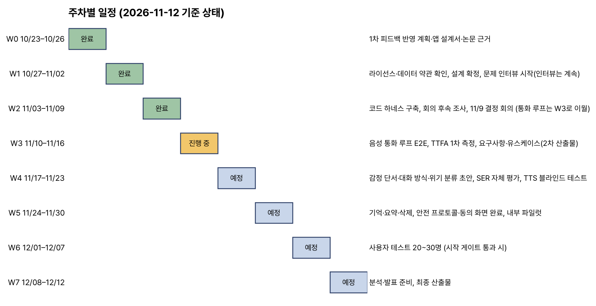

# 소프트웨어공학 프로젝트 2차 산출 보고서

## 음성 기반 개인 맞춤형 AI 서비스 "한벗" — 요구사항 명세서 및 유스케이스

- 팀: 문워크 (한남대학교 빅데이터응용학과)
- 작성일: 2026. 11. 12.
- 산출물 범위: 요구사항 명세서(기능적·비기능적), 유스케이스 다이어그램, 주요 유스케이스 시나리오, 1차 산출물 피드백 반영 사항

---

## 0. 1차 산출물 피드백 반영 요약

1차 산출물(2026. 10. 3.)에 대해 받은 보완 의견 다섯 가지를 아래 절에 반영하였음.

<표 0> 피드백 반영 위치

| 번호 | 피드백 요지 | 반영 내용 | 반영 절 |
|---|---|---|---|
| ① | 음성 감정 분석의 정확도·한계 검증 계획 부재, 오추정 시 사용자 위험 | 검증 계획(평가 데이터·프로토콜·합격선)과 오추정 위험·완화 표를 추가하고, 감정 추정을 "단정"이 아니라 "확인 질문"으로만 쓰도록 요구사항에 고정 | 5절, FR-05·FR-06, NFR-Q1~Q4 |
| ② | 위기 상황(자해 암시 등) 대응 흐름과 전문 기관 안내 방식 미명시 | 위기 2단 분류·안전 모드·109 안내의 흐름도와 상태 전이표, 실패 시 동작을 추가 | 6절, UC-06, FR-09~FR-11, NFR-S1~S4 |
| ③ | 표 2의 "익명 커뮤니티"는 성격이 다른 비교 대상 | 표를 둘로 분리. 표 2-A는 "기존 고민 경로의 한계"(문제 정의), 표 2-B는 "경쟁 서비스 비교"(서비스 포지셔닝) | 1.2절 |
| ④ | 10/22까지 "작업 없음", 개발 기간이 짧아 보임, 주차별 계획을 표로 | 10/23부터 12/12까지 주차별 계획을 표로 작성하고 11/12 기준 진행 상태를 함께 기재 | 8절 |
| ⑤ | 대화 기억 관리의 데이터 저장 범위와 보관 기간 정의 | 데이터 종류별 목적·동의·저장 위치·보관 기간 표, 저장소별 삭제 범위 표를 추가 | 7절, FR-16~FR-19, NFR-P1~P6 |

---

## 1. 프로젝트 개요 (1차 산출물 보완)

### 1.1 문제 정의 (요약)

- 1차 산출물과 동일함. 청년층의 고립·정서적 어려움, 대학생의 대인관계·팀 프로젝트 고민, 텍스트 기반 대화형 AI의 음성 감정 단서 미반영을 문제로 설정함.
- 1차 타깃은 대학생으로 유지함(2026. 11. 7. 팀 회의에서 고령층은 대상에서 제외하기로 확정).

### 1.2 기존 대안과 경쟁 서비스 (피드백 ③ 반영)

❍ 1차 산출물의 표 2는 "고민을 털어놓는 기존 경로의 한계"와 "경쟁 서비스 비교"가 한 표에 섞여 있어, 익명 커뮤니티가 경쟁 서비스처럼 읽히는 문제가 있었음. 아래와 같이 두 표로 분리함.

<표 2-A> 기존 고민 경로의 한계 (문제 정의 관점)

| 경로 | 접근성 | 비밀 보장 | 맥락 유지 | 감정 단서 반영 | 한계 |
|---|---|---|---|---|---|
| 지인(친구·가족) | 높음 | 낮음(관계가 얽힘) | 높음 | 높음 | 관계 부담, 같은 고민을 반복해 말하기 어려움 |
| 익명 커뮤니티 | 높음 | 중간(불특정 다수 노출) | 없음(매번 재설명) | 없음 | 공감 대신 평가가 돌아올 수 있음 |
| 텍스트 기반 대화형 AI | 매우 높음 | 높음(1:1) | 제한적 | 없음(문장만 분석) | "그냥 내가 다 하면 되지" 속 서운함을 놓침 |
| 전문 심리상담 | 낮음(예약·비용·대기) | 높음 | 높음 | 높음 | 일상의 작은 고민까지 다루기에는 문턱이 높음 |

<표 2-B> 경쟁 서비스 비교 (서비스 포지셔닝 관점)

| 항목 | 한벗 | 텍스트 캐릭터 챗(제타·크랙 등) | 음성 AI(ChatGPT 음성·Gemini Live) | 정신건강 앱(Wysa 등) |
|---|---|---|---|---|
| 입력 방식 | 음성 통화 | 텍스트 | 음성 | 텍스트 중심 |
| 감정 파악 | 음성 단서(억양·속도·멈춤) + 글 | 글만 | 글 중심(감정 단서 미공개) | 글만 |
| 감정 처리 방식 | 단정하지 않고 확인 질문 | 없음 | 없음 | 설문·척도 |
| 대화 방식 선택 | 들어줘·정리·조언 3모드 | 캐릭터 설정 | 없음 | 프로그램 기반 |
| 기억 관리 | 저장 전 승인, 사실·추정 분리, 열람·수정·삭제 | 대화 기록 | 계정 메모리 | 제한적 |
| 위기 대응 | 2단 분류 + 안전 모드 + 109 안내 | 청소년 이용 제한 | 안전 정책 | SOS 화면 |
| 포지션 | 안전한 경청·동반(치료 아님) | 롤플레이·엔터테인먼트 | 범용 비서 | 웰니스·치료 보조 |

---

## 2. 요구사항 명세서

### 2.1 용어 정의

<표 3> 용어

| 용어 | 정의 |
|---|---|
| 턴(turn) | 사용자가 말하기 시작해 한벗에게 발언권을 넘기기까지의 발화 한 덩어리 |
| TTFA | Time To First Audio. 사용자 발화 종료 시점부터 한벗의 첫 음성이 재생되기까지의 시간 |
| 감정 단서 | 음성에서 추정한 범주(답답함·밝음·가라앉음·불안·중립)와 점수, 속도·멈춤 지표 |
| 확인 질문 | 감정 단서를 단정하지 않고 "목소리가 좀 가라앉은 것 같은데, 맞아?"처럼 되묻는 문장 |
| 3단 동의 | R(필수: 서비스 이용·대화 기록 저장), S(선택: 음성 감정 단서 분석), V(선택: 원본 음성 보관, MVP에서는 비활성) |
| 기억 상태 | stated(내가 말한 것) → inferred(한벗이 추정한 것) → confirmed(사용자가 맞다고 한 것) → approved(저장을 승인한 것) |
| 안전 모드 | 위기 신호 감지 시 조언 생성을 멈추고 사전 검수된 안내와 109 카드를 제공하는 상태 |
| 109 | 보건복지부 자살예방상담전화(24시간) |

### 2.2 기능적 요구사항

- 우선순위: P0 = 12월 발표까지 반드시 구현, P1 = 가능하면 구현, P2 = 이후.
- 수용 기준의 수치는 시험한 표본 안에서의 결과로만 보고하며 서비스 전체 성공률을 보증하지 않음.

<표 4> 기능적 요구사항

| ID | 요구사항 | 설명 | 우선순위 | 수용 기준 | 관련 UC |
|---|---|---|---|---|---|
| FR-01 | 온보딩·AI 고지 | 첫 실행 시 "한벗은 AI 친구이며 치료나 상담을 대신하지 않는다"는 고지와 109 안내, 위기 시 사람이 실시간으로 연락하지 않는다는 운영 범위를 보여준다 | P0 | 고지 문구가 온보딩·통화 화면·첫 인사 3곳에 노출 | UC-01 |
| FR-02 | 3단 동의 수집 | R(필수)·S(선택)·V(선택) 동의를 개별로 받고, 각 동의가 켜고 끄는 기능을 설명한다. R 없이는 서비스를 쓸 수 없고 109 카드만 볼 수 있다 | P0 | 8개 동의 조합별 허용 기능표와 실제 동작 일치 8/8 | UC-01, UC-09 |
| FR-03 | 음성 통화 루프 | 사용자는 1탭으로 통화를 시작하고, 음성 인식 → 대화 생성 → 음성 합성이 끊기지 않고 이어진다. 양쪽 자막을 표시한다 | P0 | 기기 3종 × 환경 2종 × 출력 2종에서 10분 통화 완료율 보고(목표 90% 이상) | UC-02 |
| FR-04 | 대화 방식 선택 | "그냥 들어줘", "함께 정리해줘", "솔직하게 조언해줘" 중 하나를 통화 전·중에 선택·전환한다. AI의 감정 추정보다 사용자의 선택이 우선한다 | P0 | "들어줘" 모드에서 조언 문장 발생 5% 이하(판정 지침·2인 판정) | UC-03 |
| FR-05 | 음성 감정 단서 분석 | S 동의가 있을 때만 턴 종료 시 음성에서 감정 범주·점수와 속도·멈춤 지표를 계산한다. 결과가 해당 턴의 응답 생성 시작 전에 도착하지 않으면 폐기하고 다음 턴에 쓰지 않는다 | P0 | 늦게 도착한 결과가 다음 턴에 쓰인 건수 0(로그) | UC-04 |
| FR-06 | 확인 질문 | 감정 단서는 단정 표현 없이 확인 질문으로만 쓴다. 조건: 점수 기준 충족, 직전 5턴에 질문 없음, S 동의, 안전 모드 아님. 사용자가 "아니야"라고 하면 그 세션에서 같은 범주는 다시 묻지 않는다 | P0 | 단정 표현 0건(100턴, 판정 지침·2인 판정), 확인 질문 지표 5종 보고 | UC-04 |
| FR-07 | 끼어들기 | 한벗이 말하는 중 사용자가 말하거나 화면을 탭하면 재생을 멈춘다. "응", "음" 같은 짧은 맞장구에는 멈추지 않고 이어 말한다 | P0 | 사용자 발화 시작부터 재생 중단까지 300ms 이하(칸별 20회) | UC-05 |
| FR-08 | 보류·음소거 | 보류는 마이크와 한벗 발화를 모두 멈추고, 음소거는 마이크만 끈다 | P0 | 두 기능이 분리되어 동작 | UC-05 |
| FR-09 | 위기 신호 1단 감지 | 매 턴 전사에서 명시적 자살·자해 표현을 키워드 게이트로 검사하고, 양성이면 대화 생성을 거치지 않고 즉시 안전 모드로 전환한다 | P0 | 평가 세트에서 명시 위기 재현율 0.90 이상, 비위기 오탐 10% 이하 | UC-06 |
| FR-10 | 위기 신호 2단 감지 | 대화 생성 응답 첫 줄의 위험 태그(L0/L1/L2)를 해석해 L1이면 생성문을 폐기하고 안전 모드로, L2면 세션 점수를 누적해 기준 초과 시 부드럽게 안내한다 | P0 | 위험 태그 형식 준수율 99% 이상 | UC-06 |
| FR-11 | 안전 모드·전문기관 안내 | 안전 모드에서는 조언을 멈추고 사전 검수된 짧은 공감 응답과 109 카드(전화 연결·번호 복사), 지역 정신건강복지센터를 안내한다. 사용자의 중지·종료·정정 발화는 항상 처리한다 | P0 | 시나리오 20개에서 안전 규칙 유지, 유해 발화 0건 | UC-06 |
| FR-12 | 통화 후 요약 | 통화 종료 후 15초 이내에 오늘 이야기 요약과 사용자가 확인한 감정만 표시한다 | P0 | 종료 후 15초 이내 표시(목표) | UC-07 |
| FR-13 | 기억 후보 승인 | 요약에서 추출한 기억 후보를 "내가 말한 것"과 "한벗이 느낀 것"으로 나눠 보여주고, 항목별로 승인·거절한다. 승인되지 않은 후보는 저장·검색되지 않는다 | P0 | 미승인 후보가 다음 통화 맥락에 노출된 건수 0(자동 테스트) | UC-07 |
| FR-14 | 기억 열람·수정·삭제 | 저장된 기억을 상태별로 열람하고 수정·삭제한다. 수정·삭제는 다음 통화부터 반영된다 | P0 | 반영률 100% | UC-08 |
| FR-15 | 사용자 격리 | 사용자는 자신의 기억·전사만 접근할 수 있다 | P0 | A 사용자 인증으로 B의 데이터 접근 시도 100% 차단 | UC-08 |
| FR-16 | 동의 변경·통화 중 철회 | 설정에서 S 동의를 끄면 진행 중인 감정 분석을 취소하고 이후 감정 단서·추정 기억을 만들지 않는다 | P0 | 철회 10회 시 철회 이후 저장 0건 | UC-09 |
| FR-17 | 원본 음성 폐기 | 원본 음성은 음성 인식·감정 분석 처리 직후 메모리와 임시 파일에서 삭제하며 자체 저장소에 보관하지 않는다 | P0 | 처리 후 음성 파일 잔존 0건(자동 테스트) | UC-10 |
| FR-18 | 데이터 삭제 요청 | 기억 1건·대화 1건·계정 전체 단위로 삭제를 요청할 수 있다. 운영 DB·임베딩·캐시·진행 중 작업은 24시간 이내에 삭제한다 | P0 | 설계 범위 저장소에서 요청 24시간 후 잔존 0건(자동 테스트) | UC-10 |
| FR-19 | 삭제 기억 재생성 방지 | 삭제한 기억이 요약에서 다시 후보로 올라오지 않도록 차단한다 | P0 | 삭제 후 같은 후보 재등장 0건 | UC-10 |
| FR-20 | 사용 시간 표시·휴식 알림 | 오늘 사용 시간을 표시하고, 일일 60분·주 6일(임시 기준) 경계에서 휴식을 권한다. 안전 모드 중에는 알림을 보류한다 | P0 | 경계에서 알림 100%(시뮬레이션) | UC-11 |
| FR-21 | 위기 로그 점검 | 운영자는 S 동의 사용자의 위기 판정 로그와 오탐·안전 모드 전환 횟수를 점검한다 | P0 | 사용자 테스트 기간 매일 1회 점검 기록 | UC-12 |
| FR-22 | 음성 선택 | 온보딩에서 2~3종 목소리를 미리 듣고 고른다 | P1 | — | UC-01 |
| FR-23 | 맞장구·필러 | 사용자가 길게 말하다 쉬면 작은 맞장구 클립을, 응답이 1초 이상 늦을 때만 필러를 재생한다 | P1 | 맞장구 8~10초당 1회 이하, 연속 금지 | UC-02 |
| FR-24 | 텍스트 입력 전환 | 통화 화면에서 텍스트 입력으로 전환한다 | P1 | 사용 비율 로그 | UC-02 |

### 2.3 비기능적 요구사항

<표 5> 비기능적 요구사항

| ID | 분류 | 요구사항 | 측정·검증 방법 | 근거·비고 |
|---|---|---|---|---|
| NFR-R1 | 성능(지연) | TTFA 중앙값 1.0초 이하를 목표로 하고, 90퍼센타일 1.5초 이하, 4초 초과는 실패로 집계한다 | 턴마다 발화 종료 시각과 첫 재생 시각을 기록해 분포 보고 | 사람 간 대화 턴 간격 평균 약 0.2초, 응답 지연 선호는 약 1초에서 정점·2초에서 평탄 |
| NFR-R2 | 성능(지연) | 끼어들기 시 재생 중단 300ms 이하 | 칸별 20회 측정 | — |
| NFR-R3 | 성능(지연) | 말 끝 감지에서 머뭇거림 중 끊는 비율 10% 이하 | 머뭇거림 포함 녹음 50턴 이상·화자 10명 이상 | — |
| NFR-Q1 | 품질(감정 인식) | 감정 인식 성능은 화자 독립 분할·4감정(분노·기쁨·중립·슬픔) 기준 UA(비가중 정확도)로 보고하고, 합격선 0.70을 넘지 못하면 감정 단서 기능을 끈 채 출시한다 | 개발·보정·최종 세트를 화자 기준으로 분리, 화자 단위 부트스트랩 신뢰구간 | 한국어 공개 기준선은 KEMDy19 화자 독립 UA 66.26으로, 0.70은 보장된 숫자가 아님 |
| NFR-Q2 | 품질(감정 인식) | 감정 점수는 보정(ECE 측정) 전에는 확률로 해석하지 않고 순위용으로만 쓴다. 불확실하면 판정보류(시작값 약 25%)로 두고 묻지 않는다 | 보정 세트에서 신뢰도 곡선·ECE 보고 | — |
| NFR-Q3 | 품질(감정 인식) | 음성 단서는 분류를 늘리지 않고 5감정 + 판정보류 + 2축(긍정–부정, 흥분도)으로 제한한다. 불안은 글 우선, 가라앉음은 축 조건으로 정의한다 | 설계 문서 대조 | 클래스를 늘려 정확도가 오른 연구가 없음 |
| NFR-Q4 | 품질(위기) | 위기 평가 세트에서 명시 위기 재현율 0.90 이상, 비위기 오탐 10% 이하. 중간 위험·암시 유형은 별도 보고 | 명시·자해·암시·중간·대조 유형별 평가 세트(동결) | 시험 세트 성능이며 실제 안전성 보증 아님 |
| NFR-S1 | 안전 | 음성 감정 단서는 위기 위험도 계산에 넣지 않는다. 위기 판단은 글(키워드 게이트 + 위험 태그) 기반으로 한다 | 코드 검토 | 감정 점수에서 위기로 넘어갈 근거가 없음 |
| NFR-S2 | 안전 | 대화 생성·음성 합성 장애 시에도 사전 녹음된 안전 안내와 109 카드를 제공한다 | 장애 주입 테스트 | — |
| NFR-S3 | 안전 | 진단 척도(PHQ-9·GAD-7 등)와 효능 주장을 쓰지 않는다 | 문구 리뷰 체크리스트 | 전문가 검토 전까지 |
| NFR-S4 | 안전 | 사용자 테스트는 위기 평가 통과, 전문가 문구 검수, 동의·삭제·격리 테스트 통과, 연구윤리 절차 확인, 위기 운영 담당 지정이 모두 충족된 뒤 시작한다 | 시작 게이트 체크리스트 | — |
| NFR-P1 | 개인정보 | 원본 음성은 저장하지 않고 처리 직후 폐기한다. 화자 식별 정보(voiceprint)는 생성하지 않는다 | 자동 테스트 | 생체인식정보 요건 회피 |
| NFR-P2 | 개인정보 | 감정 단서·추정 기억은 별도 동의(S) 없이는 만들지 않고, 동의가 있어도 가명 키로 분리 저장한다 | 동의 조합 테스트 8/8 | 개인정보 보호법 제23조 민감정보 |
| NFR-P3 | 개인정보 | 데이터는 종류별 목적이 끝나면 지체 없이 파기한다(7절 표). 보관 기간 숫자는 처리방침에 명시한다 | 처리방침·코드 대조 | 개인정보 보호법 제21조 |
| NFR-P4 | 개인정보 | 외부 AI 서비스(음성 인식·대화 생성·음성 합성)로의 전송과 국외 이전을 온보딩에서 고지하고, 각 업체의 학습 미사용·보존 기간 조항을 확인한다 | 약관 확인표 | — |
| NFR-P5 | 보안 | 전사·기억은 암호화 저장하고, 데이터베이스 행 수준 보안(RLS)으로 사용자별 격리한다 | 격리 테스트 100% | — |
| NFR-P6 | 보안·로그 | 로그에 사용자 발화 원문을 남기지 않는다(길이·시각·라벨만) | 로그 검사 | — |
| NFR-U1 | 사용성 | 통화 시작은 1탭, 확인 질문 응답은 1탭(맞아/아니야) 또는 음성 | 사용자 테스트 관찰 | — |
| NFR-U2 | 사용성 | 안전 모드 카드는 어느 화면에서든 1탭으로 접근(SOS) | 화면 흐름 검사 | — |
| NFR-A1 | 가용성 | 음성 인식·음성 합성 공급사 장애 시 대안 공급사로 전환 가능한 구조(어댑터) | 어댑터 교체 테스트 | — |
| NFR-C1 | 호환성 | iPhone Safari, Android Chrome, 노트북 Chrome에서 동작 | 기기 3종 테스트 | — |
| NFR-L1 | 법규·라이선스 | 사용하는 모델·데이터의 상업 이용 조건을 확인하고 불확실한 것은 제품에 넣지 않는다 | 라이선스 체크리스트 | emotion2vec+ 가중치 조건, KEMDy·AI Hub 약관 확인 중 |
| NFR-M1 | 유지보수 | 규칙 값(감정 임계값, 턴 수, 보관 기간)은 설정 파일로 분리해 코드 변경 없이 조정한다 | 설정 파일 존재 | 11/9 회의 결정 대기 항목 |

---

## 3. 유스케이스 다이어그램

### 3.1 액터

<표 6> 액터 정의

| 액터 | 설명 |
|---|---|
| 사용자(대학생) | 고민을 음성으로 말하고 기억·동의·삭제를 관리하는 주 사용자 |
| 운영자(PM·안전 담당) | 사용자 테스트 기간 위기 로그와 운영 지표를 점검하는 팀원 |
| 음성 인식 서비스(RTZR STT) | 통화 음성을 실시간 전사하는 외부 시스템 |
| 대화 생성 서비스(Claude) | 모드·기억·감정 단서를 반영해 응답과 위험 태그를 생성하는 외부 시스템 |
| 음성 합성 서비스(Typecast) | 응답 문장을 음성으로 합성하는 외부 시스템 |
| 자살예방상담전화 109 | 위기 시 안내·연결되는 외부 기관(MVP는 전화 연결과 번호 안내) |

### 3.2 다이어그램

그림 1. 한벗 유스케이스 다이어그램

<표 7> 유스케이스 목록

| ID | 유스케이스 | 주 액터 | 관계 | 관련 요구사항 |
|---|---|---|---|---|
| UC-01 | 온보딩·3단 동의 | 사용자 | — | FR-01, FR-02, FR-22 |
| UC-02 | 음성 통화로 고민 말하기 | 사용자, STT, Claude, TTS | UC-03·05·07·11 포함, UC-04·06 확장 | FR-03, FR-23, FR-24 |
| UC-03 | 대화 방식 선택 | 사용자 | UC-02에 포함 | FR-04 |
| UC-04 | 감정 단서 확인 질문 | (시스템) | UC-02 확장(S 동의·점수 조건) | FR-05, FR-06 |
| UC-05 | 끼어들기·보류·음소거 | 사용자 | UC-02에 포함 | FR-07, FR-08 |
| UC-06 | 위기 신호 대응 | (시스템), 109 | UC-02 확장(위기 신호), UC-12 포함 | FR-09~FR-11 |
| UC-07 | 통화 후 요약·기억 승인 | 사용자 | UC-02에 포함 | FR-12, FR-13 |
| UC-08 | 기억 열람·수정·삭제 | 사용자 | — | FR-14, FR-15 |
| UC-09 | 동의 변경·통화 중 철회 | 사용자 | — | FR-02, FR-16 |
| UC-10 | 데이터 삭제 요청 | 사용자 | — | FR-17~FR-19 |
| UC-11 | 사용 시간·휴식 알림 | (시스템) | UC-02에 포함 | FR-20 |
| UC-12 | 위기 로그 점검·운영 지표 조회 | 운영자 | UC-06에 포함 | FR-21 |

---

## 4. 주요 유스케이스 시나리오

### UC-02 음성 통화로 고민 말하기

| 항목 | 내용 |
|---|---|
| 주 액터 | 사용자(대학생) |
| 보조 액터 | 음성 인식 서비스, 대화 생성 서비스, 음성 합성 서비스 |
| 사전 조건 | 필수 동의(R) 완료, 마이크 권한 허용, 네트워크 연결 |
| 사후 조건 | 전사와 턴 이벤트가 저장되고, 통화 종료 시 UC-07(요약·기억 승인)로 이어진다 |
| 관련 요구사항 | FR-03, FR-04, FR-07, NFR-R1~R3 |

기본 흐름
1. 사용자가 홈 화면에서 통화 버튼을 1탭한다.
2. 시스템은 통화 화면(고지 문구, 모드 선택, 자막, 보류·음소거·종료)을 표시하고 첫 인사에서 AI임을 밝힌다.
3. 사용자가 말한다. 시스템은 음성 활동 감지와 말 끝 감지로 턴 종료를 판정하고, 음성 인식 서비스가 전사를 생성한다.
4. 시스템은 선택된 모드, 승인된 기억, (S 동의 시) 감정 단서를 묶어 대화 생성 서비스에 보낸다. 이때 위기 2단 분류(UC-06)가 매 턴 실행된다.
5. 대화 생성 서비스가 응답을 스트리밍하면 시스템은 첫 줄의 위험 태그를 떼어내고 문장 단위로 음성 합성 서비스에 보낸다.
6. 첫 음성이 재생되는 시각을 기록해 TTFA를 계산한다.
7. 3~6을 반복한다. 사용자가 종료를 누르면 통화를 끝내고 UC-07로 이동한다.

대안 흐름
- 3a. 사용자가 머뭇거리며 말을 멈춘 경우: 말 끝 감지가 "아직 끝나지 않음"으로 판정하면 기다린다. (P1) 3~4초 이상 말하다 쉬면 작은 맞장구 클립을 재생한다.
- 4a. S 동의가 없으면 감정 단서를 계산하지 않고 전사와 기억만 보낸다.
- 5a. 응답 첫 소리가 1초 시점까지 준비되지 않으면 (P1) 필러를 한 번 재생한다. 1.5초 이하 지연에서는 필러를 쓰지 않는다.
- 6a. 한벗이 말하는 중 사용자가 끼어들면 UC-05로 처리한다.

예외 흐름
- E1. 음성 인식 서비스 장애: 텍스트 입력 전환(P1)을 안내하거나 재시도한다. 대안 공급사 어댑터로 전환한다.
- E2. 대화 생성 서비스 시간 초과: 고정 사과 문구를 재생하고 재시도한다.
- E3. 위기 신호 감지: UC-06으로 분기한다.

### UC-03 대화 방식 선택

| 항목 | 내용 |
|---|---|
| 주 액터 | 사용자 |
| 사전 조건 | 통화 전 또는 통화 중 |
| 사후 조건 | 이후 응답이 선택된 모드의 지침으로 생성된다 |
| 관련 요구사항 | FR-04 |

기본 흐름
1. 사용자가 "들어줘 / 정리 / 조언" 중 하나를 누른다.
2. 시스템은 다음 턴부터 해당 모드의 시스템 지침을 적용한다. "들어줘"에서는 해결책 제시를 금지하고 되비추기와 짧은 공감만 허용한다.
3. 사용자가 통화 중 모드를 바꾸면 즉시 전환하고 자막에 전환을 표시한다.

대안 흐름
- 2a. 안전 모드 중에는 모드 전환이 잠긴다(UC-06).

### UC-04 감정 단서 확인 질문

| 항목 | 내용 |
|---|---|
| 주 액터 | 시스템(사용자가 응답) |
| 사전 조건 | S 동의 켜짐, 안전 모드 아님, 해당 턴의 감정 단서가 응답 생성 시작 전 도착 |
| 사후 조건 | 사용자가 "맞아"라고 한 단서만 confirmed 상태가 되고, 요약·기억 후보에 쓰인다 |
| 관련 요구사항 | FR-05, FR-06, NFR-Q1~Q3 |

기본 흐름
1. 턴이 끝나면 시스템은 해당 발화의 음성에서 감정 범주·점수와 속도·멈춤 지표를 계산한다.
2. 조건(점수 기준 충족, 직전 5턴에 질문 없음, 판정보류 아님)을 모두 만족하면 대화 생성 서비스에 "[음성 단서] 범주=가라앉음, 말 속도=평소보다 느림" 형태로 전달한다. 점수는 전달하지 않는다.
3. 응답 끝에 "목소리가 좀 가라앉은 것 같은데, 맞아?" 한 문장을 붙인다. 단정 표현("너 우울하구나"), 라벨 직역, 진단 용어는 쓰지 않는다.
4. 사용자가 음성이나 [맞아]/[아니야] 버튼으로 답한다.
5. "맞아"면 confirmed로 기록한다(저장은 아직 아님). "아니야"면 단서를 폐기하고 그 세션에서 같은 범주는 다시 묻지 않는다. 무응답이면 폐기한다.

대안 흐름
- 1a. 발화가 2초 미만이거나 전사가 비었거나, 세션 초반(3턴 또는 30초 미만)이면 상대 지표를 쓰지 않는다.
- 2a. 글의 극성과 목소리가 어긋나면("괜찮아"라고 말했지만 가라앉은 목소리) 평균을 내지 않고 불일치로 따로 되묻는다(3턴에 1회, 10턴에 2회 이하).
- 2b. 1·2위 범주의 확률이 비슷하거나 보정 신뢰도가 낮으면 판정보류로 두고 라벨을 말하지 않는다. 필요하면 "오늘은 어땠어?" 같은 열린 질문만 한다.

예외 흐름
- E1. 감정 단서가 응답 생성 시작 후에 도착하면 폐기한다. 다음 턴에 쓰지 않는다.

### UC-06 위기 신호 대응 (안전 모드·109 안내)

| 항목 | 내용 |
|---|---|
| 주 액터 | 시스템 |
| 보조 액터 | 자살예방상담전화 109(전화 연결), 운영자(사후 점검) |
| 사전 조건 | 통화 중, 매 턴 전사가 생성됨 |
| 사후 조건 | 안전 모드 진입·해제 이력이 기록되고(S 동의 시 위기 로그), 세션 말미에 안내를 다시 보여준다 |
| 관련 요구사항 | FR-09~FR-11, NFR-Q4, NFR-S1~S4 |

기본 흐름
1. 턴 전사가 도착하면 키워드 게이트가 명시적 자살·자해 표현을 검사한다.
2. 양성이면 대화 생성 서비스를 호출하지 않고 즉시 안전 모드로 들어간다. 사전 녹음된 안전 스크립트("지금 많이 힘든 것 같아. 혼자 견디지 않아도 돼. 지금 안전한 곳에 있어?")를 재생하고 109 카드(전화 연결·번호 복사)와 지역 정신건강복지센터를 전면에 띄운다.
3. 음성이면 대화 생성 서비스에 보내고 응답 첫 줄의 위험 태그를 읽는다. L1(명시적 의도·계획·수단)이면 생성문을 폐기하고 2와 같이 처리한다. L2(암시적 신호)면 세션 점수를 누적하고 2점 이상에서 부드럽게 안내한다(임시 기준). L0이면 태그를 떼고 정상 재생한다.
4. 안전 모드 중에는 조언 생성을 멈추고 짧은 공감 응답만 하며, 모드 전환을 잠그고 휴식 알림을 보류한다. 사용자의 "그만", "끊을게", "그런 뜻 아니었어" 같은 중지·종료·정정 발화는 항상 처리한다.
5. 사용자가 "안전해"라고 말하고 이후 3턴 연속 신호가 없으면 일반 모드로 돌아간다(임시 기준, 전문가 검토 대상). 카드는 화면 하단에 유지하고 세션 말미에 다시 안내한다.
6. 운영자는 (S 동의 사용자에 한해) 위기 로그를 매일 점검한다(UC-12).

대안 흐름
- 3a. 위험 태그가 없거나 형식이 깨지면 L0으로 처리하되 키워드 결과는 유지하고 기록한다.
- 4a. 정정 직후 새 L1 신호가 오면 L1이 우선한다.
- 2a. 사용자가 통화를 종료하거나 연결이 끊기면 카드 화면과 번호 복사 버튼을 남긴다.

예외 흐름
- E1. 대화 생성·음성 합성 장애: 사전 녹음된 안내 음성과 카드를 제공한다.
- E2. 음성 인식 결과가 비어 있음: 분류 불가로 기록하고 빈도를 측정한다.

그림 2. 위기 신호 대응 흐름도

### UC-07 통화 후 요약·기억 승인

| 항목 | 내용 |
|---|---|
| 주 액터 | 사용자 |
| 사전 조건 | 통화 종료 |
| 사후 조건 | 승인된 기억만 approved 상태로 저장되고 다음 통화 맥락에 쓰인다 |
| 관련 요구사항 | FR-12, FR-13, FR-19 |

기본 흐름
1. 통화가 끝나면 시스템은 15초 이내에 요약 화면을 표시한다. 요약에는 오늘 이야기의 핵심, 사용자가 "맞아"라고 확인한 감정, 사용자가 말한 계획만 들어간다.
2. 시스템은 기억 후보를 "내가 말한 것"(stated)과 "한벗이 느낀 것"(confirmed된 추정)으로 나눠 보여주고, 각 항목에 근거 문장을 붙인다.
3. 사용자가 항목별로 [기억해]/[버려]를 누른다. 승인한 항목만 approved로 저장한다.
4. 승인하지 않은 후보는 저장·검색되지 않으며 다음 통화에 노출되지 않는다.

대안 흐름
- 2a. 확인되지 않은 추정(inferred)은 후보로 올리지 않는다.
- 3a. 사용자가 응답하지 않고 화면을 떠나면 후보는 보류 상태로 남고 홈에 "확인할 기억 N개" 배지를 표시한다.

예외 흐름
- E1. 삭제된 기억과 같은 내용이 후보로 추출되면 차단한다(재생성 방지).

### UC-08 기억 열람·수정·삭제

| 항목 | 내용 |
|---|---|
| 주 액터 | 사용자 |
| 사전 조건 | 로그인, 저장된 기억 존재 |
| 사후 조건 | 변경이 다음 통화부터 반영된다 |
| 관련 요구사항 | FR-14, FR-15, NFR-P5 |

기본 흐름
1. 사용자가 기억 탭에서 "내가 말한 것"과 "한벗이 느낀 것"으로 나뉜 목록을 본다. 각 항목에 상태 배지와 생성일을 표시한다.
2. 사용자가 항목을 수정("내가 말한 것"만)하거나 삭제한다.
3. 시스템은 즉시 반영하고, 삭제는 임베딩과 같은 트랜잭션에서 처리한다.

예외 흐름
- E1. 다른 사용자의 기억 ID로 접근을 시도하면 행 수준 보안이 차단하고 기록한다.

### UC-09 동의 변경·통화 중 철회

| 항목 | 내용 |
|---|---|
| 주 액터 | 사용자 |
| 사전 조건 | 필수 동의 완료 |
| 사후 조건 | 변경된 동의 조합에 맞는 기능만 동작한다 |
| 관련 요구사항 | FR-02, FR-16, NFR-P2 |

기본 흐름
1. 사용자가 설정에서 S(감정 단서) 동의를 끈다.
2. 시스템은 동의 철회 이벤트를 기록하고, 통화 중이면 감정 분석 처리기를 즉시 비활성화하고 진행 중인 분석 작업을 취소한다.
3. 이후 턴부터 감정 단서·확인 질문·"한벗이 느낀 것" 후보를 만들지 않는다.
4. 사용자가 기존 "한벗이 느낀 것" 기억의 삭제 여부를 선택한다.

대안 흐름
- 1a. 필수 동의(R)를 철회하면 서비스 이용이 중단되고 계정 삭제 절차(UC-10)로 안내한다.

### UC-10 데이터 삭제 요청

| 항목 | 내용 |
|---|---|
| 주 액터 | 사용자 |
| 사전 조건 | 로그인 |
| 사후 조건 | 요청 범위의 데이터가 설계 범위 저장소에서 24시간 이내 삭제된다 |
| 관련 요구사항 | FR-17~FR-19, NFR-P1, NFR-P3 |

기본 흐름
1. 사용자가 삭제 범위(기억 1건 / 대화 1건 / 계정 전체)를 선택한다.
2. 시스템은 삭제 큐에 넣고 예상 완료 시간을 안내한다.
3. 삭제 작업이 운영 DB·임베딩·캐시·진행 중 작업을 순서대로 처리하고, 삭제된 기억의 해시를 남겨 재생성을 막는다.
4. 완료 시 사용자에게 알린다.

대안 흐름
- 3a. 백업·외부 업체 사본은 각 보존 주기와 약관에 따라 처리되며, 처리방침에 "24시간은 운영 DB 기준"임을 명시한다.

---

## 5. 음성 감정 분석의 정확도·한계 검증 계획과 오추정 위험 (피드백 ① 반영)

### 5.1 기본 입장

❍ 한벗은 음성 감정 분석 결과를 "판정"이 아니라 "확인 질문의 계기"로만 사용함(FR-06). 모델은 감정을 이해하는 것이 아니라 학습 데이터의 소리 패턴과 라벨의 통계를 따라 확률을 내는 것이므로, 틀릴 수 있다는 전제를 대화 방식에 넣음.

❍ 현재 문헌으로 한국어 대학생 발화에서의 정확도는 보장할 수 없음. 공개된 한국어 화자 독립 기준선은 KEMDy19 4감정 UA 66.26이며, 영어 연기 데이터(IEMOCAP) 화자 독립 최고치도 UA 77.5 수준임. 학습한 데이터 밖의 코퍼스로 옮기면 성능이 크게 떨어진다는 보고가 많음. 따라서 합격선 UA 0.70은 "보장된 숫자"가 아니라 "이 아래면 기능을 끄는 기준"으로 둠.

### 5.2 검증 계획

<표 8> 감정 분석 검증 계획

| 구분 | 모델 성능 평가 (11월 4주) | 사용자 비교 실험 (12월 1주) |
|---|---|---|
| 목적 | 한국어 4감정 분류 성능과 보정 상태 확인 | 음성 단서 기반 확인 질문이 같은 질문 정책의 "글만" 조건보다 이해받는 느낌을 높이는가 |
| 데이터 | 공개 한국어 감정 음성(AI Hub, 약관 확인 후) + 팀 녹음(2인 판정·κ 보고) | 대학생 20~30명, 1인 3세션 |
| 분할 | 화자가 겹치지 않는 개발·보정·최종 세트, 최종 세트는 평가 전 동결 | 참가자 내 교차, 순서 무작위, 세션 간 추정 기억 이월 차단 |
| 주지표 | 최종 세트 UA(화자 단위 부트스트랩 구간), 클래스별 재현율, 혼동 행렬 | 세션 후 "이해받음" 5점 척도 |
| 보조 지표 | 보정 오차(ECE), 판정보류 커버리지-위험 곡선, 성별·발화 길이·코덱(Opus) 전후 차이 | 침해감, 거절률, 재사용 의향 |
| 합격선 | UA 0.70(미달 시 감정 단서 기능 비활성화), 분노 범주는 재현율 확인 전까지 질문 미사용 | 사전 정의한 최소 의미 효과(팀 결정), 심각한 부정 반응 시 참가자별 질문 중지 |
| 표본 | 평가 발화 200개 이상·화자 10명 이상(정확도 0.70에서 95% 구간 반폭 n=200 약 ±6.4%p, 독립 가정이라 실제는 더 넓음) | 20~30명(탐색적 해석) |

### 5.3 오추정 시 사용자 영향과 완화

<표 9> 오추정 위험과 완화

| 위험 | 사용자 영향 | 완화 설계 | 측정 |
|---|---|---|---|
| 오탐(없는 감정을 있다고 봄) | 침해감, "내 말을 안 듣는다"는 불신 | 단정 대신 확인 질문, "아니야" 시 폐기·같은 범주 재질문 금지, 판정보류, 5턴에 1회 상한 | 확인 질문 거절률, 세션 후 침해감 문항 |
| 미탐(저각성 감정을 중립으로 봄) | 외로움·우울처럼 각성이 낮은 신호를 놓침 | 범주가 아니라 긍정–부정·흥분도 축과 개인 기준선 대비 변화로 봄. 위기 판단은 음성이 아니라 글 기반으로 별도 수행 | 저각성 사례 재현율(별도 보고) |
| 글과 목소리의 불일치를 평균 내어 놓침 | "괜찮아"+가라앉은 목소리가 중립으로 사라짐 | 평균 대신 불일치를 따로 검출해 되물음 | 불일치 검출 정밀도 |
| 반복 오추정의 기억 누적 | 잘못된 "성격 꼬리표" | 추정은 사용자가 확인한 것만 confirmed, 저장은 승인한 것만, 열람·삭제 가능, 보관 기간 제한 | 수정 후 재언급률 |
| 점수를 확률로 오해 | 0.6을 "60% 맞다"로 해석해 과신 | 보정 전에는 순위용으로만 사용, 점수를 대화 생성에 넘기지 않음 | ECE 보고 |
| 연령·성별·방언 편향 | 특정 집단에서 정확도 하락 | 성별·억양 다양한 화자 10명 이상 평가, 집단별 UA 보고 | 집단별 UA 차이 |
| 늦게 도착한 결과의 오용 | 다음 턴 맥락에 엉뚱한 감정 반영 | 응답 생성 시작 전 미도착 시 폐기 | 적시 도착률, 오용 0건 |

❍ 중단 기준: 11월 4주 평가에서 UA가 0.70 미만이거나 결과가 턴 마감 전에 도착하는 비율이 50% 미만이면 감정 단서 기능을 후순위(P2)로 내리고, 확인 질문은 속도·멈춤 지표만으로 하거나 끈 채 출시함.

---

## 6. 위기 상황 대응 흐름과 전문 기관 안내 (피드백 ② 반영)

### 6.1 등급 정의

<표 10> 위기 등급

| 등급 | 정의 | 동작 |
|---|---|---|
| L0 | 신호 없음("죽겠다" 같은 관용 표현 포함) | 일반 모드 |
| L2 | 암시적 신호(무망감 등) | 단독으로 안전 모드 진입하지 않음. 세션 점수 누적, 2점 이상이면 부드러운 안내(임시 기준) |
| L1 | 명시적 자살·자해 의도·계획·수단 | 즉시 안전 모드 |
| 임박 위험(L1 하위) | 수단·시점이 구체적 | L1과 같음. 긴급 신고(112·119) 병기 여부는 전문가 자문 후 확정 |

### 6.2 상태 전이

<표 11> 안전 모드 상태 전이

| 상황 | 동작 |
|---|---|
| 진입(키워드 양성) | 대화 생성 호출 없이 사전 녹음 안전 스크립트 + 109 카드 전면 + 지역 정신건강복지센터 안내 |
| 진입(태그 L1) | 생성문 폐기 후 위와 같음 |
| 유지 | 짧은 공감 응답만, 조언·정리 금지, 모드 전환 잠금, 휴식 알림 보류, 카드 유지. 사용자의 중지·종료·정정 발화는 항상 처리 |
| 충돌 우선순위 | 키워드 양성 > 태그 L1 > 사용자 정정 > L2 누적 > 태그 누락. 정정 직후 새 L1이면 L1 우선 |
| 해제 | "안전해" + 연속 3턴 L1 없음 → 일반 모드. 카드는 하단에 유지, 세션 말미 재안내(3턴 기준은 임시이며 전문가 검토 대상) |
| 실패 동작 | 태그 누락·파싱 실패 → L0 처리 + 키워드 결과 유지 + 기록. 대화 생성·음성 합성 장애 → 사전 녹음 음성 + 카드. 전사 없음 → 분류 불가로 기록 |
| 통화 종료·연결 실패 | 카드 화면과 번호 복사 버튼을 남김 |

### 6.3 전문 기관 안내 방식

❍ 1차 안내: 자살예방상담전화 109(24시간). 카드에 전화 연결 버튼과 번호 복사 버튼을 둠. 1393은 109로 통합된 과거 번호이므로 쓰지 않음.
❍ 2차 안내: 지역 정신건강복지센터(대전 기준 센터명·번호를 처리방침과 카드에 명시, 확인 중), 청소년상담전화 1388 병기 여부는 자문 후 결정.
❍ 운영 범위 고지: 한벗 팀은 실시간으로 연락하지 않으며 의료·치료 서비스가 아님을 온보딩과 카드에 명시함. 109 공식 연동 API는 확인되지 않아 MVP는 번호 안내와 전화 링크 수준임을 밝힘.
❍ 음성 감정 단서는 위기 위험도 계산에 넣지 않음. 감정 점수에서 위기로 넘어갈 근거가 없고, 오탐이 불필요한 안전 모드 전환을 늘리기 때문임. 음성의 기여는 평가 세트에서 따로 측정한 뒤 재검토함.

### 6.4 검증 계획

<표 12> 위기 대응 검증

| 항목 | 방법 | 기준 |
|---|---|---|
| 평가 세트 | 한국어로 직접 작성한 다중 턴 시나리오 + 공개 벤치마크 번역본. 유형: 명시·자해·암시·중간 위험(수동적 사고)·비위기 대조. 평가 전 동결 | 유형별 100~300건 |
| 재현율·오탐 | 재현율 = 유형별 위기 발화 중 L1 판정 비율, 오탐 = 비위기 발화 중 L1 판정 비율(턴 단위·대화 단위 분리) | 명시 재현율 0.90 이상, 오탐 10% 이하 |
| 경로 비교 | 키워드 단독 / 태그 단독 / 결합을 같은 세트에서 비교(이중 구조의 이점을 가정하지 않음) | 결과 보고 |
| 전체 경로 | 녹음 → 음성 인식 → 분류 → 음성·카드까지 실제 경로로 시험(음성 인식 오류 포함) | 핵심어 오인식률 보고 |
| 탈옥·역할놀이 | 20개 시나리오에서 안전 규칙 유지 | 유해 발화 0건(시험 범위 내) |
| 전문가 검수 | 사용자 테스트 전 주에 안내 문구·흐름을 정신건강 전문가가 검수 | 미확보 시 테스트 연기 |

❍ 설명용 계산: 턴 단위 오탐 10%, 세션 30턴이면 비위기 사용자에게 세션당 약 3회 잘못된 안전 모드가 생길 수 있음. 따라서 턴 단위와 대화 단위 목표를 따로 정하고 운영 부담을 함께 평가함.

---

## 7. 데이터 저장 범위와 보관 기간 (피드백 ⑤ 반영)

### 7.1 원칙

❍ 필요 없는 데이터는 만들지 않고, 목적이 끝난 데이터는 지체 없이 파기함(개인정보 보호법 제21조). 다른 법령의 보존 의무가 있으면 그 기간을 따름.
❍ 감정 단서와 추정 기억은 건강 정보에 해당할 수 있으므로 별도 동의(S) 없이는 만들지 않음(제23조 민감정보). 화자 식별 정보(voiceprint)는 만들지 않음.
❍ 보관 기간의 숫자는 법령이나 문헌이 정해 주지 않으므로 아래 표의 "팀 결정 필요" 항목은 11/9 회의 결과와 법무 검토를 거쳐 처리방침에 명시함.

### 7.2 데이터 종류별 저장 범위

<표 13> 데이터 종류 × 목적 × 보관

| 데이터 | 목적 | 근거 동의 | 저장 위치 | 외부 전송 | 보관 기간 |
|---|---|---|---|---|---|
| 원본 음성 | 음성 인식·감정 분석 입력 | R | 저장 안 함(서버 메모리·임시 파일은 처리 직후 삭제) | 음성 인식 서비스 | 0일. 외부 업체 보관 조건은 약관 확인 후 처리방침에 명시 |
| 전사 텍스트 | 위기 분류, 응답 생성, 요약, 사용자 내려받기 | R | 암호화 DB | 대화 생성 서비스(국외 이전 고지) | 사용자 삭제·탈퇴·장기 미이용(기간 팀 결정 필요) 시까지 |
| AI 응답 텍스트 | 자막·요약 | R | 전사와 함께 | 음성 합성 서비스 | 전사와 동일 |
| 속도·멈춤 지표 | 확인 질문 | S | 가명 키 분리 저장 | 대화 생성(문장 형태) | 턴 종료 후 분석 완료 시까지(초안 30일, 목적 기준으로 재결정) |
| 감정 범주·점수 | 확인 질문, 테스트 지표 | S | 가명 키 분리 저장 | 대화 생성(범주만, 점수 제외) | 위와 같음 |
| 확인 응답(맞아/아니야) | 기억 상태 전이 | S | 기억 상태 | — | 기억과 동일 |
| 기억 "내가 말한 것" | 다음 통화 맥락 | R | 승인 시 저장, 암호화 | 대화 생성(프롬프트) | 사용자 삭제·탈퇴·장기 미이용 시까지 |
| 기억 "한벗이 느낀 것" | 다음 통화 맥락 | S | 승인 시 저장, 보관 기간 제한 | 대화 생성(프롬프트) | 초안 30일(팀 결정 필요), S 철회 시 삭제 선택 |
| 위기 판정(턴 단위) | 안전 모드 전환 | R(생명·신체 보호 목적, 법무 검토) | 저장 안 함(S 없을 때) | 대화 생성(전사 포함) | — |
| 위기 로그 | 오탐 분석·안전 점검 | S | 암호화 | — | 최소 보존(팀 결정 + 법무 검토) |
| 사용 시간 | 휴식 알림 | R | 저장 | — | 계정 삭제 시까지 |
| 계정·동의 기록 | 서비스 운영, 동의 증빙 | R | 저장 | — | 계정 삭제 후 법정 보존 기간 |

### 7.3 동의 조합별 허용 기능

<표 14> 3단 동의 조합

| R(필수) | S(감정 단서) | V(음성 보관) | 허용 기능 |
|---|---|---|---|
| ✕ | — | — | 서비스 이용 불가. 109 카드와 고지문만 열람 |
| ○ | ✕ | — | 통화, 전사, 요약(감정 줄 없음), "내가 말한 것" 기억, 위기 분류(글 기반)와 안내 |
| ○ | ○ | — | 위 기능 + 감정 단서·확인 질문·"한벗이 느낀 것" 기억·위기 로그 |
| ○ | ○/✕ | ○ | V는 목적·기간 확정 전까지 비활성(선택해도 기능 추가 없음) |

### 7.4 저장소별 삭제 범위

<표 15> 삭제 요청 처리

| 저장소 | 삭제 대상 | 완료 시점 | 상태 |
|---|---|---|---|
| 운영 DB | 계정, 전사, 요약, 기억, 단서, 사용 기록, 위기 로그 | 요청 후 24시간 이내(자동 테스트) | 설계 확정 |
| 임베딩(pgvector) | 기억·전사 임베딩 | 원본 행과 같은 트랜잭션 | 설계 확정 |
| 캐시·세션 컨텍스트 | 서버 세션, 클라이언트 자막·브라우저 저장소 | 세션 종료 즉시 | 설계 확정 |
| 진행 중 작업 | 요약·감정 분석·임베딩 큐 | 삭제 요청 시 취소, 완료 시점에 동의 재확인 | 설계 확정 |
| 임시 음성 파일 | 감정 분석 입력 | 처리 직후 | 설계 확정 |
| 재생성 방지 | 삭제된 기억의 재제안 | 해시로 같은 후보 차단, 과거 전사 재처리 금지 | 설계 확정 |
| 앱·지연 로그 | 사용자 키가 포함된 줄(발화 원문 없음) | 로그 보존 기간 만료 시 | 기간 팀 결정 필요 |
| 백업 | 스냅샷 안의 데이터 | 백업 보존 주기 종료 시. 처리방침에 "24시간은 운영 DB 기준"으로 명시 | 주기 팀 결정 필요 |
| 외부 업체(음성 인식·대화 생성·음성 합성) | 업체가 보관하는 요청 데이터 | 각 약관의 보존 기간 | 약관 확인 중 |

❍ "24시간 이내 삭제"는 법이 정한 기준이 아니라 팀의 내부 처리 목표이며, 법적 적정성은 별도 검토함.

---

## 8. 주차별 일정 (피드백 ④ 반영)

❍ 1차 산출물의 "10/9~10/22 작업 없음" 구간 이후 실제 개발 기간이 짧다는 지적에 따라, 10/23부터 12/12까지를 주차별 표로 재구성하고 2026. 11. 12. 기준 진행 상태를 함께 기재함. 공수 가정은 1인 주 약 15시간 × 4명.

<표 16> 주차별 계획과 진행 상태 (2026-11-12 기준)

| 주차 | 기간 | 목표 | 주요 산출물 | 검증 방법 | 상태 |
|---|---|---|---|---|---|
| W0 | 10/23–10/26 | 피드백 반영 계획 수립 | 피드백 반영 계획서, 앱 설계서(기능별 구현 방법·7주 일정), 기술 논문 근거 문서 | 설계서 비평 검토 27건 반영 | 완료 |
| W1 | 10/27–11/02 | 라이선스·데이터 약관 확인, 설계 확정, 문제 인터뷰 시작 | 라이선스 체크리스트, 인터뷰 기록 | 체크리스트 기록, 인터뷰 진행 | 완료(인터뷰는 계속) |
| W2 | 11/03–11/09 | 개발 틀(하네스) 구축, 회의 후속 조사, 결정 회의 | 코드 저장소 구조(프런트 React·백엔드 FastAPI·계약·ML·데이터), 도메인 규칙 테스트 105건, 회의 안건 17건 | 린트·단위 테스트 통과 | 완료(통화 루프는 W3로 이월) |
| W3 | 11/10–11/16 | 음성 통화 루프 E2E, 2차 산출물 | 10분 통화 성공, TTFA 1차 측정, 요구사항 명세서·유스케이스(본 보고서) | 통화 완료율, TTFA 분포 | 진행 중 |
| W4 | 11/17–11/23 | 감정 단서·대화 방식·위기 분류 초안 | 감정 분석 처리기, 확인 질문 규칙, 3모드 지침, 키워드 게이트·위험 태그, 감정 모델 자체 평가(UA·ECE), 음성 합성 블라인드 테스트 | 단정 표현 0건, 태그 준수율, UA 합격선 판정 | 예정 |
| W5 | 11/24–11/30 | 기억·요약·삭제, 안전 프로토콜·동의 화면 완료, 내부 파일럿 | 4상태 기억, 요약·승인 화면, 삭제 큐, 안전 모드·109 카드, 3단 동의 화면, 사용 시간 알림 | 미승인 노출 0건, 격리 100%, 삭제 24시간, 테스트 시작 게이트 판정 | 예정 |
| W6 | 12/01–12/07 | 사용자 테스트 20~30명(게이트 통과 시) | 1인 3세션, 핵심 비교 1개, 위기 로그 매일 점검 | 이해받음 척도, 재사용 의향, 확인 질문 지표 | 예정 |
| W7 | 12/08–12/12 | 분석·발표 준비 | 가설 판정표, 지표 보고, 안전 평가 보고, 발표 자료·데모 | 목표 대비 달성표 | 예정 |

그림 3. 주차별 일정과 진행 상태

❍ 중단·축소 기준: W3 말까지 통화 루프가 완성되지 않으면 감정 단서를 후순위로 내리고 기억은 "내가 말한 것"만 남김. W4 감정 모델 평가가 합격선 미달이면 감정 단서 기능을 끈 채 진행함. W5 말 테스트 시작 게이트(위기 평가 통과, 전문가 검수, 동의·삭제·격리 테스트, 연구윤리 절차, 위기 운영 담당)를 못 채우면 외부 테스트를 연기하고 내부 파일럿 결과로 발표함.

---

## 9. 참고 문헌

[1] 여성가족부·한국청소년정책연구원(2025). 2024년 고립·은둔 청소년 실태조사.
[2] Kim, M. et al. (2025). Therapeutic Potential of Social Chatbots in Alleviating Loneliness and Social Anxiety. Journal of Medical Internet Research, 27, e65589.
[3] Choi, J., & Toma, C. L. (2026). Chatbots and Loneliness. Communication Research.
[4] Ma, Z. et al. (2024). emotion2vec: Self-Supervised Pre-Training for Speech Emotion Representation. Findings of ACL.
[5] Ma, Z. et al. (2024). EmoBox: Multilingual Multi-corpus Speech Emotion Recognition Toolkit and Benchmark. Interspeech.
[6] Hyeon, J. et al. (2025). KEMDy19 화자 독립 음성 감정 인식(LOSO 40-fold). IEEE BigComp.
[7] Chou, H.-C. et al. (2023). The Importance of Calibration: Rethinking Confidence and Performance of Speech Multi-label Emotion Classifiers. Interspeech.
[8] Sridhar, K., & Busso, C. (2020). Modeling Uncertainty in Predicting Emotional Attributes from Spontaneous Speech. ICASSP.
[9] Stivers, T. et al. (2009). Universals and cultural variation in turn-taking in conversation. PNAS.
[10] McBain, R. et al. (2025). Evaluation of Alignment Between LLMs and Expert Clinicians in Suicide Risk Assessment. Psychiatric Services.
[11] Miner, A. S. et al. (2016). Smartphone-Based Conversational Agents and Responses to Questions About Mental Health. JAMA Internal Medicine.
[12] Huckvale, K., Torous, J., & Larsen, M. E. (2019). Assessment of the Data Sharing and Privacy Practices of Smartphone Apps for Depression and Smoking Cessation. JAMA Network Open.
[13] 보건복지부. 자살예방상담전화 109 안내.
[14] 개인정보 보호법 제21조(개인정보의 파기), 제23조(민감정보의 처리 제한), 시행령 제18조.
[15] 팀 문워크(2026). 한벗 앱 설계서, 한벗 기술 논문 근거, 한벗 최종 계획 v3 (프로젝트 저장소 reports/).
